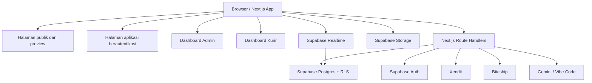

<p align="center">
  
</p>

<h1 align="center">ReBites</h1>

<p align="center">
  Marketplace makanan surplus dari UMKM kuliner.
</p>

<p align="center">
  <strong>Dari dapur UMKM, ke piring yang butuh.</strong>
</p>

<p align="center">
  <a href="#tentang-rebites">Tentang</a> ·
  <a href="#fitur-utama">Fitur</a> ·
  <a href="#alur-pesanan">Alur Pesanan</a> ·
  <a href="#arsitektur-sistem">Arsitektur</a> ·
  <a href="#menjalankan-proyek">Instalasi</a> ·
  <a href="#pengujian">Pengujian</a>
</p>

<p align="center">
  
  
  
  
  
  
  
</p>

---

## Daftar Isi

- [Tentang ReBites](#tentang-rebites)
- [Latar Belakang dan Tujuan](#latar-belakang-dan-tujuan)
- [Fitur Utama](#fitur-utama)
- [Peran Pengguna dan Hak Akses](#peran-pengguna-dan-hak-akses)
- [Alur Pesanan](#alur-pesanan)
- [Arsitektur Sistem](#arsitektur-sistem)
- [Database dan Model Data](#database-dan-model-data)
- [Teknologi](#teknologi)
- [Struktur Direktori](#struktur-direktori)
- [Menjalankan Proyek](#menjalankan-proyek)
- [Variabel Lingkungan](#variabel-lingkungan)
- [Keamanan dan Integritas Data](#keamanan-dan-integritas-data)
- [Integrasi Eksternal](#integrasi-eksternal)
- [Langganan UMKM](#langganan-umkm)
- [Pengujian](#pengujian)
- [Status Proyek dan Known Issues](#status-proyek-dan-known-issues)
- [Tim](#tim)
- [Lisensi dan Tautan](#lisensi-dan-tautan)

---

## Tentang ReBites

**ReBites** adalah marketplace dua sisi yang mempertemukan pelaku UMKM kuliner dengan pembeli untuk menyelamatkan makanan surplus. Makanan surplus adalah makanan yang masih layak dikonsumsi, tetapi belum terjual hingga mendekati atau berakhirnya jam operasional toko.

Penjual dapat mengunggah sisa menu hari itu beserta harga, stok, dan jadwal penjualan. Pembeli dapat memesan makanan untuk diantar ke alamat atau diambil langsung di toko.

ReBites dikembangkan untuk **Garda Tech National Innovation Competition (GTNIC) 2026**, kategori Web Development.

**Area layanan yang didokumentasikan saat ini: Kota Depok.** Struktur data dirancang agar dapat dikembangkan ke wilayah lain.

## Latar Belakang dan Tujuan

UMKM kuliner menyiapkan makanan berdasarkan perkiraan permintaan. Ketika jumlah pembeli lebih sedikit dari perkiraan, makanan yang masih layak konsumsi dapat tersisa pada akhir hari. Kondisi ini menyebabkan kerugian bagi pemilik usaha sekaligus meningkatkan jumlah makanan terbuang.

Di sisi lain, pembeli membutuhkan pilihan makanan yang lebih terjangkau tanpa kehilangan informasi mengenai harga, stok, lokasi, jam penjualan, dan kualitas produk.

ReBites menyediakan kanal penjualan makanan surplus dengan dua batas utama:

1. Produk hanya ditampilkan selama jadwal penjualan yang ditentukan penjual.
2. Produk dari toko yang tidak aktif atau belum terverifikasi tidak ditampilkan sebagai pilihan pembelian.

Tujuan ReBites adalah membantu UMKM memperoleh pemasukan dari stok yang berpotensi tidak terjual, menyediakan pilihan makanan yang lebih terjangkau, dan mengurangi food waste.

## Fitur Utama

### Pembeli

| Modul | Deskripsi |
|---|---|
| Katalog dan pencarian | Katalog makanan surplus, pencarian toko/produk, kategori, filter lokasi, jarak, status buka, dan rating. |
| Kategori | Makanan Berat, Jajanan, Japanese, Roti & Kue, Makanan Cepat Saji, Dessert, Buah & Sayur, serta Minuman. |
| Detail produk | Foto, harga normal dan harga surplus, stok, jadwal jual, status toko, ulasan, serta pilihan ambil/antar. |
| Detail toko | Informasi UMKM, menu, rating, ulasan layanan, dan jam operasional. |
| Checkout | Pemilihan kuantitas, metode fulfillment, alamat, kode promo, dan penggunaan ReBites Coin. |
| Pembayaran | Invoice Xendit dan konfirmasi pembayaran melalui webhook. |
| Pesanan | Status pesanan, riwayat transaksi, dan notifikasi. |
| Pelacakan | Posisi kurir pada peta ketika pesanan dikirim. |
| Ulasan dan favorit | Ulasan setelah pesanan selesai, favorit produk, dan follow toko. |
| Profil | Pengelolaan profil, avatar, alamat, dan preferensi akun. |

### Penjual (UMKM)

| Modul | Deskripsi |
|---|---|
| Registrasi dan onboarding | Pendaftaran akun penjual, profil toko, alamat, dan logo. |
| Manajemen produk | Tambah, ubah, dan hapus produk; harga normal/surplus; stok; berat; dan metode fulfillment. |
| Jadwal penjualan | Pengaturan waktu mulai dan berakhirnya penayangan produk. |
| Flash sale | Penjadwalan harga promosi sesuai ketentuan paket langganan. |
| Dashboard penjualan | Ringkasan penjualan, pesanan, produk terlaris, dan metrik performa. |
| Kelola pesanan | Melihat pesanan masuk dan memperbarui status sesuai alur yang diizinkan. |
| Ulasan toko | Melihat rating dan komentar pelanggan. |
| Langganan | Pengelolaan paket, perpanjangan, dan riwayat pembayaran. |
| Analitik | Laporan performa dan ekspor data sesuai hak paket. |
| Aktivasi toko | Pengajuan aktivasi kembali toko yang dinonaktifkan melalui proses peninjauan admin. |

### Admin dan Super Admin

Panel admin mencakup:

- Moderasi produk dan toko serta verifikasi produk.
- Manajemen pengguna dan permintaan perubahan peran.
- Peringatan, sanksi, penangguhan, dan pemblokiran akun.
- Pusat laporan pengguna, kotak pesan dukungan, dan banding akun.
- Monitoring aktivitas dan audit log.
- Analitik marketplace dan pengiriman.
- Pengelolaan koin, langganan, artikel, dan ekspor data Excel.
- Health check layanan yang terintegrasi.

Super Admin memiliki kewenangan tambahan yang dibatasi, termasuk keputusan perubahan peran dan penghapusan permanen akun sesuai pemeriksaan keamanan.

### Kurir

Fitur kurir merupakan bagian opsional dari sistem:

- Melihat tugas pengiriman yang ditugaskan.
- Memperbarui status tugas.
- Mengirim lokasi secara berkala selama pengantaran.
- Melakukan komunikasi dengan pembeli.
- Menampilkan posisi kurir kepada pembeli melalui peta.

### ReBitess-Asisten

ReBitess-Asisten merupakan chatbot yang tersedia di dalam aplikasi. Pengetahuan chatbot dibatasi pada informasi ReBites dan halaman yang boleh diakses oleh pengguna sesuai perannya.

- Admin dapat memperoleh akses ke tool tindakan tertentu sesuai guard server.
- Pembeli dan UMKM menggunakan asisten untuk bantuan informasi dengan akses read-only.
- Chatbot tidak boleh membuka data pribadi pengguna lain.
- Provider dapat menggunakan layanan Gemini atau Vibe Code sesuai konfigurasi environment.

## Peran Pengguna dan Hak Akses

Peran pengguna disimpan pada `profiles.role`. Data kurir disimpan pada tabel profil kurir yang digunakan oleh implementasi database.

| Peran | Halaman utama | Hak akses utama |
|---|---|---|
| `buyer` | `/home` | Katalog, checkout, riwayat, profil, ulasan, favorit, dan follow toko. |
| `umkm` | `/dashboard/penjual/<id-toko>` | Dashboard toko, produk, pesanan, langganan, dan analitik. |
| `courier` | `/dashboard/kurir` | Tugas pengiriman, status, pesan, dan lokasi realtime. |
| `admin` | `/dashboard/admin` | Moderasi, pengguna, monitoring, ekspor, dan konfigurasi layanan. |
| `super_admin` | `/dashboard/admin` | Hak admin serta tindakan khusus yang memerlukan kewenangan tertinggi. |

Aturan akses diterapkan berlapis:

- Pembeli hanya dapat mengakses data miliknya.
- UMKM hanya dapat mengelola toko dan produk yang dimilikinya.
- Kurir hanya dapat mengakses tugas yang ditugaskan kepadanya.
- Admin memperoleh akses sesuai cakupan peran admin.
- Perubahan role tidak boleh dilakukan oleh pengguna biasa melalui pemanggilan API/database langsung.

## Alur Pesanan

### Alur pembelian

1. Pembeli menjelajah katalog dan memilih produk.
2. Pembeli memilih kuantitas dan metode pemenuhan: `pickup` atau `delivery`.
3. Sistem memvalidasi stok, jadwal produk, status toko, dan dukungan metode pemenuhan.
4. Sistem menghitung harga, diskon, koin, biaya layanan, serta ongkir jika berlaku.
5. Sistem membuat pesanan dan menginisiasi invoice pembayaran.
6. Pembeli menyelesaikan pembayaran melalui halaman pembayaran Xendit.
7. Webhook memverifikasi callback dan memperbarui status pembayaran.
8. UMKM memproses pesanan.
9. Pesanan disiapkan untuk diambil atau diserahkan kepada kurir.
10. Pesanan diselesaikan dan pembeli dapat memberikan ulasan.

### Satu sumber kebenaran status pesanan

Status operasional menggunakan kolom `order_status`. Transisi status dijaga oleh trigger database, bukan hanya oleh antarmuka.

Urutan status yang sah:

```text
pending
  ├── paid
  │    └── processing
  │          ├── out_for_delivery
  │          │       └── completed
  │          └── ready_for_pickup
  │                  └── completed
  └── cancelled
```

Pesanan yang masih `pending` dapat dibatalkan. Pesanan yang sudah berada pada tahap pengantaran atau menunggu pengambilan dapat diselesaikan otomatis oleh proses server setelah estimasi tiba terlewati, sesuai aturan implementasi.

Setiap perubahan status dicatat pada `order_status_history` dan dapat memicu notifikasi kepada pihak terkait.

### Checkout dan idempotensi

Alur checkout teknis yang didokumentasikan:

1. Frontend mengirim permintaan ke `POST /api/checkout/xendit`.
2. Permintaan membawa token sesi Supabase melalui `Authorization: Bearer <access-token>`.
3. Frontend mengirim `Idempotency-Key` berupa UUID untuk mencegah pesanan ganda.
4. Server memvalidasi pengguna, payload, produk, stok, jadwal, status toko, dan metode fulfillment.
5. Server menghitung harga, promo, ReBites Coin, ongkir, serta biaya layanan.
6. RPC `reserve_stock_for_order` melakukan reservasi stok secara atomik.
7. Server membuat invoice Xendit dan mengembalikan informasi invoice.
8. Pembeli diarahkan ke halaman pembayaran Xendit.
9. Webhook Xendit diverifikasi menggunakan callback token dan pemeriksaan invoice/amount.
10. Server memperbarui status pembayaran dan menjalankan proses lanjutan yang diperlukan.

Transisi invoice yang didokumentasikan:

```text
not_started → inflight → paid
                      └→ failed
```

## Arsitektur Sistem

ReBites berjalan sebagai satu aplikasi **Next.js 14 App Router**. Halaman menggunakan komponen React, sedangkan operasi yang membutuhkan hak istimewa diproses melalui Route Handlers di `app/api`.

### Lapisan sistem

| Lapisan | Teknologi | Tanggung jawab |
|---|---|---|
| Presentasi | Next.js 14, React 18, TypeScript | Halaman, komponen, Server Components, dan Client Components untuk interaksi. |
| API dan logika bisnis | Next.js Route Handlers | Autentikasi Bearer, validasi input, aturan bisnis, mutasi data, dan integrasi provider. |
| Data dan otorisasi | Supabase Postgres dan RLS | Penyimpanan data, autentikasi, otorisasi tingkat baris, trigger, dan fungsi database. |
| Realtime | Supabase Realtime | Notifikasi, perubahan pesanan, dan posisi kurir. |
| Storage | Supabase Storage | Logo toko, foto produk, dan avatar. |
| Layanan eksternal | Xendit, Biteship, Gemini/Vibe Code | Pembayaran, logistik, dan asisten AI. |

### Diagram komponen



### Route dan kelompok halaman

Route groups `(landing)`, `(app)`, dan `(preview)` digunakan untuk mengelompokkan layout tanpa mengubah URL.

- `(landing)`: halaman publik seperti landing page, blog, informasi, dan preview produk.
- `(app)`: halaman aplikasi yang memerlukan sesi pengguna.
- `(preview)`: tampilan preview produk publik.
- `app/dashboard/admin`: dashboard admin dengan RBAC.
- `app/dashboard/kurir`: dashboard kurir.
- `app/api`: endpoint backend untuk checkout, pesanan, profil, admin, langganan, shipping, courier, webhook, dan chatbot.

### Prinsip implementasi

- Server Components menjadi pilihan default.
- Client Components digunakan saat membutuhkan interaksi browser.
- Operasi sensitif dilakukan di server.
- Modul `lib/server/*` tidak boleh diimpor oleh komponen client karena dapat menggunakan kredensial server.
- `SUPABASE_SERVICE_ROLE_KEY` tidak boleh menggunakan prefix `NEXT_PUBLIC_`.
- `RequireAuth` harus ditempatkan sebelum shell aplikasi agar redirect autentikasi terjadi sebelum navbar atau skeleton aplikasi ditampilkan.
- `DetailProductContent` menggunakan prop `shell` dari route untuk menghindari masuknya kode autentikasi ke bundle halaman publik.

## Database dan Model Data

Database utama menggunakan **Supabase PostgreSQL**. Perubahan skema dikelola melalui migrasi di `supabase/migrations`.

Kelompok entitas yang dijelaskan dalam dokumentasi:

| Kelompok | Tabel yang disebutkan |
|---|---|
| Akun dan peran | `profiles`, `user_preferences`, `role_change_requests`, `role_change_logs` |
| Usaha | `umkm_profiles`, `store_follows`, `store_activation_requests`, `store_visitors` |
| Katalog | `products`, `product_favorites`, `reviews`, `moderation_logs` |
| Transaksi | `orders`, `order_status_history`, `seller_transactions`, `promo_codes`, `coin_transactions` |
| Langganan | `plans`, `subscriptions` |
| Logistik | `couriers`, `delivery_assignments`, `delivery_locations`, `courier_messages` |
| Dukungan | `support_threads`, `support_messages`, `support_appeals` |
| Pemantauan | `activity_logs`, `admin_audit_logs`, `reports`, `report_notes`, `warnings`, `sanctions` |
| Konten | `articles` |
| Asisten | `chat_sessions`, `chat_messages` |
| Analitik | `site_visitors`, `site_visitor_days` |

### Entitas dan kolom penting

| Tabel | Tujuan dan kolom penting |
|---|---|
| `profiles` | Identitas pengguna, email, nama, role, status akun, avatar, dan data verifikasi. |
| `umkm_profiles` | Identitas toko, pemilik, slug, alamat, kota, koordinat, rating, status verifikasi, dan jam operasional. |
| `products` | Menu surplus, kategori, harga normal/surplus, stok, status, verifikasi, jadwal tayang, berat, dan opsi delivery/pickup. |
| `orders` | Pembeli, UMKM, produk, kuantitas, rincian harga, status pembayaran, status operasional, idempotency key, dan invoice state. |
| `subscriptions` | Langganan UMKM, paket, status, periode, dan jenis billing. |
| `plans` | Nama paket, slug, harga bulanan/tahunan, batas produk, dan fitur. |
| `reviews` | Ulasan pesanan/produk oleh pengguna. |
| `coin_transactions` | Ledger koin yang diperoleh, digunakan, atau dikembalikan. |
| `couriers` / `courier_profiles` | Data kurir dan identitas pengguna kurir. Nama tabel mengikuti migrasi yang benar-benar ada pada repository. |
| `delivery_locations` | Koordinat dan waktu pembaruan lokasi pengiriman. |
| `support_threads`, `support_messages`, `support_appeals` | Percakapan dukungan dan banding akun. |

> **Catatan konsistensi skema:** dua naskah dokumentasi yang digabung menyebut nama tabel kurir yang berbeda (`couriers` dan `courier_profiles`). Daftar migrasi aktual di `supabase/migrations` adalah acuan final untuk nama tabel dan kolom. Jangan membuat tabel pengganti hanya berdasarkan perbedaan penamaan pada dokumentasi.

### Constraint dan integritas bisnis

- Produk harus memenuhi status verifikasi sebelum ditampilkan kepada pembeli.
- Transisi `order_status` dibatasi oleh state machine dan trigger database.
- `Idempotency-Key` digunakan untuk mencegah pesanan checkout ganda.
- Reservasi stok menggunakan RPC `reserve_stock_for_order` secara atomik.
- Stok dapat dilepas kembali ketika pembayaran gagal atau pesanan kedaluwarsa melalui mekanisme stock-release guard.
- RLS membatasi data berdasarkan pemilik, pembeli, kurir, dan peran admin.

## Teknologi

| Kategori | Teknologi | Peran |
|---|---|---|
| Framework | Next.js 14.2.35 | App Router, Turbopack, Server Components, Route Handlers. |
| UI | React 18.2.0 | Komponen antarmuka. |
| Bahasa | TypeScript 5.2.2 | Strict type checking. |
| Styling | Tailwind CSS 3 | Utility CSS dan design tokens. |
| UI primitives | Radix UI / shadcn-style | Button, Dialog, Dropdown, Select, Toast, Avatar, dan komponen UI. |
| Animasi | Framer Motion | Transisi dan animasi antarmuka. |
| Smooth scroll | Lenis | Smooth scrolling pada landing page. |
| Ikon | Lucide React | Ikon aplikasi. |
| Form dan validasi | React Hook Form, Zod | Validasi form autentikasi, profil, dan checkout. |
| Backend dan database | Supabase V1 | PostgreSQL, Auth, Realtime, Storage, dan Edge Functions. |
| Pembayaran | Xendit | Invoice, webhook, dan pembayaran langganan. |
| Logistik | Biteship | Tarif, pembuatan kiriman, dan webhook. |
| Grafik | Recharts | Analitik dashboard penjual. |
| Peta | MapLibre GL | Pelacakan posisi kurir. |
| Carousel | Embla Carousel | Komponen carousel. |
| Font | Plus Jakarta Sans, Be Vietnam Pro | Tipografi aplikasi. |
| Gambar | next/image | Optimasi gambar. |
| Testing | `node --test` | Pengujian offline. |
| AI | Gemini / Vibe Code | Asisten kontekstual. |

**Penting:** proyek menggunakan Supabase V1. Jangan membuat konfigurasi Supabase V2 untuk repository ini.

## Struktur Direktori

Berikut struktur tingkat atas dan kelompok modul utama sebagaimana dijelaskan dokumentasi proyek. Ini merupakan peta direktori, bukan daftar setiap file satu per satu.

```text
rebites/
├── app/
│   ├── (landing)/
│   │   ├── page.tsx
│   │   ├── layout.tsx
│   │   ├── preview/product/
│   │   └── blog/ dampak/ fitur/ tentang-kami/ hubungi-kami/
│   │
│   ├── (app)/
│   │   ├── home/
│   │   ├── detail/
│   │   ├── makanan/[category]/
│   │   ├── riwayatPesanan/
│   │   ├── notifikasi/pembeli/
│   │   ├── profile/
│   │   ├── toko/
│   │   ├── alamat/
│   │   ├── pengaturan/
│   │   ├── langganan/
│   │   └── dashboard/penjual/
│   │
│   ├── (preview)/preview/
│   ├── api/
│   │   ├── admin/
│   │   ├── checkout/xendit/
│   │   ├── courier/
│   │   ├── delivery/
│   │   ├── orders/
│   │   ├── profile/
│   │   ├── reports/
│   │   ├── seller/
│   │   ├── shipping/
│   │   ├── store-visitors/
│   │   ├── subscriptions/
│   │   ├── support/
│   │   ├── visitors/
│   │   ├── webhooks/
│   │   └── chat/
│   │
│   ├── auth/
│   ├── dashboard/
│   │   ├── admin/
│   │   ├── penjual/
│   │   └── kurir/
│   ├── components/
│   │   ├── admin/
│   │   ├── buyer/
│   │   ├── seller/
│   │   ├── auth/
│   │   ├── chatbot/
│   │   ├── dashboard-penjual/
│   │   ├── detail-product/
│   │   ├── landing/
│   │   ├── legal/
│   │   ├── profile/
│   │   ├── shared/
│   │   ├── support/
│   │   └── ui/
│   ├── layout.tsx
│   ├── globals.css
│   └── error.tsx / global-error.tsx / not-found.tsx
│
├── hooks/
│   ├── buyer/
│   ├── seller/
│   └── use-*.ts
│
├── lib/
│   ├── server/
│   ├── chatbot/
│   ├── catalog.ts
│   ├── catalog-filters.ts
│   ├── categories.ts
│   ├── current-user.ts
│   ├── order-state-machine.ts
│   ├── pricing.ts
│   ├── subscription-plans.ts
│   ├── image-path.ts
│   ├── shipping-tariff.ts
│   ├── store-hours.ts
│   └── ... utility modules
│
├── supabase/
│   └── migrations/          # 80+ migrasi database
│
├── tests/                   # Suite pengujian node:test
├── scripts/
├── public/
│   ├── logo.avif
│   ├── hero-makanan.avif
│   ├── foods/
│   └── lanyard/
│
├── docs/
│   └── PROJECT_CONTEXT.md
│
├── package.json
├── tailwind.config.ts
├── tsconfig.json
├── next.config.js
├── .env.example
└── README.md
```

### Konvensi direktori dan route

- Route groups `(landing)`, `(app)`, dan `(preview)` tidak mengubah URL.
- Halaman `makanan/[category]` menggunakan `generateStaticParams` untuk delapan path kategori.
- `RequireAuth` ditempatkan di luar shell halaman yang memerlukan autentikasi.
- `lib/server/*` hanya boleh digunakan dari sisi server.
- `DetailProductContent` menerima `shell` dari route untuk menjaga pemisahan tampilan publik dan autentikasi.

## Menjalankan Proyek

### Prasyarat

- Node.js minimal 18; direkomendasikan Node.js 20 atau lebih baru.
- npm minimal 9.
- Project Supabase dengan PostgreSQL, Auth, Realtime, dan Storage.
- Akun Xendit untuk menguji pembayaran.
- Akun Biteship untuk menguji layanan pengiriman.
- API key Gemini atau Vibe Code jika chatbot AI akan digunakan.

### Instalasi lokal

```bash
# 1. Clone repository
git clone https://github.com/kayy-eci/Rebitesss-GTNIC2026.git rebites

# 2. Masuk ke direktori proyek
cd rebites

# 3. Install dependency
npm install

# 4. Salin environment variables
cp .env.example .env.local

# 5. Isi nilai variabel di .env.local
# Gunakan kredensial milik project masing-masing.

# 6. Periksa status migrasi Supabase
npx supabase migration list

# 7. Jalankan development server
npm run dev
```

Buka `http://localhost:3000`.

### Menjalankan server development

Dokumentasi proyek menetapkan port development pada `3000`. Jalankan **satu server development saja** untuk satu folder kerja. Dua server yang menggunakan folder build yang sama dapat menyebabkan chunk hilang atau halaman mengembalikan error 500.

Jika port 3000 masih digunakan, periksa proses yang menggunakannya sebelum menjalankan ulang server. Dokumentasi proyek juga mencantumkan `npm run dev:reset` untuk membersihkan proses milik proyek, misalnya setelah server gagal start dengan `EADDRINUSE`, kemudian jalankan `npm run dev`.

Alternatif development tanpa Turbopack:

```bash
npm run dev:webpack
```

### Build dan verifikasi

```bash
# Type-check kode aplikasi
npm run typecheck

# Type-check file test
npm run typecheck:tests

# Lint
npm run lint

# Production build
npm run build

# Jalankan production server
npm start
```

Jalankan lint secara terpisah sebelum commit. Konfigurasi proyek mendokumentasikan bahwa ESLint dilewati pada proses build.

## Variabel Lingkungan

Salin `.env.example` menjadi `.env.local`. Nama variabel berikut dihimpun dari dokumentasi proyek; periksa `.env.example` dan konfigurasi aktual repository untuk memastikan nilai default serta kewajiban tiap variabel.

| Variabel | Fungsi |
|---|---|
| `NEXT_PUBLIC_SUPABASE_URL` | URL project Supabase. |
| `NEXT_PUBLIC_SUPABASE_ANON_KEY` | Anon/public key Supabase untuk client. |
| `SUPABASE_SERVICE_ROLE_KEY` | Service role key khusus server. |
| `NEXT_PUBLIC_SITE_URL` | URL situs untuk redirect dan callback. |
| `SUPER_ADMIN_USER_ID` | UUID pengguna Super Admin untuk bootstrap. Jika kosong atau bukan UUID, penunjukan diabaikan (fail-closed). |
| `PASSWORD_DELETE_USER` | Password konfirmasi penghapusan permanen akun. Kosong berarti fitur dinonaktifkan. |
| `XENDIT_SECRET_KEY` | Secret key Xendit. |
| `XENDIT_CALLBACK_TOKEN` / `XENDIT_WEBHOOK_TOKEN` | Token verifikasi callback Xendit; gunakan nama yang dibaca oleh kode aktif. |
| `BITESHIP_API_KEY` | API key Biteship. |
| `BITESHIP_COURIERS` | Daftar layanan kurir yang digunakan. |
| `BITESHIP_WEBHOOK_SECRET` | Secret verifikasi webhook Biteship. |
| `DELIVERY_BASE_FEE_IDR` | Biaya dasar tarif kurir lokal. Dokumentasi menyebut default Rp5.000. |
| `DELIVERY_PER_KM_FEE_IDR` | Biaya per kilometer. Dokumentasi menyebut default Rp2.500. |
| `DELIVERY_MIN_FEE_IDR` | Batas minimum ongkir. Dokumentasi menyebut default Rp5.000. |
| `DELIVERY_MAX_FEE_IDR` | Batas maksimum ongkir. Dokumentasi menyebut default Rp50.000. |
| `VIBE_CODE_URL` | Endpoint provider AI Vibe Code. |
| `VIBE_CODE_KEY` | API key provider AI Vibe Code. |
| `VIBE_CODE_MODEL` | Model AI Vibe Code. |
| `GEMINI_API_KEY` | API key Gemini. |
| `GEMINI_MODEL` | Model Gemini. |
| `CHATBOT_ACTION_SECRET` | Secret untuk aksi chatbot. |

**Keamanan environment:**

- Jangan commit `.env` atau `.env.local`.
- Jangan menambahkan prefix `NEXT_PUBLIC_` pada service role key atau secret provider.
- `SUPABASE_SERVICE_ROLE_KEY` hanya digunakan di server dan script tepercaya.
- `XENDIT_CALLBACK_TOKEN` dan `BITESHIP_WEBHOOK_SECRET` harus cocok dengan konfigurasi callback di dashboard provider.
- Jangan menempelkan kredensial asli ke issue publik atau dokumentasi yang dapat diakses umum.

## Keamanan dan Integritas Data

### Autentikasi dan otorisasi

- Supabase Auth mendukung email/password dan Google OAuth sesuai konfigurasi project.
- Endpoint admin menggunakan header `Authorization: Bearer <access_token>`.
- Pemeriksaan role dilakukan di server melalui guard akses admin.
- RLS menjadi lapisan otorisasi di PostgreSQL.
- Akun yang diblokir harus ditolak pada jalur autentikasi dan akses aplikasi.
- Perubahan role hanya dapat dilakukan melalui jalur tepercaya yang telah diotorisasi.

**Catatan khusus autentikasi admin:** dokumentasi implementasi menyatakan endpoint `app/api/admin/*` tidak bergantung pada `middleware.ts` atau cookie sesi untuk otorisasi. Endpoint tersebut memerlukan Bearer token; permintaan tanpa header harus menerima respons `401`.

### Pengamanan akun dan peran

- Status akun dibaca dari `profiles.account_status`.
- Sanksi akun disinkronkan dengan status ban Supabase Auth dan dapat menonaktifkan toko terkait.
- Akun yang diblokir dapat melihat informasi blokir dan memantau banding melalui halaman publik `/banding`.
- Penghapusan permanen hanya untuk Super Admin, memerlukan password konfirmasi `PASSWORD_DELETE_USER` dan alasan.
- Penghapusan permanen ditolak jika akun masih memiliki pesanan berjalan atau artikel yang terkait.
- Jika `PASSWORD_DELETE_USER` kosong, fitur penghapusan permanen dinonaktifkan.
- Admin tim tidak otomatis memiliki seluruh kewenangan Super Admin.
- Permintaan perubahan role harus diputuskan oleh pihak yang berwenang dan tidak boleh diputuskan sendiri oleh pengaju.

### Validasi dan integritas transaksi

| Area | Mekanisme |
|---|---|
| Validasi input | Zod dan React Hook Form pada form yang relevan. |
| Stok | Validasi dan reservasi atomik melalui RPC `reserve_stock_for_order`. |
| Jadwal produk | Validasi jadwal tayang sebelum produk ditampilkan atau dipesan. |
| Idempotensi | `Idempotency-Key` dan transisi `invoice_state`. |
| Webhook | Verifikasi token dengan `timingSafeEqual` dan pemeriksaan invoice/amount di server. |
| Status pesanan | State machine dan trigger database. |
| Lokasi kurir | `delivery_locations` dengan RLS dan Supabase Realtime Postgres Changes. |

### Audit dan observabilitas

- `GET /api/admin/health` digunakan untuk health check layanan yang didukung.
- `admin_audit_logs` mencatat aksi administratif.
- Supabase Realtime digunakan untuk pembaruan pesanan dan sanksi.
- UI menyediakan error state dan skeleton untuk kondisi data tidak tersedia.
- Ekspor Excel dibatasi maksimal 5.000 baris; permintaan yang melewati batas harus ditolak dengan pesan yang menjelaskan batas tersebut.

## Integrasi Eksternal

### Xendit

Xendit digunakan untuk:

- Membuat invoice pembayaran checkout.
- Membuat invoice langganan UMKM.
- Mengirim callback/webhook pembayaran.
- Memverifikasi callback token dan data invoice sebelum status transaksi diperbarui.

Endpoint webhook yang didokumentasikan:

```text
POST /api/webhooks/xendit
```

### Biteship

Biteship digunakan untuk:

- Menghitung tarif pengiriman.
- Membuat kiriman.
- Menerima webhook status kiriman dan nomor resi.

Endpoint webhook yang didokumentasikan:

```text
POST /api/webhooks/biteship
```

### Kurir lokal ReBites

Selain Biteship, dokumentasi menyebut opsi tarif lokal Kurir ReBites. Tarif dihitung berdasarkan jarak dan menggunakan variabel lingkungan untuk biaya dasar, biaya per kilometer, batas minimum, dan maksimum.

### Pelacakan kurir

Posisi kurir disimpan pada `delivery_locations`, dilindungi RLS, dan disiarkan melalui Supabase Realtime Postgres Changes. Dokumentasi menyatakan bahwa kanal Broadcast publik tidak digunakan untuk data posisi pesanan karena dapat mengekspos lokasi kepada pihak yang mengetahui kode pesanan.

### Asisten AI

Provider AI dapat menggunakan Gemini atau Vibe Code. Akses tool ditentukan server berdasarkan sesi dan role. Informasi pribadi pengguna lain tidak boleh disediakan kepada chatbot.

## Langganan UMKM

Dokumentasi fitur menyebut tiga tier paket: **Basic, Standar, dan Max**. Paket memengaruhi batas jumlah produk, akses riwayat penjualan, prioritas marketplace, laporan, dan dukungan.

| Paket | Harga bulanan | Harga tahunan | Batas produk |
|---|---:|---:|---:|
| Basic | Rp24.999 | Rp249.990 | 3 produk |
| Standar | Rp49.000 | Rp490.000 | 5 produk |
| Max | Rp99.000 | Rp990.000 | 15 produk |

Aktivasi langganan dilakukan setelah pembayaran terverifikasi. Halaman sukses menyediakan jalur kembali manual apabila proses verifikasi belum selesai.

> Jika nilai paket pada database atau migrasi berbeda dari tabel ini, gunakan data paket pada implementasi aktif sebagai acuan operasional.

## Pengujian

Proyek menggunakan test runner bawaan Node.js melalui `node --test`. Pengujian berfokus pada logika dan kontrak kode tanpa memerlukan browser, database, atau jaringan.

Area pengujian yang disebutkan:

- Checkout: idempotensi, perhitungan harga, dan kegagalan pembayaran.
- Admin: RBAC, health check, analitik, dan ekspor.
- Stock reservation dan stock release.
- Tarif pengiriman.
- Order state machine.
- Dashboard penjual.
- Lokasi kurir.
- Chatbot.
- Image path resolver.
- Regresi antarmuka dan kontrak komponen.

Perintah pemeriksaan:

```bash
npm run typecheck
npm run typecheck:tests
npm run lint
node --test tests/*.test.ts
```

Dokumentasi yang digabung mencatat angka pengujian berbeda pada dua snapshot: satu bagian menyebut **96 test suites / sekitar 401 kasus**, sedangkan catatan proyek yang lebih baru menyebut **sekitar 1.312 tes**. Karena angka tersebut berasal dari snapshot dokumentasi yang berbeda, jumlah aktual harus diperiksa dari direktori `tests/` dan skrip repository saat ini.

Tidak ada pengujian E2E browser (Playwright/Cypress) atau pipeline CI/CD yang dinyatakan telah terkonfigurasi pada dokumentasi.

**Kegagalan tes tidak boleh diabaikan.** Perbaiki penyebabnya dan jalankan kembali pemeriksaan yang relevan.

## Status Proyek dan Known Issues

### Fitur inti yang didokumentasikan

- Marketplace: katalog, detail produk, checkout, riwayat, dan ulasan.
- Autentikasi email/password dan Google OAuth.
- Manajemen toko dan produk UMKM.
- Flash sale dan jadwal produk.
- Langganan Basic, Standar, dan Max.
- Integrasi Xendit untuk invoice dan webhook.
- Integrasi Biteship untuk tarif dan kiriman.
- Dashboard admin untuk moderasi, pengguna, monitoring, dan ekspor.
- Dashboard kurir opsional dengan tugas, status, lokasi realtime, dan chat.
- Chatbot AI dengan akses berdasarkan role.
- Notifikasi realtime dan banding akun.

### Known issues dan mitigasi

| Issue | Keterangan | Mitigasi yang didokumentasikan |
|---|---|---|
| ESLint dilewati saat build | `eslint.ignoreDuringBuilds: true` pada konfigurasi Next.js. | Jalankan `npm run lint` secara terpisah sebelum commit. |
| Ketidaksesuaian ekstensi gambar | Database dapat menyimpan path `.jpeg`/`.webp`, sedangkan aset fisik menggunakan `.avif`. | Gunakan `lib/image-path.ts` dan `resolveImageSrc`. |
| Artifact transparansi gambar | `public/makanan2.avif` dan `public/makanan5.avif` memiliki pola checkerboard yang sudah menyatu pada gambar. | Hindari penggunaan untuk UI baru. |
| Sensitivitas EOL Windows | Tes regresi admin UI dapat gagal karena perbedaan CRLF/LF. | Pulihkan line ending LF atau gunakan `.gitattributes`. |
| Tipe Next.js usang setelah pemindahan route | Type-check dapat membaca `.next/types` yang belum diperbarui. | Jalankan build ulang setelah pemindahan route. |
| Belum ada CI/CD | GitHub Actions atau pipeline belum dinyatakan terkonfigurasi. | Jalankan typecheck, lint, build, dan pemeriksaan visual secara manual. |
| Load testing dan rate limit API | Belum ada load testing atau rate limit menyeluruh di level API. | Masuk backlog penguatan. |
| Backup otomatis | Backup mengikuti fasilitas backup managed Supabase. | Pastikan kebijakan backup project Supabase sesuai kebutuhan. |
| Ketergantungan provider | Pembayaran dan pengiriman bergantung pada layanan eksternal. | Tampilkan kegagalan secara jelas dan jangan membuat status transaksi palsu. |

### Batasan operasional

- Area layanan yang didokumentasikan masih Kota Depok.
- Ongkir dapat berupa estimasi apabila berat produk atau koordinat toko belum lengkap.
- Verifikasi email, Google OAuth, dan pembayaran membutuhkan kredensial provider milik pemilik project.
- Fitur kurir bergantung pada migrasi dan konfigurasi yang sesuai.
- Tidak ada klaim bahwa load testing atau CI/CD telah selesai.

### Backlog pengembangan

- Load testing dan rate limiting API.
- Perluasan layanan ke luar Kota Depok.
- Integrasi kurir lokal mandiri.
- Ekspor data UMKM ke format Excel khusus.
- Refactor `lib/server/*`, terutama proses checkout idempoten.

## Tim

Dikembangkan oleh **Team Tony Stark Inc.** untuk GTNIC 2026.

| Nama | Peran |
|---|---|
| Faletehan Al Farabi | Backend Developer |
| Aburahman Kayysan | Fullstack Developer |
| Jona Alfaros | Frontend Developer |

## Lisensi dan Tautan

Proyek ini ditujukan untuk keperluan demonstrasi dan kompetisi GTNIC 2026. Dokumentasi sumber menyatakan bahwa `package.json` menggunakan `private: true` dan tidak mendeklarasikan lisensi komersial maupun lisensi open-source.

- **Repository:** https://github.com/kayy-eci/Rebitesss-GTNIC2026
- **Dokumentasi konteks:** `docs/PROJECT_CONTEXT.md`
- **Indeks dokumentasi:** `docs/README.md`
- **Naskah demo video:** `docs/naskah-demo-video.md`
- **Development:** http://localhost:3000

---

<p align="center">
  <strong>ReBites</strong> — Dari dapur UMKM, ke piring yang butuh.
  <br />
  Membantu mengurangi food waste dan membuka peluang baru bagi UMKM kuliner.
</p>

<p align="center">
  <sub>README gabungan berdasarkan dokumentasi proyek yang diberikan. Periksa migrasi, konfigurasi, dan source code aktif sebelum menggunakan detail teknis sebagai acuan implementasi.</sub>
</p>
