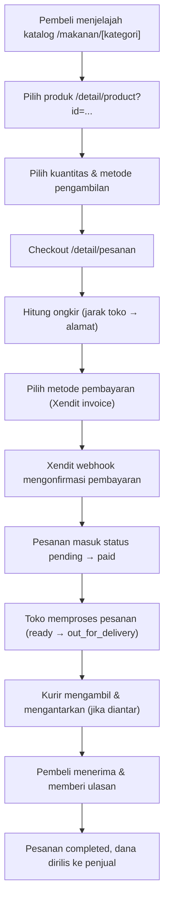
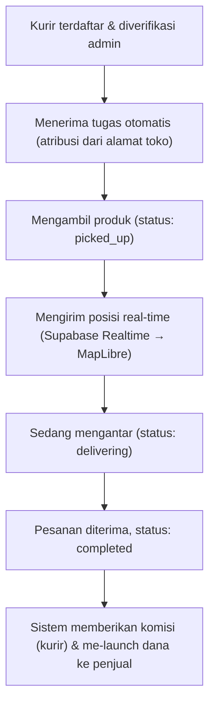
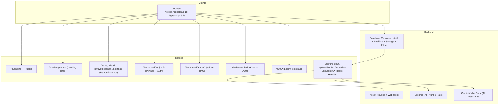

# ReBites


**ReBites** adalah marketplace makanan surplus untuk UMKM kuliner — tempat penjual menjual sisa masakan yang masih layak konsumsi dengan harga miring, dan pembeli memesan melalui aplikasi web. Solusi ini menjembatani dua masalah sekaligus: mengurangi food waste dari dapur UMKM sekaligus menyediakan makanan terjangkau bagi pembeli. Saat ini area layanan berfokus pada **Kota Depok** (statis dikodekan di halaman `makanan/[category]`, namun struktur data mendukung kota lain).

## Daftar Isi

- [Latar Belakang & Masalah](#latar-belakang--masalah)
- [Fitur Utama](#fitur-utama)
- [Peran Pengguna](#peran-pengguna)
- [Alur Bisnis](#alur-bisnis)
- [Arsitektur Sistem](#arsitektur-sistem)
- [Implementasi Teknis](#implementasi-teknis)
- [Struktur Basis Data](#struktur-basis-data)
- [Struktur Direktori](#struktur-direktori)
- [Teknologi yang Digunakan](#teknologi-yang-digunakan)
- [Variabel Lingkungan](#variabel-lingkungan)
- [Keamanan & Keandalan](#keamanan--keandalan)
- [Panduan Pengembangan](#panduan-pengembangan)
- [Roadmap](#roadmap)
- [Lisensi](#lisensi)

---

## Latar Belakang & Masalah

UMKM kuliner di Indonesia sering menghadapi persoalan klasik: sisa makanan pada akhir jam operasional yang masih layak konsumsi tetapi tidak lagi bisa dijual dengan harga normal. Sebagian besar akhirnya dibuang, padahal memiliki nilai ekonomi dan nutrisi. Di sisi lain, banyak konsumen ingin membeli makanan dengan harga lebih terjangkau namun khawatir akan kualitas atau kejelasan proses penyajiannya.

ReBites hadir untuk menjembatani celah ini dengan mekanisme pasar sederhana:

1. **Sisi penjual** — UMKM mendaftarkan sisa produk (masih layak konsumsi) dengan harga khusus, batas stok, dan jendela waktu (kapan makanan bisa diambil/diantar).
2. **Sisi pembeli** — Pengguna menjelajah produk berdasarkan kategori, mencari berdasarkan jarak/lokasi, dan melakukan pemesanan dengan biaya pengiriman yang dihitung otomatis berdasarkan jarak dari toko.
3. **Sistem pembayaran** — Menggunakan integrasi Xendit untuk invoice dan webhook pembayaran, dengan mekanisme idempoten yang memastikan pesanan tidak digandakan saat jaringan gagal.
4. **Sistem logistik** — Integrasi Biteship untuk tracking pengiriman, dan dashboard kurir (opsional) yang membolehkan pengguna terdaftar menjadi kurir untuk mengambil pesanan dari toko dan mengantarkannya ke alamat pembeli.

Model langganan tiered (Basic/Standar/Max) memungkinkan UMKM memilih paket sesuai skala usaha, sekaligus membiayikan operasional marketplace. Pembeli menerima nilai tambah berupa diskon signifikan, transparansi (jam ketersediaan, lokasi, berat produk), dan fitur like/follow toko untuk notifikasi promo.

---

## Fitur Utama

### Sisi Pembeli (Buyer)

- **Katalog & Pencarian** — Menelusuri produk dari kategori utama (Makanan Berat, Jajanan, Roti & Kue, dll.), dengan filter lokasi, jarak, status buka/terutupan, dan rating.
- **Detail Produk** — Melihat foto, harga asli vs harga surplus, stok tersisa, ulasan pembeli, dan lokasi toko.
- **Detail Toko** — Halaman khusus per UMKM yang menampilkan menu mereka, rating, dan tinjauan layanan pelanggan.
- **Pesan & Checkout** — Menambah keranjang, memilih metode pengambilan (diambil sendiri atau diantar), memvalidasi alamat, dan menghitung ongkir secara real-time.
- **Pembayaran** — Integrasi Xendit dengan invoice otomatis dan webhook konfirmasi.
- **Lacak Pesanan** — Dashboard riwayat dengan timeline status (dibuat, dibayar, sedang disiapkan, siap diambil, sedang diantar, selesai).
- **Notifikasi & Ulasan** — Memberi rating produk/toko setelah pesanan selesai, menerima notifikasi push (Supabase Realtime), dan mengikuti toko untuk update promo.
- **Akun & Preferensi** — Kelola alamat pengiriman, avatar, dan preferensi lain melalui halaman profil.

### Sisi Penjual (UMKM)

- **Registrasi & Onboarding** — Mendaftar toko, mengisi profil, dan mengunggah logo (Supabase Storage).
- **Manajemen Produk** — Menambah, mengedit, dan menghapus menu, dengan harga normal vs harga surplus, stok, jadwal tayang (jam atau tanggal), dan info berat/dimensi untuk pengiriman.
- **Flash Sale & Promosi** — Menjadwalkan promo harga khusus pada slot waktu tertentu (fitur per-paket).
- **Dashboard Penjualan** — Melihat metrik penjualan, statistik harian/mingguan, produk terlaris, dan analisis permintaan.
- **Kelola Pesanan** — Melihat daftar pesanan masuk, mengonfirmasi status (diambil, siap diantar, selesai) dengan notifikasi realtime.
- **Ulasan & Reputasi** — Melihat rating dan komentar pelanggan, serta mengelola reputasi toko.
- **Langganan & Billing** — Mengelola paket (Basic/Standar/Max), memperpanjang langganan, dan melihat riwayat pembayaran.
- **Analitik & Pelaporan** — Fitur lanjutan pada paket Max: ekspor Excel, analisis permintaan, dan performa kategori.

### Sisi Admin

- **Moderasi & Sanksi** — Meninjau produk yang dilaporkan, menjatuhkan sanksi (peringatan, blokir sementara/permanen), dan mengelola konten.
- **Manajemen Pengguna** — Mengganti role (buyer→admin, dll.), menangguhkan atau menghapus akun, dan mengelola hak akses.
- **Monitoring & Log** — Audit trail semua aksi admin, log aktivitas sistem, dan pantau kesehatan infrastruktur.
- **Data & Pelaporan** — Ekspor data, lihat metrik marketplace (jumlah pengguna, transaksi, dll.), dan mengelola artikel/landing.
- **Integrasi & Webhook** — Konfigurasi Xendit, Biteship, dan service kesehatan.

### Sisi Kurir (Opsional)

- **Pendaftaran** — Pengguna biasa bisa mendaftar sebagai kurir, dan setelah diverifikasi, menerima tugas pengiriman yang diatribusikan secara otomatis.
- **Dashboard** — Melihat daftar tugas aktif, mengubah status (mengambil, memulai, selesai), dan mengirim lokasi real-time (Supabase Realtime) untuk ditampilkan di peta pembeli.
- **Chat Kurir** — Berkomunikasi dengan pembeli melalui pesan untuk koordinasi pengambilan/penyerahan.

---

## Peran Pengguna

ReBites mendefinisikan empat peran utama melalui kolom `role` di tabel `profiles`:

| Peran | Deskripsi | Halaman Utama | Hak Akses |
|---|---|---|---|
| `buyer` | Pelanggan yang membeli makanan surplus | `/home` | Katalog, checkout, riwayat, profil, ulasan |
| `umkm` | Penjual / pemilik toko | `/dashboard/penjual` | Dashboard penjualan, kelola produk, kelola pesanan, langganan |
| `admin` | Administrator platform | `/dashboard/admin` | Moderasi, kelola pengguna, monitoring, ekspor data |
| `super_admin` | Administrator tertinggi (satu dari sistem) | `/dashboard/admin` | Semua hak admin + hapus permanen akun, ubah role |
| `courier` | Kurir (ditambahkan via tabel `courier_profiles`) | `/dashboard/kurir` | Tugas pengiriman, chat, lokasi real-time |

Setiap peran memiliki batasan akses:
- Pembeli hanya melihat datanya sendiri; admin dapat melihat semua; kurir hanya melihat tugas yang ditugaskan.
- Perubahan role hanya dapat dilakukan oleh admin (via panel khusus); transaksi finansial dan webhook Xendit tidak melibatkan role.

---

## Alur Bisnis

### Alur Pembelian



### Alur Penjualan (UMKM)

```mermaid
graph LR
    A["UMKM mendaftar toko /auth/register/penjual"] --> B["Onboarding: isi profil & logo"]
    B --> C["Toko aktif & dapat menambah menu /dashboard/penjual/tambahMenu"]
    C --> D["Produk diverifikasi admin / dashboard/admin"]
    D --> E["Tersedia di katalog (status: available, verified: approved)"]
    E --> F["Pembeli memesan, webhook Xendit mengonfirmasi"]
    F --> G["Toko memproses (siap → diantar/diapresiasi)"]
    G --> H["Order selesai, dana masuk account (ledger coin)"]
    H --> I["UMKM melihat metrik & dapat ekspor laporan"]
```



### Alur Kurir



---

## Arsitektur Sistem

### Diagram Komponen



**Responsibilitas Lapisan:**

1. **Lapisan Presentasi (Next.js)** — Komponen React, halaman, dan route handler. Menggunakan App Router dengan Server Component untuk halaman statis (`makanan/[category]`) dan Client Component untuk interaktif (`home`, `checkout`).
2. **Lapisan API & Logika (Route Handler)** — `app/api/*` menangani semua mutasi (checkout, langganan, profil, administrasi). Mengintegrasikan auth token Supabase (Bearer) dan memanggil service klien untuk Xendit/Biteship/Gemini.
3. **Lapisan Data (Supabase)** — Postgres sebagai database utama; Auth untuk manajemen akun; Realtime untuk stream notifikasi & lokasi kurir; Storage untuk upload logo & produk; RLS (Row-Level Security) sebagai lapisan otorisasi database.
4. **Lapisan Eksternal** — Xendit untuk payment gateway, Biteship untuk logistik, Gemini/Vibe Code untuk chatbot AI.

### Data Flow (Checkout)

1. Pembeli di halaman checkout mengisi form (produk, jumlah, alamat).
2. Frontend memanggil `POST /api/checkout/xendit` dengan token auth Supabase (Bearer) dan header `Idempotency-Key`.
3. Route handler memvalidasi produk (stok, jadwal, toko aktif), menghitung ongkir via Biteship, membuat invoice Xendit.
4. Respons `invoiceUrl` (halaman pembayaran Xendit) dikirim ke frontend; frontend mengalihkan pengguna.
5. Setelah pembayaran, Xendit mengirim webhook `POST /api/webhooks/xendit` dengan token callback (timing-safe compare).
6. Webhook memverifikasi, mengubah status pesanan ke `paid`, dan mengaktifkan kurir (jika delivery).

---

## Implementasi Teknis

### Struktur Route & Halaman

| Kategori | Route | Halaman | Komponen Utama |
|---|---|---|---|
| **Landing (Publik)** | `/`, `/preview/product` | `app/(landing)/page.tsx`, `app/(preview)/preview/product/page.tsx` | `PublicShell`, `HeroSection`, `FoodDiscoverySection` |
| **Pembeli (Auth)** | `/home`, `/detail/product`, `/riwayatPesanan`, `/notifikasi/pembeli`, `/profile` | `app/(app)/*` | `BuyerShell`, `RequireAuth` |
| **Penjual (Auth)** | `/dashboard/penjual/*` | `app/(app)/dashboard/penjual/` | `SellerShell`, `useStoreRouteId` |
| **Admin (RBAC)** | `/dashboard/admin/*` | `app/dashboard/admin/` | `AdminShell`, `useRequireAdmin` |
| **Kurir (Auth)** | `/dashboard/kurir` | `app/dashboard/kurir/page.tsx` | `RequireAuth`, `useCourierAssignments` |
| **Auth** | `/auth/login`, `/auth/register`, `/auth/login/penjual`, `/auth/register/penjual` | `app/auth/*` | `AuthForm`, `RequireAuth` |

### State Management & Data Fetching

- **Frontend** — Menggunakan `React Query` (via `useCatalog`, `useStoreProducts`, dll.) dan `fetchWithAuth` untuk semua panggilan API yang memerlukan token.
- **State Lokal** — Konteks React (`CheckoutContext`, `CartContext`) untuk alur checkout & keranjang.
- **Realtime** — Supabase Realtime Channels untuk notifikasi pesanan & lokasi kurir (`hooks/use-notifications.ts`, `hooks/use-courier-location.ts`).

### API & Service

- **Checkout & Payment** — `app/api/checkout/xendit/*` (minta & verifikasi invoice), `app/api/webhooks/xendit` (callback dari Xendit).
- **Profil & Alamat** — `app/api/profile/*` (CRUD profil, kelola alamat, unggah avatar).
- **Pesanan** — `app/api/orders/[code]` (detail pesanan), `app/api/admin/orders/*` (admin kelola).
- **Kurir & Logistik** — `app/api/courier/*` (atribusi & status), `app/api/shipping/rates` (hitung ongkir).
- **Administrasi** — `app/api/admin/*` (moderasi, sanksi, log, ekspor, health check).
- **Langganan** — `app/api/subscriptions/xendit/*` (invoice & webhook langganan).

### Integrasi Eksternal

- **Xendit** — `lib/server/xendit.ts` membuat invoice (order & subscription) dan memverifikasi webhook. Kunci API disimpan di environment (hanya server).
- **Biteship** — `lib/server/biteship.ts` menghitung ongkir berdasarkan jarak & berat, dan `lib/server/biteship-shipment.ts` membuat pengiriman (opsional, webhook kurir).
- **Supabase Storage** — Mengunggah logo toko, foto produk, dan avatar (bucket terpisah, RLS per-role).
- **Gemini / Vibe Code** — `lib/server/gemini.ts` & `lib/server/ai-provider.ts` menyediakan chatbot bantuan (profil disesuaikan: admin dapat akses tool write, pengguna biasa hanya read).

### Error Handling & Keamanan

- **Auth Guard** — `RequireAuth` (client) & `getAdminUser` (server) memastikan halaman & API terlindungi.
- **Idempoten** — Header `Idempotency-Key` & tabel `orders.invoice_state` mencegah pesanan duplikat saat jaringan gagal.
- **Validation** — Zod untuk validasi form (auth, profil), dan pemeriksaan stok/jadwal di server (bukan hanya client).
- **Error State** — Komponen `AdminErrorState`, `store-closed-modal`, dan fallback skeleton untuk UX saat data tidak tersedia.

---

## Struktur Basis Data

Schema inti (Postgres/Supabase):

| Tabel | Tujuan | Kolom Utama |
|---|---|---|
| `profiles` | Profil pengguna (buyer/umkm/admin) | `id` (PK), `email`, `full_name`, `role`, `avatar_url`, `is_verified`, `created_at` |
| `umkm_profiles` | Data toko UMKM | `id` (PK), `user_id` (FK→profiles), `business_name`, `slug`, `address`, `city`, `latitude`, `longitude`, `rating`, `is_verified` |
| `products` | Menu / produk surplus | `id` (PK), `umkm_id` (FK), `name`, `category`, `slug`, `original_price`, `surplus_price`, `stock`, `status` (available/sold_out/hidden), `verification_status` (pending/approved/rejected), `scheduled_start/end`, `weight_gram` |
| `orders` | Pesanan | `order_code` (PK), `buyer_id` (FK), `product_id` (FK), `quantity`, `unit_price`, `subtotal`, `service_fee`, `delivery_fee`, `total_price`, `payment_status` (unpaid/paid/failed/refunded), `order_status` (pending/paid/processing/.../completed), `delivery_option` (delivery/pickup), `idempotency_key`, `invoice_state` |
| `subscriptions` | Langganan UMKM | `id` (PK), `umkm_id` (FK), `plan_id` (FK→plans), `status` (trial/active/expired/cancelled), `billing` (monthly/yearly), `price_paid` |
| `plans` | Paket langganan | `id` (PK), `slug` (basic/standar/premium), `name`, `price_monthly`, `price_yearly`, `max_products`, `features[]` |
| `reviews` | Ulasan produk/toko | `id` (PK), `order_id` (FK), `product_id`, `user_id`, `rating`, `comment`, `created_at` |
| `coin_transactions` | Ledger koin (rewards) | `id` (PK), `user_id`, `order_id`, `type` (earned/spent/refund), `amount` |
| `courier_profiles` | Data kurir (opsional) | `id` (PK), `user_id`, `full_name`, `phone`, `vehicle_type`, `is_active` |
| `delivery_locations` | Lokasi kurir realtime | `order_id` (FK), `lat`, `lng`, `updated_at` |
| `support_threads` / `support_appeals` | Kotak pesan admin & banding | `id`, `user_id`, `status` |

**Hubungan Kunci:**

- `profiles` → `umkm_profiles` (1:1, pemilik toko)
- `umkm_profiles` → `products` (1:many, menu toko)
- `orders` → `products` (many:1, referensi produk)
- `orders` → `profiles` (buyer & seller)
- `subscriptions` → `plans` (many:1)
- `reviews` → `orders` (1:1, setelah pesanan selesai)
- `coin_transactions` → `orders` (ledger reward)

**Constraint & Validasi:**

- `verification_status` di `products` dikontrol oleh admin (moderasi).
- `order_status` memiliki state machine (`pending → paid → processing → ready → out_for_delivery → completed`) yang divalidasi di `lib/order-state-machine.ts`.
- `Idempotency-Key` unik per buyer & session checkout (mencegah duplikasi).
- RLS memastikan hanya pemilik toko yang dapat melihat/ubah produknya; admin dapat melihat semua.

---

## Struktur Direktori

```
├── app/
│   ├── (landing)/          # Halaman publik (tanpa auth)
│   │   ├── page.tsx       # Landing /
│   │   ├── layout.tsx
│   │   └── blog/, dampak/, fitur/, tentang-kami/
│   ├── (app)/             # Aplikasi utama (memerlukan sesi)
│   │   ├── home/          # Beranda pembeli
│   │   ├── detail/        # Detail produk & pesanan
│   │   ├── makanan/       # Kategori (SSG, generateStaticParams)
│   │   ├── riwayatPesanan/
│   │   ├── notifikasi/
│   │   ├── profile/
│   │   ├── toko/
│   │   ├── dashboard/penjual/
│   │   ├── alamat/, pengaturan/
│   │   ├── langganan/
│   │   └── banding/       # (Publik — banding akun terblokir)
│   ├── (preview)/preview/ # Preview produk publik
│   ├── api/               # Route handler (backend)
│   │   ├── admin/         # Admin API (RBAC)
│   │   ├── checkout/      # Xendit checkout
│   │   ├── orders/        # Detail pesanan
│   │   ├── profile/       # Profil & alamat
│   │   ├── courier/       # Kurir
│   │   ├── shipping/      # Tarif pengiriman
│   │   ├── subscriptions/ # Langganan
│   │   ├── webhooks/      # Xendit & Biteship callback
│   │   ├── chat/          # Chatbot AI
│   │   └── support/       # Banding
│   ├── components/        # Shared UI components
│   │   ├── admin/
│   │   ├── buyer/
│   │   ├── seller/
│   │   ├── auth/
│   │   ├── shared/
│   │   ├── landing/
│   │   ├── ui/            # Primitif (button, dialog, card, dll)
│   │   └── chatbot/
│   ├── dashboard/
│   │   ├── admin/         # Halaman admin
│   │   ├── penjual/       # Halaman penjual
│   │   └── kurir/         # Halaman kurir
│   ├── artikel/           # Blog / artikel
│   ├── auth/              # Login, registrasi, penjual
│   ├── banding/           # Form banding (publik)
│   ├── privacy/, terms/   # Legal
│   └── layout.tsx         # Root layout (fonts, metadata, chatbot)
├── hooks/                 # Custom React hooks (use-require-admin, dll)
├── lib/
│   ├── server/            # ONLY server-side (Supabase klien, auth, Xendit, Biteship)
│   ├── chatbot/           # Knowledge, tools, rate-limit, guard
│   ├── supabase.ts        # Klien Supabase (client + server)
│   ├── current-user.ts    # Hook sesi & role
│   ├── catalog.ts         # Fetch produk & vendor
│   ├── order-state-machine.ts  # State transition & validasi
│   ├── pricing.ts         # Perhitungan harga & diskon
│   └── ... (utility lainnya)
├── supabase/
│   └── migrations/        # Schema & RLS (SQL)
├── tests/                 # Tes offline (node --test, ~401 kasus)
├── scripts/               # Skrip sekali-jalan
├── public/                # Aset statis (makanan1–15.avif, logo, dll)
├── docs/                  # Dokumentasi (PROJECT_CONTEXT, dll)
└── package.json           # Dependensi & skrip
```

**Konvensi Penting:**

- Semua route `app/(app)/` dan `app/(landing)/` adalah **grup URL** (tanpa prefix di path).
- Halaman `makanan/[category]` menggunakan `generateStaticParams` → SSG (8 kategori).
- Komponen `RequireAuth` dibungkus *di luar* shell agar navbar/skeleton tidak tampil sebelum redirect.
- `lib/server/*` tidak boleh di-import dari client (menggunakan `SUPABASE_SERVICE_ROLE_KEY`).

---

## Teknologi yang Digunakan

| Teknologi | Versi | Peran |
|---|---|---|
| **Next.js** | ^14.2.35 | Framework web (App Router, Turbopack dev) |
| **React** | 18.2.0 | UI (Server Components by default, `"use client"` saat perlu) |
| **TypeScript** | 5.2.2 | Bahasa & type safety (`tsconfig.json` strict) |
| **Supabase** | ^2.58 | Backend (Postgres, Auth, Realtime, Storage) |
| **Tailwind CSS** | 3.3.3 | Styling (desain token, utilities) |
| **shadcn UI** | — | Komponen primitif (button, dialog, card, dropdown, dll) |
| **Framer Motion** | ^13 | Animasi & transisi |
| **Lucide React** | ^0.446 | Ikon |
| **React Hook Form + Zod** | ^7.53, ^3.23 | Form & validasi |
| **Xendit** | — | Payment gateway (invoice & webhook) |
| **Biteship** | — | Kurir & tarif pengiriman |
| **Gemini / Vibe Code** | — | Chatbot AI (opsional, profil disesuaikan) |
| **Recharts** | ^2.12 | Grafik & analitik (dashboard penjual) |
| **MapLibre GL** | ^5.24 | Peta & lokasi kurir |
| **Embla Carousel** | ^8.3 | Carousel (shadcn) |

---

## Variabel Lingkungan

**File `.env.example`** (salin ke `.env.local` dan isi kredensial):

```bash
# Supabase (publik & privat)
NEXT_PUBLIC_SUPABASE_URL=https://xxx.supabase.co
NEXT_PUBLIC_SUPABASE_ANON_KEY=eyJ...
SUPABASE_SERVICE_ROLE_KEY=eyJ...

# URL situs (untuk redirect Xendit & webhook)
NEXT_PUBLIC_SITE_URL=http://localhost:3000

# Admin
SUPER_ADMIN_USER_ID=00000000-0000-0000-0000-000000000000
PASSWORD_DELETE_USER=  # (kosong = fitur hapus permanen nonaktif)

# Xendit
XENDIT_SECRET_KEY=xpn_live_...
XENDIT_CALLBACK_TOKEN=your_callback_token
XENDIT_WEBHOOK_TOKEN=your_webhook_token

# Biteship
BITESHIP_API_KEY=api_key_...
BITESHIP_COURIERS=jne,anterait,sih,gojek
BITESHIP_WEBHOOK_SECRET=webhook_secret_...

# Tarif pengiriman (IDR)
DELIVERY_BASE_FEE_IDR=5000
DELIVERY_PER_KM_FEE_IDR=2500
DELIVERY_MIN_FEE_IDR=5000
DELIVERY_MAX_FEE_IDR=50000

# AI / Chatbot (opsional)
VIBE_CODE_URL=https://api.opencode.ai/v1
VIBE_CODE_KEY=your_api_key
VIBE_CODE_MODEL=gpt-6-luna
GEMINI_API_KEY=your_gemini_key
GEMINI_MODEL=gemini-2.5-flash
CHATBOT_ACTION_SECRET=random_secret_string

```

**Catatan Keamanan:**

- Jangan pernah commit `.env` atau `.env.local` ( sudah ada di `.gitignore`).
- `SUPABASE_SERVICE_ROLE_KEY` hanya di server (route handler & script), jangan di `NEXT_PUBLIC_*`.
- `XENDIT_CALLBACK_TOKEN` & `BITESHIP_WEBHOOK_SECRET` harus sama dengan yang terkonfigurasi di dashboard penyedia.

---

## Keamanan & Keandalan

### Autentikasi & Otorisasi

- **Supabase Auth** — Email/password & Google OAuth; sesi disimpan di `localStorage` (client) & `cookies` (server, hanya untuk route handler yang perlu).
- **Bearer Token** — Semua API admin & checkout menggunakan `Authorization: Bearer <token>` (dari sesi Supabase). Tidak ada middleware; validasi di server (`getUserFromBearer`).
- **Role Guard** — `profiles.role` & `getAdminUser` (server) memastikan hanya admin yang dapat mengakses route/admin API.
- **RLS (Row-Level Security)** — Postgres policy: pembeli hanya melihat datanya sendiri; penjual melihat tokonya; admin melihat semua.
- **Hapus Akun** — Super Admin menggunakan `PASSWORD_DELETE_USER` (env) + alasan, dan menolak jika masih ada pesanan berjalan.

### Validasi & Integritas Data

- **Zod + React Hook Form** — Validasi input di client (auth, profil, checkout).
- **Stok & Jadwal** — Server memvalidasi stok (RPC `reserve_stock`) dan menu jadwal (`isMenuScheduleVisible`) sebelum checkout.
- **Idempoten** — `Idempotency-Key` (client-generated) + `invoice_state` transition (not_started → inflight → paid/failed) mencegah pesanan duplikat.
- **Webhook Verifikasi** — `timingSafeEqual` untuk token Xendit & Biteship; verifikasi invoice & jumlah pembayaran di server.

### Error Handling & Observability

- **Health Check** — `app/api/admin/health` (probe Supabase & Xendit) untuk monitoring sistem.
- **Audit Log** — `admin_audit_logs` mencatat semua aksi admin (best-effort insert).
- **Notifikasi Realtime** — Supabase Realtime untuk pesanan & sanksi (dipakai kurir & pembeli).
- **Error State** — Komponen `AdminErrorState`, `StoreClosedModal`, dan skeleton untuk UX saat data tidak tersedia.

### Batasan & Risiko

- Belum ada load testing / rate limit di level API (hanya chatbot & webhook).
- Belum ada backup otomatis (bergantung pada Supabase).
- Fitur kurir opsional (butuh migrasi khusus & dashboard).
- Integrasi Xendit & Biteship bergantung pada ketersediaan API eksternal.

---

## Panduan Pengembangan

### Persyaratan

- **Node.js** ≥ 18 (rekomendasi 20+)
- **npm** ≥ 9
- **Supabase** project (Postgres + Auth + Realtime + Storage)
- (Opsional) **Xendit** & **Biteship** account untuk fitur pembayaran & kurir

### Setup

```bash
# 1. Clone repository
git clone https://github.com/kayy-eci/Rebitesss-GTNIC2026.git rebites
cd rebites

# 2. Install dependensi
npm install

# 3. Salin & isi environment
cp .env.example .env.local
# (edit .env.local: isi NEXT_PUBLIC_SUPABASE_URL, dll)

# 4. (Opsional) Setup Supabase migrations
npx supabase migration list
# (sesuaikan jika perlu menjalankan migration di project Anda)

# 5. Jalankan dev server
npm run dev
# (http://localhost:3000, Turbopack)

# (Alternatif tanpa Turbopack)
npm run dev:webpack
```

### Perintah Build & Verifikasi

```bash
# Type-check (tsc --noEmit)
npm run typecheck

# Type-check tes (tsconfig.tests.json)
npm run typecheck:tests

# Lint (ESLint)
npm run lint

# Produksi build
npm run build

# Serve produksi
npm start
```

### Tes

Proyek memiliki **~401 tes offline** (node --test, tanpa browser/DB), terbagi dalam modul (contoh: `checkout-idempotency`, `admin-audit-summary`, `shipping-rates`, dll). Menjalankan satu modul:

```bash
# Contoh: tes idempotensi checkout
npm run test:checkout-idempotency

# Menjalankan semua modul (opsi: pilih yang relevan)
npm run test:checkout-idempotency
npm run test:admin-audit-summary
# ... dst
```

Konvensi: Setiap tes membaca file `lib/server/*` atau `app/api/*` yang relevan dan menguji logika murni (tanpa side effect). Kegagalan tes selalu berarti ada yang salah — jangan diabaikan.

---

## Roadmap

Fitur yang sudah ada:

- ✅ Marketplace (katalog, detail, checkout, riwayat, ulasan)
- ✅ Autentikasi (email/password + Google OAuth)
- ✅ Manajemen toko (UMKM) & produk
- ✅ Langganan tiered (Basic/Standar/Max)
- ✅ Integrasi Xendit & Biteship
- ✅ Dashboard admin & kurir (opsional)
- ✅ Chatbot AI (profil disesuaikan)
- ✅ Notifikasi realtime & banding akun

Penguatan / pengembangan berikutnya:

- Load testing & rate limit di level API (bukan hanya chatbot)
- Multi-region / area layanan di luar Kota Depok
- Integrasi kurir lokal (kurir mandiri, tidak hanya Biteship)
- Fitur ekspor data untuk UMKM (Excel dengan format khusus)
- Refactor `lib/server/*` untuk mengurangi kompleksitas (terutama checkout idempoten)

---

## Lisensi

Proyek ini bersifat **non-komersial / untuk keperluan demonstrasi & kompetisi**. Tidak ada lisensi komersial atau open-source yang dideklarasikan di `package.json` (hanya `private: true`).

- **Sumber:** [GitHub — kayy-eci/Rebitesss-GTNIC2026](https://github.com/kayy-eci/Rebitesss-GTNIC2026)
- **URL Demo:** (verifikasi sesuai deployment aktif; default `http://localhost:3000` saat development)

---

*ReBites dibangun dengan Next.js, Supabase, dan integrasi Xendit & Biteship untuk menghadirkan marketplace makanan surplus yang transparan, cepat, dan efisien bagi UMKM kuliner.*
