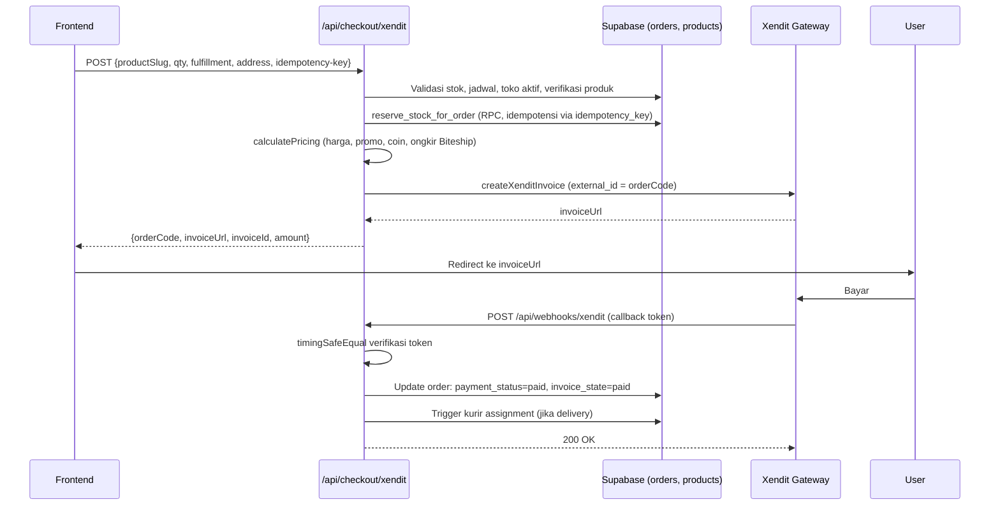
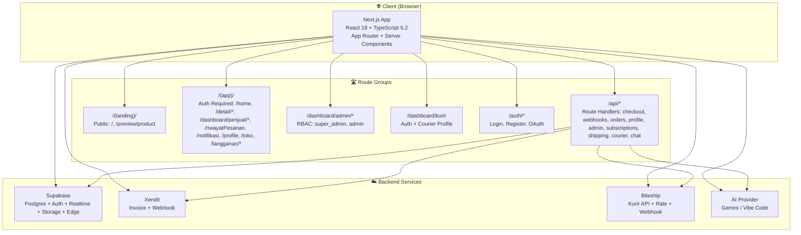
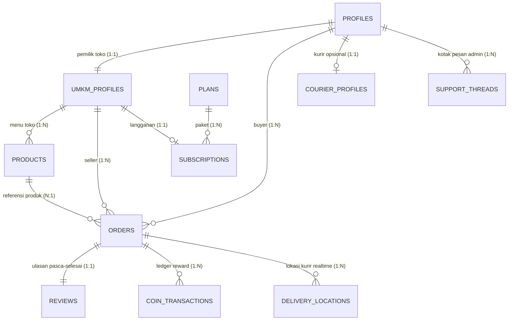

<p align="center">
  <a href="https://github.com/kayy-eci/Rebitesss-GTNIC2026" aria-label="ReBites repository">
    
  </a>
</p>

<h1 align="center">ReBites</h1>

<p align="center">
  <em>Dari dapur UMKM, ke piring yang butuh.</em>
</p>

<p align="center">
  Marketplace makanan surplus yang mempertemukan pelaku UMKM kuliner dengan pembeli<br/>
  untuk menyelamatkan hidangan yang masih layak konsumsi — bukan yang terbuang.
</p>

<p align="center">
  <a href="#panduan-pengembangan"><strong>Mulai Cepat</strong></a>
  &nbsp;·&nbsp;
  <a href="#fitur-utama"><strong>Fitur Utama</strong></a>
  &nbsp;·&nbsp;
  <a href="#arsitektur-sistem"><strong>Arsitektur</strong></a>
  &nbsp;·&nbsp;
  <a href="#teknologi"><strong>Teknologi</strong></a>
</p>

<p align="center">
  
  
  
  
</p>

<p align="center">
  
  
  
  
</p>


---

## Daftar Isi

- [Tentang ReBites](#tentang-rebites)
- [Fitur Utama](#fitur-utama)
- [Peran Pengguna & Kontrol Akses](#peran-pengguna-and-kontrol-akses)
- [Alur Bisnis Utama](#alur-bisnis-utama)
- [Arsitektur Sistem](#arsitektur-sistem)
- [Database & Relasi Data](#database-and-relasi-data)
- [Teknologi](#teknologi)
- [Struktur Direktori](#struktur-direktori)
- [Panduan Pengembangan](#panduan-pengembangan)
- [Variabel Lingkungan](#variabel-lingkungan)
- [Keamanan & Keandalan](#keamanan-and-keandalan)
- [Testing & Quality Assurance](#testing-and-quality-assurance)
- [Status Proyek & Known Issues](#status-proyek-and-known-issues)

---

## Tentang ReBites

**ReBites** adalah marketplace dua-sisi yang mempertemukan **pelaku UMKM kuliner** (penjual) dengan **pembeli** untuk menyelamatkan makanan surplus — makanan yang masih layak konsumsi namun tidak terjual pada akhir jam operasional.

### Sorotan Produk

| Kemampuan | Deskripsi |
|-----------|-----------|
| Temukan makanan surplus | Jelajahi 8 kategori dengan filter lokasi, jarak, status buka/tutup, rating, dan pencarian. |
| Kelola produk & ketersediaan | UMKM menambah/edit menu, mengatur stok, harga surplus, jadwal tayang, dan promo flash sale. |
| Proses pemesanan | Checkout dengan pilih ambil sendiri atau diantar, validasi alamat, dan hitung ongkir real-time. |
| Kelola transaksi | Pembayaran via Xendit (invoice + webhook) dengan idempotensi, dukungan ReBites Coin & kode promo. |
| Pantau riwayat & notifikasi | Timeline status pesanan, riwayat lengkap, ulasan, notifikasi realtime via Supabase. |

### Masalah yang Diselesaikan

| Sisi | Masalah | Solusi ReBites |
|------|---------|----------------|
| **UMKM** | Sisa makanan layak konsumsi dibuang → kerugian & food waste | Jual surplus dengan harga khusus, batas stok, jendela waktu tayang |
| **Pembeli** | Makanan terjangkau sulit ditemukan, khawatir kualitas | Katalog terkurasi, transparansi (harga asli vs surplus, stok, lokasi, jam buka), ulasan & rating |
| **Platform** | Perlu biaya operasional berkelanjutan | Model langganan tiered (Basic/Standar/Max) bulanan untuk UMKM |

**Area layanan saat ini:** Kota Depok (statis pada halaman kategori, struktur data mendukung ekspansi multi-kota).

---

## 🎯 Fitur Utama

### 🛒 Sisi Pembeli (Buyer)

| Modul | Deskripsi | Status |
|-------|-----------|--------|
| **Katalog & Pencarian** | 8 kategori (Makanan Berat, Jajanan, Japanese, Roti & Kue, Makanan Cepat Saji, Dessert, Buah & Sayur, Minuman), filter lokasi, jarak, status buka/tutup, rating, pencarian nama toko | ✅ Lengkap |
| **Detail Produk** | Foto, harga asli vs surplus, stok real-time, ulasan, lokasi toko, opsi ambil/antar | ✅ Lengkap |
| **Detail Toko** | Halaman khusus UMKM: menu, rating, tinjauan layanan, jam operasional | ✅ Lengkap |
| **Keranjang & Checkout** | Pilih kuantitas, metode pengambilan (ambil sendiri/diantar), validasi alamat, hitung ongkir real-time via Biteship | ✅ Lengkap |
| **Pembayaran** | Integrasi Xendit (invoice + webhook), idempotensi (hindari duplikasi pesanan), dukungan ReBites Coin & kode promo | ✅ Lengkap |
| **Lacak Pesanan** | Timeline status: dibuat → dibayar → disiapkan → siap diambil/diantar → selesai | ✅ Lengkap |
| **Riwayat & Ulasan** | Riwayat pesanan lengkap, rating produk/toko setelah selesai | ✅ Lengkap |
| **Notifikasi Realtime** | Supabase Realtime: status pesanan, promo toko yang di-follow, sanksi admin | ✅ Lengkap |
| **Favorit & Follow** | Like produk, follow toko untuk notifikasi promo | ✅ Lengkap |
| **Profil & Alamat** | Kelola alamat pengiriman, avatar, preferensi akun | ✅ Lengkap |

### 🏪 Sisi Penjual (UMKM)

| Modul | Deskripsi | Status |
|-------|-----------|--------|
| **Registrasi & Onboarding** | Daftar toko, isi profil, upload logo (Supabase Storage) | ✅ Lengkap |
| **Manajemen Produk** | Tambah/edit/hapus menu: harga normal vs surplus, stok, jadwal tayang (jam/tanggal), berat/dimensi untuk ongkir | ✅ Lengkap |
| **Flash Sale** | Jadwalkan promo harga khusus pada slot waktu tertentu (per-paket langganan) | ✅ Lengkap |
| **Dashboard Penjualan** | Metrik harian/mingguan, produk terlaris, analisis permintaan (paket Max) | ✅ Lengkap |
| **Kelola Pesanan** | Daftar pesanan masuk, konfirmasi status (siap → diantar/diambil), notifikasi realtime ke pembeli | ✅ Lengkap |
| **Ulasan & Reputasi** | Lihat rating & komentar pelanggan, kelola reputasi toko | ✅ Lengkap |
| **Langganan & Billing** | Kelola paket Basic/Standar/Max, perpanjang, riwayat pembayaran via Xendit | ✅ Lengkap |
| **Analitik Lanjutan (Max)** | Ekspor Excel, analisis permintaan, performa kategori | ✅ Lengkap |

### 🛡️ Sisi Admin

| Area | Deskripsi | Status |
|------|-----------|--------|
| **Moderasi & Sanksi** | Tinjau produk dilaporkan, sanksi (peringatan, blokir sementara/permanen), kelola konten | ✅ Lengkap |
| **Manajemen Pengguna** | Ganti role (buyer→admin, dll), tangguhkan/hapus akun, kelola hak akses | ✅ Lengkap |
| **Monitoring & Audit** | Audit trail aksi admin, log aktivitas sistem, pantau kesehatan infrastruktur | ✅ Lengkap |
| **Data & Ekspor** | Ekspor data, metrik marketplace (pengguna, transaksi), kelola artikel/landing | ✅ Lengkap |
| **Integrasi** | Konfigurasi Xendit, Biteship, health check service | ✅ Lengkap |

### 🚚 Sisi Kurir (Opsional)

| Fitur | Deskripsi | Status |
|-------|-----------|--------|
| **Pendaftaran** | Pengguna daftar jadi kurir, verifikasi admin | ✅ Lengkap |
| **Dashboard Tugas** | Lihat tugas aktif, ubah status (ambil, mulai, selesai) | ✅ Lengkap |
| **Lokasi Realtime** | Kirim posisi via Supabase Realtime → ditampilkan di peta pembeli (MapLibre GL) | ✅ Lengkap |
| **Chat Kurir** | Komunikasi dengan pembeli untuk koordinasi | ✅ Lengkap |

### 🤖 Asisten AI (Chatbot)

- Terintegrasi di seluruh halaman via `ChatbotMount`
- Profil perilaku ditentukan server dari status sesi:
  - **Admin**: akses tool write (kelola data)
  - **UMKM/Pembeli**: read-only (bantuan informasi)
- Provider: Gemini / Vibe Code (konfigurable via env)

---

## 👥 Peran Pengguna & Kontrol Akses

ReBites mendefinisikan peran melalui kolom `role` di tabel `profiles` + tabel `courier_profiles` untuk kurir.

| Peran | Deskripsi | Halaman Utama | Akses Utama |
|-------|-----------|---------------|-------------|
| `buyer` | Pelanggan membeli makanan surplus | `/home` | Katalog, checkout, riwayat, profil, ulasan, favorit, follow toko |
| `umkm` | Pemilik toko kuliner | `/dashboard/penjual` | Dashboard penjualan, kelola produk, kelola pesanan, langganan, analitik |
| `admin` | Administrator platform | `/dashboard/admin` | Moderasi, kelola pengguna, monitoring, ekspor data, konfigurasi integrasi |
| `super_admin` | Admin tertinggi (satu dari sistem) | `/dashboard/admin` | Semua hak admin + hapus permanen akun, ubah role, bootstrap admin |
| `courier` | Kurir pengiriman (via `courier_profiles`) | `/dashboard/kurir` | Tugas pengiriman, chat, lokasi realtime |

**Aturan akses (divalidasi via RLS & guard server):**
- Pembeli hanya melihat datanya sendiri
- UMKM hanya melihat toko & produk miliknya
- Admin melihat semua data
- Kurir hanya melihat tugas yang ditugaskan
- Perubahan role hanya oleh admin via panel khusus

---

## 🔄 Alur Bisnis Utama

### Alur Pembelian (Buyer)

```mermaid
flowchart TD
    A[Pembeli menjelajah katalog<br/>/makanan/[kategori]] --> B[Pilih produk<br/>/detail/product?id=...]
    B --> C[Pilih kuantitas & metode<br/>ambil/antar]
    C --> D[Checkout /detail/pesanan]
    D --> E[Hitung ongkir<br/>jarak toko → alamat]
    E --> F[Pilih pembayaran<br/>Xendit invoice]
    F --> G[Xendit webhook<br/>konfirmasi pembayaran]
    G --> H[Pesanan: pending → paid]
    H --> I[Toko memproses<br/>ready → out_for_delivery]
    I --> J[Kurir mengambil & mengantarkan<br/>jika delivery]
    J --> K[Pembeli menerima & ulasan]
    K --> L[Pesanan completed<br/>dana dirilis ke penjual]
```

### Alur Penjualan (UMKM)

```mermaid
flowchart LR
    A[UMKM daftar toko<br/>/auth/register/penjual] --> B[Onboarding: profil & logo]
    B --> C[Toko aktif → tambah menu<br/>/dashboard/penjual/tambahMenu]
    C --> D[Produk diverifikasi admin]
    D --> E[Tersedia di katalog<br/>status: available, verified: approved]
    E --> F[Pembeli pesan, webhook Xendit konfirmasi]
    F --> G[Toko proses: siap → diantar/diambil]
    G --> H[Order selesai, dana masuk ledger coin]
    H --> I[UMKM lihat metrik & ekspor laporan]
```



### Alur Checkout & Idempotensi (Teknis)



---

## 🏗️ Arsitektur Sistem

### Diagram Komponen



### Lapisan Arsitektur

| Lapisan | Teknologi | Tanggung Jawab |
|---------|-----------|----------------|
| **Presentasi** | Next.js 14 App Router, React 18 | Server Components default, Client Components hanya untuk interaktivitas (`"use client"`). Route groups `(landing)` / `(app)` / `(preview)` tidak mempengaruhi URL. |
| **API & Logika Bisnis** | Next.js Route Handlers (`app/api/*`) | Semua mutasi: checkout, langganan, profil, admin, webhook. Validasi server-side, integrasi Supabase Service Role, Xendit, Biteship, AI. |
| **Data & Otorisasi** | Supabase (Postgres + RLS) | Database utama, Auth (email/password + Google OAuth), Realtime (notifikasi, lokasi kurir), Storage (logo, produk, avatar). RLS sebagai lapisan otorisasi database. |
| **Eksternal** | Xendit, Biteship, AI | Payment gateway, logistik kurir, asisten AI. Semua kredensial hanya di server (`lib/server/*`). |

### Data Flow: Checkout (Detail)

```
1. Frontend (checkout-view) → POST /api/checkout/xendit
   - Header: Authorization: Bearer <supabase-access-token>
   - Header: Idempotency-Key (client-generated UUID)
   - Body: {productSlug, quantity, fulfillment, addressSnapshot, promoCode, useCoins}

2. Route Handler (server):
   a. getUserFromBearer → validasi sesi Supabase
   b. Validasi payload (Zod-level via manual check)
   c. Fetch produk (anon client): stok, status, verification_status, jadwal, harga flash sale
   d. Validasi toko: is_active, is_open, jam operasional (WIB)
   e. Validasi fulfillment: produk support delivery/pickup
   f. Hitung ongkir: Biteship rate (jarak haversine → estimasi jalan → fee)
   g. calculatePricing: unitPrice × qty + promo% + coin + ongkir + admin fee (12%)
   h. reserve_stock_for_order (RPC, idempotensi via idempotency_key)
   i. Insert orders row: invoice_state=not_started, payment_status=unpaid
   j. createXenditInvoice → dapat invoiceUrl
   k. Response: {orderCode, invoiceUrl, invoiceId, amount, invoiceState}

3. Frontend → redirect ke invoiceUrl (Xendit hosted page)

4. User bayar → Xendit POST /api/webhooks/xendit
   - Header: x-callback-token (timingSafeEqual vs env)
   - Verifikasi invoice & amount
   - Update order: payment_status=paid, invoice_state=paid
   - Trigger kurir assignment (jika delivery)
   - Return 200 OK
```

---

## 🗄️ Database & Relasi Data

### Entitas Utama (Postgres/Supabase)



| Tabel | Tujuan | Kolom Kunci |
|-------|--------|-------------|
| `profiles` | Pengguna (buyer/umkm/admin) | `id` PK, `email`, `full_name`, `role`, `avatar_url`, `is_verified`, `account_status`, `deleted_at` |
| `umkm_profiles` | Data toko UMKM | `id` PK, `user_id` FK→profiles, `business_name`, `slug`, `address`, `city`, `lat/lng`, `logo_url`, `rating`, `is_verified`, `open_hours`, `is_open`, `is_active` |
| `products` | Menu surplus | `id` PK, `umkm_id` FK, `name`, `category`, `slug`, `original_price`, `surplus_price`, `stock`, `status`, `verification_status`, `flash_sale_*`, `scheduled_start/end`, `weight_gram`, `is_delivery/pickup` |
| `orders` | Pesanan | `order_code` PK, `buyer_id` FK, `umkm_id` FK, `product_id` FK, `quantity`, `unit_price`, `subtotal`, `service_fee`, `delivery_fee`, `total_price`, `payment_status`, `order_status`, `delivery_option`, `idempotency_key`, `invoice_state`, `coin_used`, `coin_earned` |
| `subscriptions` | Langganan UMKM | `id` PK, `umkm_id` FK, `plan_id` FK, `status` (trial/active/expired/cancelled), `billing` (monthly/yearly), `current_period_start/end` |
| `plans` | Paket langganan | `id` PK, `slug` (basic/standar/premium), `name`, `price_monthly`, `price_yearly`, `max_products`, `features[]`, `is_popular` |
| `reviews` | Ulasan | `id` PK, `order_id` FK, `product_id`, `user_id`, `rating`, `comment` |
| `coin_transactions` | Ledger koin | `id` PK, `user_id`, `order_id`, `type` (earned/spent/refund), `amount` |
| `courier_profiles` | Data kurir | `id` PK, `user_id` FK, `full_name`, `phone`, `vehicle_type`, `is_active` |
| `delivery_locations` | Lokasi realtime | `order_id` FK, `lat`, `lng`, `updated_at` |
| `support_threads` / `support_appeals` | Banding akun | `id`, `user_id`, `status` |

### Constraint & Validasi Bisnis

- **Product verification**: `verification_status` (pending/approved/rejected) dikontrol admin
- **Order state machine**: `pending → paid → processing → ready_for_pickup/out_for_delivery → completed` (validasi di `lib/order-state-machine.ts`)
- **Idempotensi**: `idempotency_key` unik per buyer + session checkout, mencegah duplikasi
- **RLS**: Pembeli lihat data sendiri, UMKM lihat toko sendiri, admin lihat semua
- **Stock reservation**: RPC `reserve_stock_for_order` atomic, release otomatis via `stock-release-guard` saat gagal/expired

---

## 🛠️ Teknologi

| Kategori | Teknologi | Versi | Peran di ReBites |
|----------|-----------|-------|------------------|
| **Framework** | Next.js | ^14.2.35 | App Router, Turbopack dev, Server Components, Route Handlers |
| **UI Library** | React | 18.2.0 | Server Components default, Client Components on demand |
| **Language** | TypeScript | 5.2.2 | Strict mode (`tsconfig.json`), type safety end-to-end |
| **Styling** | Tailwind CSS | 3.3.3 | Design tokens (HSL CSS variables), utilities, dark-mode ready |
| **UI Primitives** | shadcn-style (Radix UI) | — | Button, Dialog, Dropdown, Select, Toast, Avatar, dll. |
| **Animation** | Framer Motion | ^13 | Transisi, reveal, reduced-motion support via `MotionConfig` |
| **Smooth Scroll** | Lenis | ^1.3.26 | Smooth scroll landing page, anchor navigation |
| **Icons** | Lucide React | ^0.446 | Ikon sistematis seluruh aplikasi |
| **Forms/Validation** | React Hook Form + Zod | ^7.53 / ^3.23 | Auth, profil, checkout forms |
| **Backend** | Supabase | ^2.58 | Postgres, Auth, Realtime, Storage, Edge Functions |
| **Payments** | Xendit | — | Invoice (checkout + subscription), webhook, idempotensi |
| **Logistics** | Biteship | — | Rate calculation, shipment creation, webhook kurir |
| **Charts** | Recharts | ^2.12 | Dashboard analitik penjual (seller analytics) |
| **Maps** | MapLibre GL | ^5.24 | Peta lokasi kurir realtime |
| **Carousel** | Embla Carousel | ^8.3 | Carousel komponen (shadcn) |
| **Fonts** | Google Fonts (next/font) | — | **Plus Jakarta Sans** (primary), **Be Vietnam Pro** (secondary) |
| **Images** | next/image | — | Remote hosts: `images.pexels.com`, `*.supabase.co` |
| **Testing** | node --test | — | 96 test suites offline (no browser/DB), ~401 test cases |
| **AI/Chatbot** | Gemini / Vibe Code | — | Asisten kontekstual, role-based tool access |

---

## 📁 Struktur Direktori

```
├── app/
│   ├── (landing)/           # Halaman publik (tanpa auth)
│   │   ├── page.tsx        # Landing page /
│   │   ├── layout.tsx      # LandingShell (navbar, preloader, footer)
│   │   ├── preview/product/ # Public product detail /preview/product
│   │   └── blog/, dampak/, fitur/, tentang-kami/, hubungi-kami/
│   ├── (app)/              # Aplikasi utama (memerlukan sesi)
│   │   ├── home/           # Beranda pembeli (RequireAuth)
│   │   ├── detail/         # Detail produk, pesanan, toko
│   │   ├── makanan/[category]/ # Kategori SSG (8 paths via generateStaticParams)
│   │   ├── riwayatPesanan/ # Riwayat pesanan pembeli
│   │   ├── notifikasi/pembeli/ # Notifikasi realtime
│   │   ├── profile/        # Profil & alamat
│   │   ├── toko/           # Daftar UMKM (filter, search, sort)
│   │   ├── alamat/         # Kelola alamat pengiriman
│   │   ├── pengaturan/     # Pengaturan akun
│   │   ├── langganan/      # Pembayaran & sukses langganan
│   │   └── dashboard/penjual/ # Dashboard UMKM (storeId di URL)
│   ├── (preview)/preview/  # Preview produk publik (LandingNavbar shell)
│   ├── api/                # Route Handlers (Backend)
│   │   ├── admin/          # Admin API (RBAC guarded)
│   │   ├── checkout/xendit/ # Checkout order + verify
│   │   ├── courier/        # Kurir atribusi & status
│   │   ├── delivery/       # Estimasi & tracking
│   │   ├── orders/         # Detail pesanan
│   │   ├── profile/        # Profil, alamat, avatar
│   │   ├── reports/        # Ekspor data admin
│   │   ├── seller/         # UMKM-specific API
│   │   ├── shipping/       # Tarif pengiriman (Biteship)
│   │   ├── store-visitors/ # Analytics kunjungan toko
│   │   ├── subscriptions/  # Langganan Xendit
│   │   ├── support/        # Banding akun
│   │   ├── visitors/       # Analytics pengunjung situs
│   │   ├── webhooks/       # Xendit & Biteship callback
│   │   └── chat/           # Chatbot AI endpoint
│   ├── auth/               # Login, register, seller auth, OAuth callback
│   ├── dashboard/
│   │   ├── admin/          # Admin panel (RBAC: super_admin, admin)
│   │   ├── penjual/        # Seller dashboard pages
│   │   └── kurir/          # Courier dashboard
│   ├── components/         # Shared UI Components
│   │   ├── admin/          # Admin panel components
│   │   ├── buyer/          # Buyer-specific components
│   │   ├── seller/         # Seller-specific components
│   │   ├── auth/           # Auth forms & guards
│   │   ├── chatbot/        # Chatbot widget
│   │   ├── dashboard-penjual/ # Seller dashboard components
│   │   ├── detail-product/ # Shell-injected product detail
│   │   ├── landing/        # Landing page sections
│   │   ├── legal/          # Privacy, Terms
│   │   ├── profile/        # Profile components
│   │   ├── shared/         # Cross-cutting: shells, modals, reveal, buttons
│   │   ├── support/        # Support/appeal components
│   │   └── ui/             # Primitives (shadcn-style: button, card, dialog, dll)
│   ├── layout.tsx          # Root layout: fonts, metadata, ChatbotMount
│   ├── globals.css         # Design tokens (CSS variables), utilities
│   └── error.tsx / global-error.tsx / not-found.tsx
├── hooks/                  # Custom React Hooks
│   ├── buyer/              # use-addresses, use-orders, use-liked-foods, dll
│   ├── seller/             # use-seller-orders, use-seller-analytics, dll
│   └── use-*.ts            # Cross-cutting: admin, courier, notifications, auth
├── lib/                    # Business Logic & Utilities
│   ├── server/             # Server-only (Supabase service role, Xendit, Biteship, AI)
│   ├── chatbot/            # Knowledge, tools, rate-limit, guard
│   ├── catalog.ts          # Fetch produk & vendor (SSR/SSG)
│   ├── catalog-filters.ts  # Filter & sort vendor/produk
│   ├── categories.ts       # 8 kategori statis + Pexels images
│   ├── current-user.ts     # Hook sesi & role (client)
│   ├── order-state-machine.ts # State transitions & valid actions
│   ├── pricing.ts          # Perhitungan harga, diskon, coin, ongkir
│   ├── subscription-plans.ts # 3 tier: Basic/Standar/Max
│   ├── image-path.ts       # Resolver .jpeg/.webp → .avif (public assets)
│   ├── shipping-tariff.ts  # Haversine + Biteship rate calculation
│   ├── store-hours.ts      # Jam operasional toko (WIB)
│   └── ... (147+ utility modules)
├── supabase/
│   └── migrations/         # 80+ SQL migrations (schema, RLS, seed, functions)
├── tests/                  # 96 test suites (node --test)
├── scripts/                # One-off scripts (sync bans, check gemini, dll)
├── public/                 # Static assets (semua .avif)
│   ├── logo.avif
│   ├── hero-makanan.avif
│   ├── makanan1–15.avif (kecuali 6,7,11,12 dihapus)
│   ├── foods/, lanyard/
│   └── step images: penjual-login, pembeli-mencaro, penerimaan, terselamatkan
├── docs/
│   └── PROJECT_CONTEXT.md  # Snapshot arsitektur & konvensi terverifikasi
├── package.json            # Dependencies & npm scripts
├── tailwind.config.ts      # Design tokens mapping, admin-only palette
├── tsconfig.json           # Strict TypeScript config
├── next.config.js          # Turbopack, image domains, eslint ignore during build
├── .env.example            # Environment variable template
└── README.md               # (File ini)
```

**Konvensi Penting:**
- Route groups `(landing)` / `(app)` / `(preview)` **tidak mempengaruhi URL**
- Halaman `makanan/[category]` menggunakan `generateStaticParams` → **SSG (8 paths)**
- `RequireAuth` dibungkus **di luar shell** agar navbar/skeleton tidak tampil sebelum redirect
- `lib/server/*` **tidak boleh** di-import dari client (menggunakan `SUPABASE_SERVICE_ROLE_KEY`)
- Shell injection: `DetailProductContent` menerima `shell` prop dari route (mencegah auth code di bundle publik)

---

## 🚀 Panduan Pengembangan

### Prasyarat

- **Node.js** ≥ 18 (direkomendasikan 20+)
- **npm** ≥ 9
- **Supabase Project** (Postgres + Auth + Realtime + Storage)
- (Opsional) **Xendit Account** untuk pembayaran
- (Opsional) **Biteship Account** untuk logistik kurir
- (Opsional) **Gemini / Vibe Code API Key** untuk chatbot AI

### Setup Lokal

```bash
# 1. Clone repository
git clone https://github.com/kayy-eci/Rebitesss-GTNIC2026.git rebites
cd rebites

# 2. Install dependensi
npm install

# 3. Salin & isi environment variables
cp .env.example .env.local
# Edit .env.local dengan kredensial Supabase, Xendit, Biteship, dll.

# 4. (Opsional) Setup Supabase migrations
# Pastikan project Supabase sudah running, lalu:
npx supabase migration list
# Atau push migrations ke project Anda

# 5. Jalankan development server (Turbopack)
npm run dev
# → http://localhost:3000

# Alternatif tanpa Turbopack
npm run dev:webpack
```

### Perintah Build & Verifikasi

```bash
# Type-check (tsc --noEmit)
npm run typecheck

# Type-check tests (tsconfig.tests.json)
npm run typecheck:tests

# Lint (ESLint)
npm run lint

# Production build (type-check + build, lint di-skip via next.config.js)
npm run build

# Serve production build
npm start
```

### Menjalankan Test

Proyek memiliki **96 test suites** (node --test, tanpa browser/DB), ~401 kasus uji.

```bash
# Contoh: jalankan suite spesifik
npm run test:checkout-idempotency
npm run test:admin-auth-guard
npm run test:shipping-rates

# Jalankan semua (pilih yang relevan, tidak ada script "test:all")
# Lihat package.json untuk daftar lengkap 96 script test:*
```

**Konvensi Test:**
- Setiap test membaca file `lib/server/*` atau `app/api/*` yang relevan
- Menguji logika murni (tanpa side effect DB/jaringan)
- Kegagalan test = ada yang salah, **jangan diabaikan**

---

## 🔐 Variabel Lingkungan

**File `.env.example`** (salin ke `.env.local` dan isi):

| Variabel | Deskripsi | Wajib |
|----------|-----------|-------|
| `NEXT_PUBLIC_SUPABASE_URL` | URL project Supabase | ✅ |
| `NEXT_PUBLIC_SUPABASE_ANON_KEY` | Anon key Supabase (client) | ✅ |
| `SUPABASE_SERVICE_ROLE_KEY` | Service role key (server only, **jangan** `NEXT_PUBLIC_`) | ✅ |
| `NEXT_PUBLIC_SITE_URL` | URL situs (redirect Xendit, webhook) | ✅ |
| `SUPER_ADMIN_USER_ID` | User ID super admin bootstrap | ✅ |
| `PASSWORD_DELETE_USER` | Password konfirmasi hapus permanen (kosong = nonaktif) | ❌ |
| `XENDIT_SECRET_KEY` | Secret key Xendit (server only) | ✅ |
| `XENDIT_CALLBACK_TOKEN` / `XENDIT_WEBHOOK_TOKEN` | Token verifikasi webhook Xendit | ✅ |
| `BITESHIP_API_KEY` | API key Biteship | ✅ |
| `BITESHIP_COURIERS` | Daftar kurir (contoh: `jne,anterait,sih,gojek`) | ✅ |
| `BITESHIP_WEBHOOK_SECRET` | Secret webhook Biteship | ✅ |
| `DELIVERY_BASE_FEE_IDR` | Biaya dasar ongkir (default 5000) | ❌ |
| `DELIVERY_PER_KM_FEE_IDR` | Biaya per km (default 2500) | ❌ |
| `DELIVERY_MIN_FEE_IDR` | Minimum ongkir (default 5000) | ❌ |
| `DELIVERY_MAX_FEE_IDR` | Maksimum ongkir (default 50000) | ❌ |
| `VIBE_CODE_URL` / `VIBE_CODE_KEY` / `VIBE_CODE_MODEL` | Config AI Vibe Code | ❌ |
| `GEMINI_API_KEY` / `GEMINI_MODEL` | Config Gemini AI | ❌ |
| `CHATBOT_ACTION_SECRET` | Secret untuk aksi chatbot | ❌ |

**Keamanan:**
- ❌ Jangan commit `.env` atau `.env.local` (sudah di `.gitignore`)
- ❌ `SUPABASE_SERVICE_ROLE_KEY` hanya di server (route handler & script)
- ✅ `XENDIT_CALLBACK_TOKEN` & `BITESHIP_WEBHOOK_SECRET` harus sama dengan dashboard penyedia

---

## 🔒 Keamanan & Keandalan

### Autentikasi & Otorisasi

| Mekanisme | Implementasi |
|-----------|--------------|
| **Supabase Auth** | Email/password + Google OAuth; sesi di `localStorage` (client) & `cookies` (server untuk route handler) |
| **Bearer Token** | Semua API admin & checkout: `Authorization: Bearer <token>` (dari sesi Supabase), validasi server via `getUserFromBearer` |
| **Role Guard** | `profiles.role` + `getAdminUser` (server) memastikan hanya admin akses route/admin API |
| **RLS (Row-Level Security)** | Postgres policy: pembeli lihat data sendiri, UMKM lihat toko sendiri, admin lihat semua |
| **Hapus Akun** | Super Admin butuh `PASSWORD_DELETE_USER` (env) + alasan, tolak jika ada pesanan berjalan |

### Validasi & Integritas Data

| Area | Implementasi |
|------|--------------|
| **Input Validation** | Zod + React Hook Form (auth, profil, checkout) |
| **Stok & Jadwal** | Server memvalidasi stok (RPC `reserve_stock_for_order`) & jadwal menu (`isMenuScheduleVisible`) sebelum checkout |
| **Idempotensi** | `Idempotency-Key` (client-generated) + `invoice_state` transition (`not_started → inflight → paid/failed`) mencegah pesanan duplikat |
| **Webhook Verifikasi** | `timingSafeEqual` untuk token Xendit & Biteship; verifikasi invoice & amount di server |

### Error Handling & Observability

- **Health Check**: `GET /api/admin/health` (probe Supabase & Xendit) untuk monitoring
- **Audit Log**: `admin_audit_logs` mencatat semua aksi admin (best-effort insert)
- **Notifikasi Realtime**: Supabase Realtime untuk pesanan & sanksi (pembeli & kurir)
- **Error State UI**: `AdminErrorState`, `StoreClosedModal`, skeleton loaders untuk UX saat data tidak tersedia

### Batasan & Risiko Terkenal

- ⚠️ Belum ada load testing / rate limit di level API (hanya chatbot & webhook)
- ⚠️ Belum ada backup otomatis (bergantung pada Supabase managed backup)
- ⚠️ Fitur kurir opsional (butuh migrasi khusus & dashboard terpisah)
- ⚠️ Integrasi Xendit & Biteship bergantung pada ketersediaan API eksternal
- ⚠️ `next build` skip ESLint (`eslint.ignoreDuringBuilds: true`), jalankan `npm run lint` terpisah
- ⚠️ `public/makanan2.avif` dan `public/makanan5.avif` memiliki artifact checkerboard transparency (baked-in), **jangan digunakan di UI baru**

---

## 🧪 Testing & Quality Assurance

| Aspek | Detail |
|-------|--------|
| **Test Runner** | `node --test` (native, no dependencies) |
| **Test Suites** | 96 files di `tests/` (~401 kasus uji) |
| **Coverage Areas** | Checkout idempotency/price/failure, Admin RBAC/health/analytics/export, Stock release, Shipping rates, Order state machine, Seller dashboard, Courier location, Chatbot, Image path resolver, dll. |
| **Type Checking** | `npm run typecheck` (strict), `npm run typecheck:tests` |
| **Linting** | `npm run lint` (ESLint + Next.js config) |
| **Build Verification** | `npm run build` (production build + type-check) |
| **Visual Verification** | Manual di breakpoint 320/375/768/1024/1440/1920 (no horizontal overflow pada `/`) |

> **Catatan:** Tidak ada test E2E browser (Playwright/Cypress) dan tidak ada CI pipeline terkonfigurasi. Semua test offline (unit/integration logic only).

---

## 📊 Status Proyek & Known Issues

### ✅ Sudah Terimplementasi (Core)

- Marketplace: katalog, detail, checkout, riwayat, ulasan
- Autentikasi: email/password + Google OAuth
- Manajemen toko (UMKM) & produk (CRUD, flash sale, jadwal)
- Langganan tiered: Basic / Standar / Max (bulanan/tahunan via Xendit)
- Integrasi Xendit (invoice + webhook idempoten) & Biteship (rate + shipment)
- Admin dashboard lengkap: moderasi, pengguna, monitoring, ekspor, konfigurasi
- Dashboard kurir (opsional): tugas, status, lokasi realtime, chat
- Chatbot AI: role-based (admin write tools, user read-only)
- Notifikasi realtime (Supabase Realtime) & banding akun
- 96 test suites offline passing

### 🔧 Known Issues / Technical Debt

| Issue | Deskripsi | Mitigasi |
|-------|-----------|----------|
| **ESLint skipped during build** | `eslint.ignoreDuringBuilds: true` di `next.config.js` | Jalankan `npm run lint` manual sebelum commit |
| **Image path mismatch DB vs FS** | DB menyimpan `/makanan1.jpeg`, `/makanan9.webp` tapi file fisik `.avif` | `lib/image-path.ts` (`resolveImageSrc`) memetakan ekstensi lama → `.avif` |
| **Transparency artifact** | `makanan2.avif`, `makanan5.avif` punya checkerboard baked-in | Jangan gunakan di UI baru; mungkin masih dirujuk DB |
| **EOL sensitivity (Windows)** | `tests/admin-ui-regressions` gagal spurious jika CRLF | Restore LF via `git cat-file blob :0:lib/admin-preferences.ts` atau tambah `.gitattributes` |
| **Stale types after route move** | `npm run typecheck` baca `.next/types` | Jalankan `npm run build` dulu setelah pindah route |
| **No CI/CD** | Belum ada GitHub Actions / pipeline | Manual verification: `typecheck` + `lint` + `build` + visual pass |

### 🚧 Rencana Penguatan (Backlog)

- Load testing & rate limit di level API (bukan hanya chatbot)
- Multi-region / area layanan di luar Kota Depok
- Integrasi kurir lokal mandiri (bukan hanya Biteship)
- Fitur ekspor data UMKM (Excel format khusus)
- Refactor `lib/server/*` untuk mengurangi kompleksitas (khususnya checkout idempoten)

---

## 📄 Lisensi

Proyek ini bersifat **non-komersial / untuk keperluan demonstrasi & kompetisi** (GTNIC 2026). Tidak ada lisensi komersial atau open-source yang dideklarasikan di `package.json` (hanya `private: true`).

- **Sumber:** [GitHub — kayy-eci/Rebitesss-GTNIC2026](https://github.com/kayy-eci/Rebitesss-GTNIC2026)
- **Demo Development:** `http://localhost:3000` (setelah `npm run dev`)

---

<p align="center">
  <strong>ReBites</strong> — Dibangun dengan Next.js, Supabase, Xendit & Biteship<br/>
  untuk menghadirkan marketplace makanan surplus yang transparan, cepat, dan efisien bagi UMKM kuliner.
</p>

<p align="center">
  <sub>Dokumentasi ini mencerminkan kondisi codebase per November 2026. Semua klaim teknis diverifikasi terhadap implementasi aktual.</sub>
</p>