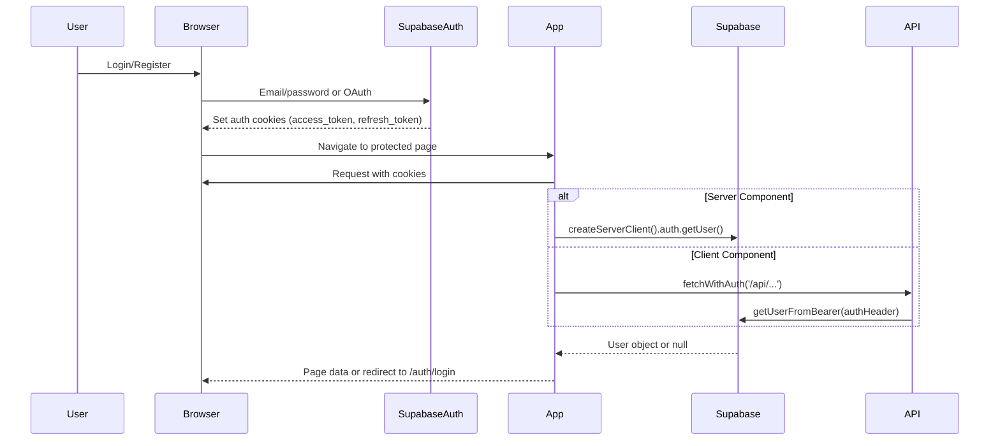
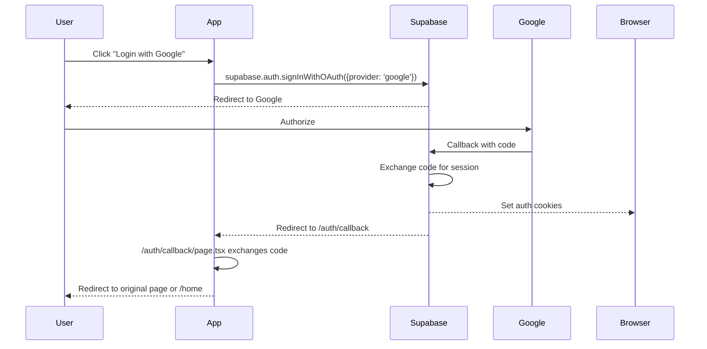
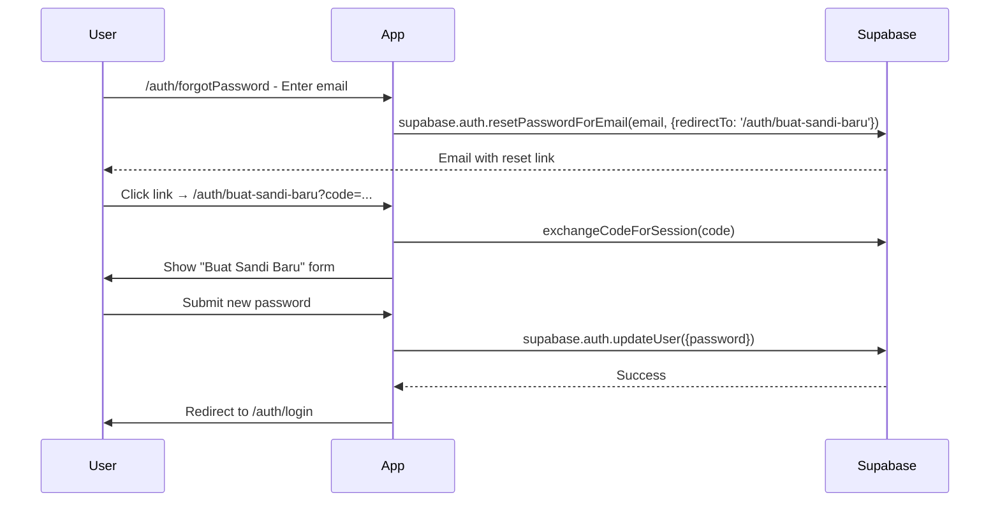

# Authentication Boundary & Authorization

> Auth system architecture, role hierarchy, guard patterns, and session management.

---

## Auth Architecture Overview

```mermaid
graph TB
    subgraph "Client"
        Browser[Browser]
        SupabaseClient[@supabase/supabase-js]
    end

    subgraph "Next.js App"
        Middleware[Middleware? No - not used]
        ServerComponents[Server Components]
        ClientComponents["use client Components"]
        APIRoutes[API Routes]
    end

    subgraph "Supabase Auth"
        AuthServer[Auth Server]
        JWT[JWT Tokens]
        Refresh[Refresh Tokens]
    end

    Browser -->|Cookies| SupabaseClient
    SupabaseClient -->|Auto-refresh| AuthServer
    ClientComponents -->|fetchWithAuth| APIRoutes
    ServerComponents -->|createServerClient| Supabase
    APIRoutes -->|getUserFromBearer| Supabase
```

**Key Design Decision**: No Next.js middleware for auth. Instead:
- **Client components**: `fetchWithAuth` adds `Authorization: Bearer <access_token>` header
- **Server components**: `createServerClient()` reads cookies directly
- **API routes**: `getUserFromBearer(req.headers.get('authorization'))` validates JWT

---

## Session Flow



---

## Role System

### Role Hierarchy

```
super_admin (1)
    │
    ├── Can: Everything
    ├── Role changes: Approve/reject admin role requests
    ├── User deletion: Soft + hard delete
    └── Assigned via: SUPER_ADMIN_USER_ID env var

admin (N)
    │
    ├── Can: Moderate products, users, orders, articles
    ├── Can: View analytics, monitoring, reports
    ├── Can: Manage sanctions, warnings
    ├── Cannot: Change roles (needs super_admin approval)
    └── Assigned via: Admin UI → Role Request → Super Admin approval

seller / UMKM (N)
    │
    ├── Can: Manage own store, products, orders
    ├── Can: View own analytics, subscriptions
    ├── Linked via: umkm_profiles.user_id = auth.users.id
    └── Plan entitlements: Basic / Standar / Premium (Max)

courier (N)
    │
    ├── Can: View assignments, update status, share GPS
    ├── Can: Chat with buyers on assigned orders
    ├── Linked via: couriers.user_id = auth.users.id
    └── Admin-controlled: is_active flag

buyer (N)
    │
    ├── Can: Browse, order, track, review, favorite, follow
    ├── Can: Chat with courier during delivery
    └── Default: All authenticated users without other roles

public (unauthenticated)
    │
    └── Can: Landing, preview, articles, category pages (SSG)
```

### Role Storage

| Table | Column | Values |
|-------|--------|--------|
| `profiles` | `role` | `'buyer' \| 'seller' \| 'admin' \| 'super_admin' \| 'courier'` |
| `umkm_profiles` | `user_id` | FK to `auth.users` — indicates seller |
| `couriers` | `user_id` | FK to `auth.users` — indicates courier |

### Role Checks

**Server-side (API routes):**
```typescript
// lib/server/supabase.ts
export async function getUserFromBearer(authHeader: string | null) {
    const token = authHeader?.replace('Bearer ', '');
    const { data: { user }, error } = await supabase.auth.getUser(token);
    if (error || !user) return null;
    return user;
}

export async function getAdminUser(authHeader: string | null) {
    const user = await getUserFromBearer(authHeader);
    if (!user) return null;
    const { data: profile } = await supabase
        .from('profiles')
        .select('role')
        .eq('id', user.id)
        .maybeSingle();
    return profile?.role === 'admin' || profile?.role === 'super_admin' ? user : null;
}

export async function getSuperAdminUser(authHeader: string | null) {
    const user = await getUserFromBearer(authHeader);
    if (!user) return null;
    const superAdminId = process.env.SUPER_ADMIN_USER_ID;
    return user.id === superAdminId ? user : null;
}
```

**Client-side (React hooks):**
```typescript
// hooks/use-current-user.ts
export function useCurrentUser() {
    const [user, setUser] = useState<User | null>(null);
    const [loading, setLoading] = useState(true);

    useEffect(() => {
        supabase.auth.getSession().then(({ data: { session } }) => {
            setUser(session?.user ?? null);
            setLoading(false);
        });
        const { data: { subscription } } = supabase.auth.onAuthStateChange((_, session) => {
            setUser(session?.user ?? null);
        });
        return () => subscription.unsubscribe();
    }, []);

    return { user, loading };
}
```

**Admin UI Guard (`app/components/admin/admin-page-header.tsx`):**
```typescript
// Uses fetchAdminDashboard() which calls /api/admin/me
// /api/admin/me verifies admin role via getAdminUser()
```

---

## Guard Patterns

### 1. RequireAuth (Buyer/Seller Pages)

```typescript
// app/components/auth/require-auth.tsx
export function RequireAuth({ children }: { children: ReactNode }) {
    const router = useRouter();
    const { user, loading } = useCurrentUser();

    useEffect(() => {
        if (!loading && !user) {
            const redirect = encodeURIComponent(window.location.pathname + window.location.search);
            router.push(`/auth/login?redirect=${redirect}`);
        }
    }, [user, loading, router]);

    if (loading) return <PageSkeleton />;
    if (!user) return null; // Redirect handled by effect

    return <>{children}</>;
}
```

**Usage:**
```tsx
// app/(app)/notifikasi/pembeli/page.tsx
export default function BuyerNotificationPage() {
    return (
        <RequireAuth>
            <BuyerNotificationContent />
        </RequireAuth>
    );
}
```

**Critical**: Guard wraps entire page content — navbar/skeleton/title all hidden before redirect.

### 2. SellerShell (Seller Dashboard)

```typescript
// app/components/seller/dashboard-penjual/SellerShell.tsx
export function SellerShell({ children }: { children: ReactNode }) {
    const { user, loading } = useCurrentUser();
    const { storeId, storeSlug, loading: sellerLoading } = useSellerStatus();

    // Redirects to /dashboard/penjual if no store
    // Provides sidebar navigation, MobileNavbar
}
```

### 3. Admin RBAC (Admin Dashboard)

```typescript
// app/dashboard/admin/layout.tsx
export default function AdminLayout({ children }: { children: ReactNode }) {
    const { data, loading } = useAdminAuth(); // Calls /api/admin/me

    if (loading) return <AdminSkeleton />;
    if (!data?.isAdmin) return <AccessDenied />;

    return <AdminSidebar>{children}</AdminSidebar>;
}
```

**API `/api/admin/me/route.ts`:**
```typescript
export async function GET(req: NextRequest) {
    const user = await getAdminUser(req.headers.get('authorization'));
    if (!user) return NextResponse.json({ isAdmin: false }, { status: 403 });
    const { data: profile } = await supabase
        .from('profiles')
        .select('role, full_name, avatar_url')
        .eq('id', user.id)
        .single();
    return NextResponse.json({ isAdmin: true, role: profile.role, ... });
}
```

### 4. Courier Dashboard

```typescript
// app/dashboard/kurir/page.tsx
export default function CourierDashboardPage() {
    return (
        <RequireAuth>
            <CourierDashboardContent />
        </RequireAuth>
    );
}

// CourierDashboardContent uses useCourierProfile()
// which calls /api/courier/profile and checks schemaReady
```

---

## Token Management

### Client-Side (Browser)

```typescript
// lib/auth-token.ts
export async function getValidAuthHeader(): Promise<string> {
    const { data: { session } } = await supabase.auth.getSession();
    if (!session) throw new AuthError('No session');
    
    // Auto-refresh handled by supabase-js via cookies
    // But we can proactively refresh if needed
    const { data, error } = await supabase.auth.refreshSession();
    if (error) throw new AuthError('Session expired');
    
    return `Bearer ${data.session!.access_token}`;
}

export async function fetchWithAuth(url: string, options: RequestInit = {}) {
    const authHeader = await getValidAuthHeader();
    return fetch(url, {
        ...options,
        headers: {
            ...options.headers,
            'Authorization': authHeader,
            'Content-Type': 'application/json',
        },
    });
}
```

### Server-Side (API Routes)

```typescript
// lib/server/supabase.ts
export function createServiceClient() {
    return createClient(
        process.env.NEXT_PUBLIC_SUPABASE_URL!,
        process.env.SUPABASE_SERVICE_ROLE_KEY!,
        { auth: { persistSession: false } }
    );
}

export function createAnonServerClient() {
    return createClient(
        process.env.NEXT_PUBLIC_SUPABASE_URL!,
        process.env.NEXT_PUBLIC_SUPABASE_ANON_KEY!,
        { auth: { persistSession: false } }
    );
}
```

---

## OAuth Flows

### Supported Providers
- Google
- GitHub (if configured in Supabase)

### Flow



**Callback Handler** (`app/auth/callback/page.tsx`):
```typescript
export default function AuthCallbackPage() {
    const { searchParams } = useSearchParams();
    const code = searchParams.get('code');
    const next = searchParams.get('next') ?? '/home';

    useEffect(() => {
        if (code) {
            supabase.auth.exchangeCodeForSession(code).then(() => {
                router.push(next);
            });
        }
    }, [code, next, router]);

    return <LoadingSpinner />;
}
```

---

## Password Reset Flow



---

## Multi-Factor Authentication

**Not currently implemented.** Supabase MFA available but not integrated.

---

## Session Persistence

| Context | Storage | Lifetime |
|---------|---------|----------|
| Browser | HttpOnly cookies (`sb-*-auth-token`) | Access: 1hr, Refresh: 30 days |
| Server Components | Cookie parsing via `createServerClient()` | Per request |
| API Routes | `Authorization: Bearer <token>` header | Per request |
| Service Role | `SUPABASE_SERVICE_ROLE_KEY` env var | Never expires (server only) |

---

## Security Considerations

| Measure | Implementation |
|---------|----------------|
| **Token in header, not URL** | `fetchWithAuth` uses `Authorization` header |
| **Service role never in browser** | `SUPABASE_SERVICE_ROLE_KEY` only in `lib/server/` |
| **Role checks on every admin API** | `getAdminUser()` / `getSuperAdminUser()` |
| **Row-Level Security** | All tables have RLS policies (see database/rls-policies.md) |
| **Webhook secrets** | `XENDIT_WEBHOOK_TOKEN`, `BITESHIP_WEBHOOK_SECRET` validated |
| **Idempotency keys** | Prevent duplicate orders on retry |
| **Rate limiting** | Chatbot: per-user/IP; Admin: not yet implemented |

---

## Known Auth Issues

| Issue | Location | Impact |
|-------|----------|--------|
| No middleware | N/A | Auth checked per-component/page; slight flicker possible |
| Admin session not auto-refresh | `lib/admin-dashboard.ts` | 401-retry with one refresh implemented |
| Windows EOL in test fixture | `tests/admin-ui-regressions.test.ts` | Flaky test on CRLF checkouts |
| No MFA | Supabase config | Not available for admin/seller accounts |