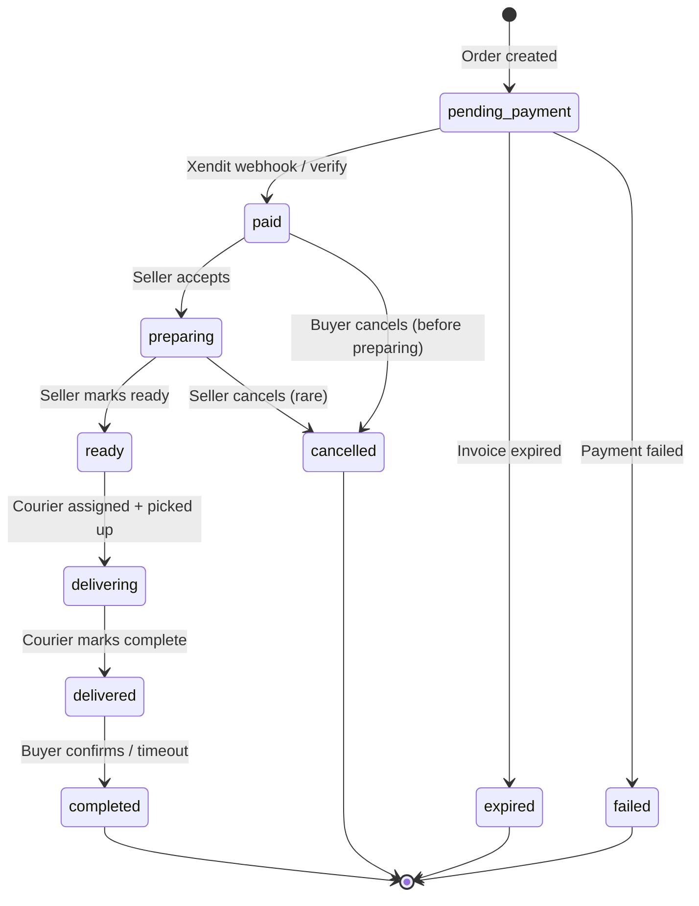

# Data Flow

> Complete data flow diagrams for major business processes.

---

## Checkout & Payment Flow

```mermaid
flowchart TB
    subgraph "Buyer Action"
        A[Buyer adds items to cart] --> B[Clicks "Pesan Sekarang"]
    end

    subgraph "Client Checkout"
        B --> C{Authenticated?}
        C -->|No| D[Redirect /auth/login?redirect=...]
        C -->|Yes| E[Build CheckoutPayload<br/>{items, fulfillment, addressId,<br/>idempotencyKey: uuid}]
    end

    subgraph "API: /api/checkout/xendit"
        E --> F[POST /api/checkout/xendit]
        F --> G[Validate items & address]
        G --> H[INSERT into checkout_idempotency<br/>ON CONFLICT DO NOTHING]
        H --> I{Duplicate?}
        I -->|Yes| J[409 Conflict + existing orderCode]
        I -->|No| K[Call RPC: reserve_stock_for_order]
        K --> L{Stock available?}
        L -->|No| M[409 + release markers]
        L -->|Yes| N[Create Xendit Invoice]
        N --> O[INSERT orders<br/>status=pending_payment<br/>invoice_state=created]
        O --> P[Return {invoiceUrl, orderCode}]
    end

    subgraph "Xendit"
        P --> Q[Buyer redirected to Xendit]
        Q --> R{Payment method}
        R -->|QRIS/VA/Digital Wallet| S[Buyer completes payment]
        R -->|Card| T[3D Secure flow]
        S --> U[Payment captured]
        T --> U
    end

    subgraph "Webhook: /api/webhooks/xendit"
        U --> V[Xendit sends invoice.paid webhook]
        V --> W[Validate XENDIT_WEBHOOK_TOKEN]
        W --> X[Update orders:<br/>status=paid, invoice_state=paid]
        X --> Y[Confirm stock reservation<br/>decrement inventory]
        Y --> Z[Create notification<br/>to buyer & seller]
        Z --> AA{Fulfillment?}
        AA -->|delivery| AB[Create Biteship shipment]
        AA -->|pickup| AC[Notify seller for pickup]
    end

    subgraph "Order Completion"
        AB --> AD[Courier assigned]
        AD --> AE[Delivery in progress]
        AE --> AF[Delivered]
        AC --> AG[Buyer picks up]
        AF --> AH[Order completed]
        AG --> AH
    end
```

### Idempotency Details

**Table: `checkout_idempotency`**
```sql
CREATE TABLE checkout_idempotency (
    idempotency_key UUID PRIMARY KEY,
    order_code TEXT NOT NULL,
    created_at TIMESTAMPTZ DEFAULT now(),
    expires_at TIMESTAMPTZ DEFAULT now() + INTERVAL '24 hours'
);
```

**Flow:**
1. Client generates `uuid` as `idempotencyKey`
2. On retry with same key → returns existing order (409 with `orderCode`)
3. Markers auto-expire after 24h
4. Unique constraint ensures only one order per key

### Stock Reservation

**RPC: `reserve_stock_for_order(items jsonb)`**
```sql
-- Atomic transaction:
-- 1. For each item: UPDATE products SET stock = stock - qty WHERE stock >= qty
-- 2. INSERT into reservation_markers (product_id, qty, order_code, status='reserved')
-- 3. If any item fails: ROLLBACK all
-- 4. Return success/failure
```

**Marker Lifecycle:**
```
reserved → confirmed (on payment success)
reserved → released (on payment failure/expiry)
```

---

## Subscription Purchase Flow

```mermaid
flowchart TB
    subgraph "Seller Action"
        A[Seller selects plan + billing] --> B[Clicks "Bayar via Xendit"]
    end

    subgraph "API: /api/subscriptions/xendit"
        B --> C[POST {planSlug, billing}]
        C --> D[Verify umkm_profiles exists]
        D --> E[Calculate total: price + 12% tax]
        E --> F[Generate externalId: SUB-{umkmId6}-{timestamp36}]
        F --> G[Create Xendit Invoice<br/>successUrl: /langganan/sukses?external_id=...]
        G --> H[INSERT subscriptions<br/>status=pending, xendit_invoice_id]
        H --> I[Return {invoiceUrl}]
    end

    subgraph "Xendit Payment"
        I --> J[Seller redirected to Xendit]
        J --> K[Completes payment]
    end

    subgraph "Webhook: /api/webhooks/xendit"
        K --> L[invoice.paid webhook]
        L --> M[Lookup subscription by xendit_invoice_id]
        M --> N[Verify amount matches]
        N --> O[Call activateSubscriptionPaid]
        O --> P[UPDATE subscriptions:<br/>status=active, current_period_end]
        P --> Q[UPDATE umkm_profiles:<br/>plan_id, subscription_expires_at]
        Q --> R[Notification: "Langganan aktif"]
    end

    subgraph "Manual Verification (Fallback)"
        S[Seller on /langganan/sukses] --> T[POST /api/subscriptions/xendit/verify]
        T --> U[Lookup Xendit invoice status]
        U -->|PAID/SETTLED| V[Activate if not already]
        U -->|PENDING| W[Return pending + throttle]
        U -->|EXPIRED| X[Mark subscription expired]
    end
```

### Plan Entitlements

| Feature | Basic (Rp24.999/bln) | Standar (Rp49.000/bln) | Premium/Max (Rp99.000/bln) |
|---------|----------------------|----------------------|--------------------------|
| Max products | 3 | 5 | 15 |
| Sales history | 30 days | Unlimited | Unlimited |
| Flash Sale | ✗ (0 slots) | 1 slot | Unlimited |
| Featured promotion | ✗ | ✓ | ✓ |
| Priority in marketplace | ✗ | ✓ | ✓ |
| Detailed reports | ✗ | ✓ | ✓ |
| UMKM Verified badge | ✗ | ✓ | ✓ |
| Demand analytics | ✗ | ✗ | ✓ |
| Priority support | ✗ | ✗ | ✓ |

**Yearly pricing**: Monthly × 10 (2 months free)
- Basic: Rp249.990/yr
- Standar: Rp490.000/yr
- Premium: Rp990.000/yr

---

## Order Lifecycle State Machine



**State Storage:**
- `orders.status`: `pending_payment`, `paid`, `preparing`, `ready`, `delivering`, `delivered`, `completed`, `cancelled`, `expired`, `failed`
- `orders.invoice_state`: `created`, `paid`, `expired`, `failed`
- `orders.shipment_status`: Biteship tracking: `confirmed`, `scheduled`, `allocated`, `picking_up`, `picked`, `cancelled`, `in_transit`, `delivered`, ...

**Seller Actions (API: /api/orders/[code]):**
```typescript
// PATCH /api/orders/[code]
// { action: 'accept' } → status: preparing
// { action: 'mark_ready' } → status: ready
// { action: 'cancel', reason } → status: cancelled (before ready)
```

---

## Courier Assignment Flow

```mermaid
flowchart TB
    subgraph "System (Server)"
        A[Order status=ready + fulfillment=delivery] --> B[Create Biteship shipment]
        B --> C[Find nearest active courier]
        C --> D[INSERT courier_assignments<br/>status=assigned, distanceKm]
    end

    subgraph "Courier Dashboard"
        D --> E[Realtime broadcast assignment]
        E --> F[Courier sees new task]
        F --> G[Clicks "Pesanan sudah diambil"]
        G --> H[PATCH /api/courier/assignments<br/>{assignmentId, status: picked_up}]
        H --> I[Update order shipment_status]
        I --> J[Realtime broadcast to buyer]
        
        J --> K[Courier en route]
        K --> L[Every 10s: POST /api/courier/location<br/>{orderId, lat, lng}]
        L --> M[UPDATE courier_locations]
        M --> N[Realtime broadcast position]
        N --> O[Buyer sees live map]
        
        O --> P[Courier arrives]
        P --> Q[Clicks "Mulai antar ke pembeli"]
        Q --> R[PATCH status: delivering]
        R --> S[Clicks "Selesai diantar"]
        S --> T[PATCH status: completed]
        T --> U[UPDATE order: delivered, completed]
    end

    subgraph "Biteship Webhook"
        U --> V[order.status webhook]
        V --> W[Confirm shipment_status=delivered]
    end
```

**Assignment Statuses:**
```
assigned → picked_up → delivering → completed
              ↓
           cancelled (admin)
```

**GPS Position Sender** (`useCourierPositionSender`):
- Interval: 10 seconds
- Trigger: `navigator.geolocation.getCurrentPosition`
- Sends: `{orderId, latitude, longitude, accuracy}`
- Fallback: If GPS denied, shows error but tasks still work
- Visibility API: Pauses when tab hidden

---

## Chatbot Data Flow

```mermaid
flowchart TB
    subgraph "Chatbot Widget (Client)"
        A[User opens chatbot] --> B{Role?}
        B -->|Public| C[Profile: publik]
        B -->|Member| D[Profile: anggota]
        B -->|Admin| E[Profile: admin]
        
        C --> F[POST /api/chat<br/>{message, sessionId}]
        D --> F
        E --> F
    end

    subgraph "API: /api/chat"
        F --> G[Rate limit check<br/>user vs IP]
        G --> H[Load session history<br/>(member/admin only)]
        H --> I[classifyInput: content guard]
        I --> J{Allowed?}
        J -->|No| K[Refusal message<br/>log to history]
        J -->|Yes| L[Build AI prompt<br/>system + history + user]
        L --> M[AI Provider: chatCompletion]
        M --> N{Tool calls?}
        N -->|Yes & admin| O[Execute read tools<br/>or create pending actions]
        N -->|Yes & non-admin| P[Return "data only for admin"]
        N -->|No| Q[Sanitize output]
        O --> Q
        P --> Q
        Q --> R[Append to session]
        R --> S[Return {reply, pendingActions, profile}]
    end

    subgraph "Pending Actions (Admin)"
        S --> T{User confirms?}
        T -->|Yes| U[POST /api/chat/actions<br/>{token}]
        U --> V[Verify signature + expiry]
        V --> W[Execute action<br/>approve_product, warn_user, etc.]
        T -->|No| X[Discard]
    end
```

**AI Provider** (`lib/server/ai-provider.ts`):
- Base URL: `VIBE_CODE_URL` env var
- API Key: `VIBE_CODE_KEY` env var
- Supports: chat completions with tool calls
- Max tool rounds: 3 (configurable via `CHAT_MAX_TOOL_ROUNDS`)
- Max input: 2000 chars
- Rate limits: 10/min anon, 30/min user

**Pending Action Security:**
```typescript
// lib/chatbot/actions.ts
function signAction({ adminId, action, payload, reason }) {
    // HMAC-SHA256 signature with secret
    // Expiry: 15 minutes
    // Token includes: action type, target id, reason, admin id
}

// Verification on /api/chat/actions:
// 1. Parse token
// 2. Check signature matches
// 3. Check not expired
// 4. Verify admin still has access
// 5. Execute action
```

---

## Article Publishing Flow

```mermaid
flowchart TB
    subgraph "Admin CMS"
        A[Admin creates/edits article] --> B[POST /api/admin/articles]
        B --> C[INSERT articles<br/>status=draft]
        C --> D[Save cover image<br/>to Supabase Storage<br/>bucket: articles]
        D --> E[Admin clicks "Publish"]
        E --> F[POST /api/admin/articles/{id}/publish]
        F --> G[UPDATE articles<br/>status=published, published_at=now()]
    end

    subgraph "Public Blog"
        G --> H[GET /api/articles<br/>filter: status=published<br/>published_at <= now]
        H --> I[List articles on /artikel]
        I --> J[GET /api/articles/{slug}]
        J --> K[Full article on /artikel/{slug}]
    end
```

**Article Table:**
```sql
articles (
    id UUID PRIMARY KEY,
    title TEXT NOT NULL,
    slug TEXT UNIQUE NOT NULL,
    excerpt TEXT,
    content TEXT,
    cover_image TEXT, -- Supabase Storage URL
    category TEXT,
    tags TEXT[],
    status TEXT DEFAULT 'draft', -- draft | published | archived
    published_at TIMESTAMPTZ,
    author_id UUID REFERENCES profiles,
    created_at TIMESTAMPTZ DEFAULT now(),
    updated_at TIMESTAMPTZ DEFAULT now()
)
```

**RLS**: Public can read only `published` articles. Admin can read/write all.

---

## Visitor Tracking

```mermaid
flowchart LR
    A[Visitor opens page] --> B[POST /api/visitors]
    B --> C{Has session?}
    C -->|No| D[Record anonymous visitor<br/>by IP hash]
    C -->|Yes| E[Record by user_id]
    D --> F[INSERT site_visitors<br/>(dedup by ip_hash + date)]
    E --> G[INSERT site_visitors<br/>(dedup by user_id + date)]
    F --> H[Admin dashboard shows<br/>unique visitors today/week]
    G --> H
```

**Store Visitors:**
```mermaid
flowchart LR
    I[Buyer visits store page] --> J[POST /api/store-visitors]
    J --> K[INSERT store_visitors<br/>(umkm_id, user_id, timestamp)]
    K --> L[Seller dashboard shows<br/>unique store visitors]
    L --> M[Admin can see<br/>store visitor stats]
```

---

## Notification Flow

```mermaid
flowchart TB
    subgraph "Triggers"
        A[New order] --> B[Notify buyer + seller]
        C[Order status change] --> D[Notify buyer]
        E[New review] --> F[Notify seller]
        G[Product warning] --> H[Notify seller]
        I[New assignment] --> J[Notify courier]
        K[New report] --> L[Notify admin + seller]
    end

    subgraph "Supabase"
        B --> M[INSERT notifications<br/>user_id, type, payload]
        D --> M
        F --> M
        H --> M
        J --> M
        L --> M
    end

    subgraph "Realtime"
        M --> N[Supabase Realtime broadcast]
        N --> O[Client subscribes<br/>postgres_changes on notifications]
        O --> P[Update badge count]
        P --> Q[Show toast notification]
    end

    subgraph "In-App"
        Q --> R[/notifikasi/pembeli]
        R --> S[Notification list]
        S --> T[Mark as read<br/>PATCH notifications/{id}]
    end
```

**Notification Types** (from migrations):
- `order_created`, `order_paid`, `order_status_changed`
- `new_review`
- `product_warning`, `product_rejected`
- `report_submitted`
- `assignment_created`
- `delivery_updated`