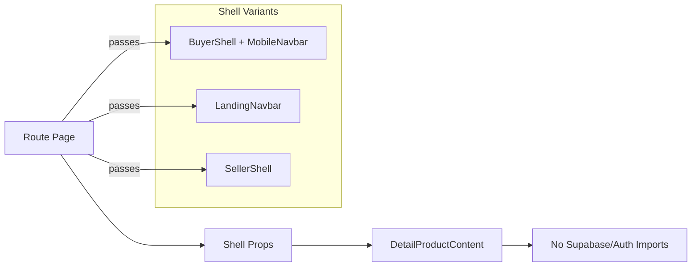
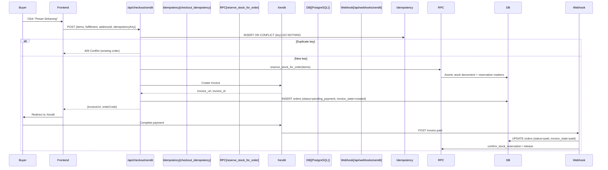
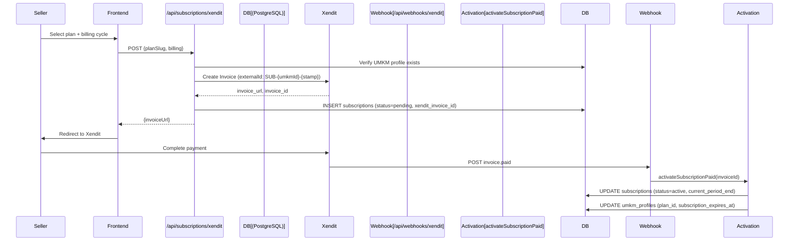
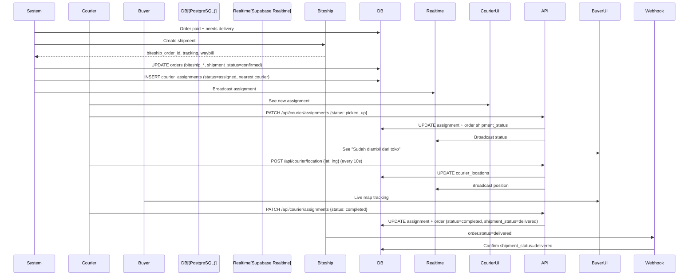

# Architecture Overview

> High-level system architecture of the ReBites food surplus marketplace.

---

## System Context Diagram

```mermaid
graph TB
    subgraph "Users"
        Buyer[Buyer 👤]
        Seller[Seller/UMKM 🏪]
        Courier[Courier 🚚]
        Admin[Admin 👮]
    end

    subgraph "Frontend (Next.js 14)"
        Landing[(Landing Pages)]
        App[(Authenticated App)]
        AdminUI[(Admin Dashboard)]
        CourierUI[(Courier Dashboard)]
        Chatbot[🤖 Chatbot Widget]
    end

    subgraph "Backend Services"
        API[API Routes]
        Supabase[(Supabase)]
        Xendit[Xendit Payments]
        Biteship[Biteship Logistics]
        AI[AI Provider]
    end

    Buyer --> Landing
    Buyer --> App
    Buyer --> Chatbot
    Seller --> App
    Courier --> CourierUI
    Admin --> AdminUI

    Landing --> API
    App --> API
    AdminUI --> API
    CourierUI --> API
    Chatbot --> API

    API --> Supabase
    API --> Xendit
    API --> Biteship
    API --> AI

    Supabase --> Realtime[Realtime]
    Supabase --> Storage[Storage]
    Supabase --> Auth[Auth]
    Supabase --> DB[(PostgreSQL)]

    Xendit --> WebhookX[Webhook: /api/webhooks/xendit]
    Biteship --> WebhookB[Webhook: /api/webhooks/biteship]
    AI --> ChatAPI[/api/chat]
```

---

## Core Architectural Patterns

### 1. Route Groups (No URL Impact)

```
app/
├── (landing)/     # Public marketing: /, /preview/product, /fitur, /tentang-kami...
├── (app)/         # Authenticated app: /home, /makanan/[category], /detail/*, /dashboard/penjual/...
├── (preview)/     # Public preview: /preview/product
└── [root]/        # Shared: /auth/*, /api/*, /dashboard/admin/*, /dashboard/kurir/*, /artikel/*, /toko-diikuti, /banding/*, /pengaturan/*, /terms, /privacy
```

Route groups `(landing)`, `(app)`, `(preview)` organize code only — they **do not** affect URLs.

### 2. Shell Injection Pattern

Critical for keeping auth code out of public bundles:



**Implementation** (`app/components/detail-product/detail-page.tsx`):
```typescript
interface DetailProductShell {
    header: ReactNode;
    productPath: string;
    seeAllHref: string;
}

function DetailProductContent({ shell }: { shell: DetailProductShell }) {
    // Zero auth imports — purely presentational
}
```

**Routes supplying shells:**
- `app/(app)/detail/product/page.tsx` → `BuyerShell` + `MobileNavbar`
- `app/(landing)/preview/product/page.tsx` → `LandingNavbar`
- `app/(app)/detail/toko/page.tsx` → `SellerShell`

### 3. Authentication Boundary

```
┌─────────────────────────────────────────────────────────────┐
│                     PUBLIC ZONE                              │
│  /  /preview/product  /fitur  /tentang-kami  /hubungi-kami  │
│  /makanan/[category] (SSG)  /artikel  /artikel/[slug]       │
└──────────────────────────┬──────────────────────────────────┘
                           │ RequireAuth Guard
┌──────────────────────────▼──────────────────────────────────┐
│                   AUTHENTICATED ZONE                         │
│  /home  /detail/*  /riwayatPesanan  /notifikasi/pembeli      │
│  /profile  /toko  /toko-diikuti  /banding/*                  │
│  /dashboard/penjual/*  /dashboard/kurir/                     │
│  /langganan/*  /pengaturan/*                                 │
└──────────────────────────┬──────────────────────────────────┘
                           │ Admin RBAC Guard
┌──────────────────────────▼──────────────────────────────────┐
│                      ADMIN ZONE                              │
│  /dashboard/admin/**                                         │
└──────────────────────────────────────────────────────────────┘
```

**Guard Implementation** (`app/components/auth/require-auth.tsx`):
```typescript
export function RequireAuth({ children }: { children: ReactNode }) {
    // Redirects to /auth/login?redirect=... if no session
    // Guard lives OUTSIDE shell so navbar/title/skeleton are hidden before redirect
}
```

### 4. Role Hierarchy

| Role | Scope | Assignment |
|------|-------|------------|
| `super_admin` | Full platform access, role changes, user deletion | `SUPER_ADMIN_USER_ID` env var |
| `admin` | Moderation, orders, products, users, analytics | Granted by super_admin |
| `seller` (UMKM) | Store management, menu, orders, subscriptions | `umkm_profiles.user_id` |
| `courier` | Assignments, GPS tracking, delivery chat | `couriers.user_id` |
| `buyer` | Orders, favorites, reviews, chat | Default authenticated user |
| `public` | Landing, preview, articles | No auth required |

---

## Data Flow: Checkout & Order Creation



**Key Guarantees:**
- **Idempotency**: `checkout_idempotency` table with unique `idempotency_key` prevents double orders
- **Stock Reservation**: Atomic RPC `reserve_stock_for_order` with `reservation_markers` table
- **State Machine**: `invoice_state` column (`created` → `paid` → `expired`/`failed`) tracks payment lifecycle

---

## Data Flow: Subscription Purchase



---

## Data Flow: Courier Assignment & Delivery



---

## Component Organization

```
app/components/
├── admin/                 # Admin dashboard components
│   ├── dashboard/         # KPI grid, analytics, monitoring
│   ├── admin-page-header.tsx
│   └── admin-state.tsx
├── auth/                  # Auth forms, guards, shells
│   ├── require-auth.tsx
│   ├── auth-split-shell.tsx
│   └── *-form.tsx
├── buyer/                 # Buyer-specific components
│   ├── order-history/     # DeliveryMap, CourierChat
│   ├── makanan-category/  # CategoryView
│   └── profile/
├── chatbot/               # AI Chatbot widget
│   ├── chatbot-widget.tsx
│   ├── chat-markdown.tsx
│   └── types.ts
├── dashboard-penjual/     # Seller dashboard components
│   ├── Card.tsx
│   ├── SellerShell.tsx
│   ├── SalesStatsCard.tsx
│   ├── StoreCard.tsx
│   └── ...
├── detail-product/        # Shell-injected product detail
│   ├── detail-page.tsx
│   └── DetailProductContent.tsx
├── landing/               # Landing page sections
│   ├── HeroSection.tsx
│   ├── FoodDiscoverySection.tsx
│   └── ...
├── seller/                # Seller-specific (non-dashboard)
│   ├── subscription/
│   │   └── subscription-checkout-view.tsx
│   └── tambahMenu/
│       └── EditProductModal.tsx
├── shared/                # Truly shared components
│   ├── SmartImage.tsx
│   ├── LocationPickerMap.tsx
│   ├── reveal.tsx
│   └── skeletons/
├── ui/                    # shadcn-style primitives
│   ├── button.tsx
│   ├── dialog.tsx
│   ├── badge.tsx
│   └── ...
└── seller/                # Legacy? Check for consolidation
```

---

## Hooks Organization

```
hooks/
├── buyer/                 # Buyer-specific data hooks
│   ├── use-buyer-orders.ts
│   ├── use-buyer-favorites.ts
│   └── ...
├── seller/                # Seller-specific data hooks
│   ├── use-store-products.ts
│   ├── use-seller-orders.ts
│   ├── use-seller-analytics.ts
│   └── ...
├── use-courier-profile.ts
├── use-courier-assignments.ts
├── use-courier-location.ts
├── use-current-user.ts
├── use-toast.ts
└── ...
```

---

## Library Organization

```
lib/
├── server/                # Server-only code (never in client bundles)
│   ├── supabase.ts        # Service role client
│   ├── xendit.ts          # Invoice creation, webhook verification
│   ├── biteship.ts        # Rates API, webhook handling
│   ├── ai-provider.ts     # Chat completions, tool calls
│   ├── checkout-idempotency.ts
│   ├── subscription-activation.ts
│   ├── verify-throttle.ts
│   └── ...
├── chatbot/               # Chatbot logic (shared)
│   ├── knowledge.ts
│   ├── guard.ts
│   ├── tools.ts
│   ├── actions.ts
│   ├── history.ts
│   ├── rate-limit.ts
│   └── types.ts
├── auth-token.ts          # fetchWithAuth, getValidAuthHeader
├── catalog.ts             # Product fetching, filtering
├── pricing.ts             # Price calculations, discounts
├── order-state-machine.ts # Invoice state transitions
├── shipping-tariff.ts     # Delivery fee calculation
├── package-weight.ts      # Weight resolution
├── store-origin-point.ts  # Store coordinate resolution
├── flash-sale.ts          # Flash sale scheduling logic
├── menu-schedule.ts       # Product schedule visibility
├── subscription-plans.ts  # Plan definitions
├── seller-plan.ts         # Seller entitlements
├── seller-store-path.ts   # URL generation for seller routes
├── product-storage.ts     # Client-side product mutations
├── subscription-storage.ts
├── types.ts               # Domain TypeScript interfaces
├── utils.ts               # cn(), formatRupiah(), etc.
├── supabase.ts            # Anon client (browser)
├── current-user.ts        # React hook for current user
├── data.ts                # Static data (categories, etc.)
├── image-path.ts          # DB .jpeg/.webp → .avif resolver
├── filter-search.ts       # Search sanitization
├── delivery-estimate.ts   # Travel time calculation
├── ...
```

---

## Key Files Reference

| File | Purpose |
|------|---------|
| `app/layout.tsx` | Fonts, metadata, global providers |
| `app/globals.css` | Design tokens (CSS variables), utilities |
| `tailwind.config.ts` | Tailwind theme, fonts, colors, custom tokens |
| `next.config.js` | Image domains, ESLint skip, Turbopack config |
| `tsconfig.json` | Strict TypeScript config |
| `components.json` | shadcn/ui component configuration |
| `lib/server/supabase.ts` | Service role client factory |
| `lib/auth-token.ts` | Auth header helpers for client→API calls |
| `lib/types.ts` | Domain interfaces: Product, Order, UMKM, Subscription, etc. |
| `supabase/migrations/` | 80+ migrations: schema, RLS, functions, triggers |