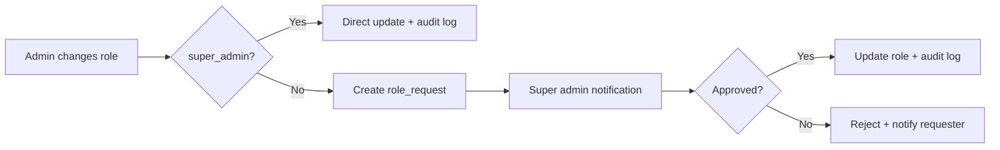
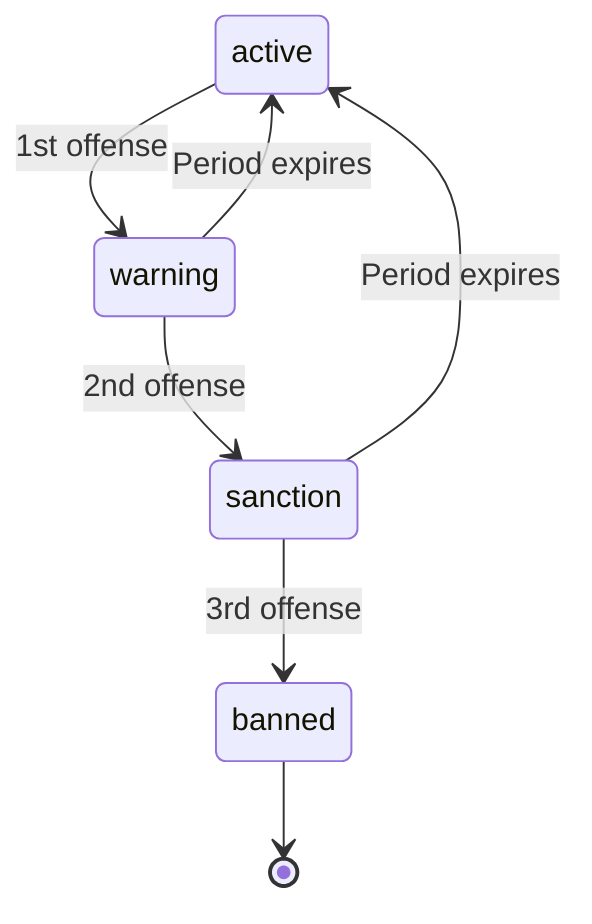

# Admin Dashboard Feature

> Platform administration: moderation, user management, analytics, monitoring, reports.

---

## Overview

The admin dashboard provides full platform administration for `admin` and `super_admin` roles.

**Access**: `/dashboard/admin/**` (requires admin role via `/api/admin/me`)

**RBAC Model:**
- `super_admin`: Full access (defined by `SUPER_ADMIN_USER_ID` env var)
- `admin`: Moderation, orders, products, users, analytics (role changes require super_admin approval)

---

## Routes

| Route | Page | Description |
|-------|------|-------------|
| `/dashboard/admin` | Dashboard KPIs, attention items, analytics, visitors, activity |
| `/dashboard/admin/umkm` | UMKM store list with filters |
| `/dashboard/admin/umkm/[id]` | Store detail: verification, activation, deletion |
| `/dashboard/admin/produk` | Product list with moderation queue |
| `/dashboard/admin/pesanan` | Order list, status history, export |
| `/dashboard/admin/pengiriman` | Shipment list (Biteship tracking) |
| `/dashboard/admin/pengguna` | User list: role, status, coins |
| `/dashboard/admin/pengguna/[id]` | User detail: role history, deletion |
| `/dashboard/admin/artikel` | Article CMS: draft, edit, publish |
| `/dashboard/admin/langganan` | Subscription overview + management |
| `/dashboard/admin/monitoring` | Monitoring dashboard |
| `/dashboard/admin/monitoring/aktivitas` | Activity logs |
| `/database/admin/monitoring/laporan` | User reports + notes |
| `/dashboard/admin/monitoring/laporan/[id]` | Report detail |
| `/dashboard/admin/monitoring/peringatan` | Product warnings |
| `/dashboard/admin/monitoring/sanksi` | Sanctions: ban, cycle |
| `/dashboard/admin/monitoring/audit` | Audit log viewer |
| `/dashboard/admin/pengaturan` | Platform settings |
| `/dashboard/admin/permintaan-role` | Role change requests (approve/reject) |
| `/dashboard/admin/profile` | Admin profile |
| `/dashboard/admin/riwayat` | Activity history |
| `/dashboard/admin/system` | Health check, DB status |
| `/dashboard/admin/koin` | Coin economy management |
| `/dashboard/admin/chat` | Support chat threads |
| `/dashboard/admin/chat/[id]` | Chat thread detail |
| `/dashboard/admin/moderasi` | Product moderation queue |

---

## Dashboard KPIs

```tsx
// KPI Grid (DashboardKpiGrid):
- Total Users (today + total)
- Total Orders (today + total)
- Total Revenue (today + total)
- Total UMKM (active + total)
- Pending Reports
- Pending Role Requests
- Sanctions Active
- Subscriptions (active + pending)
```

**Data Source**: `/api/admin/dashboard` → Supabase RPCs + queries

---

## User Management (`/pengguna`)

### List View
| Column | Data |
|--------|------|
| User | Name, email, avatar |
| Role | buyer/seller/admin/super_admin |
| Status | active/blocked/banned |
| Coins | Balance |
| Joined | Date |
| Actions | View detail, Block, Ban |

### Detail View (`/pengguna/[id]`)
- Full profile info
- Role history (audit trail)
- Coin transactions
- Orders summary
- Actions:
  - Block/Unblock (reversible)
  - Ban (requires reason, reverses via appeal)
  - Soft delete (mark deleted, retain data)
  - Hard delete (permanently remove - super_admin only)

### Role Changes



**API:**
- `PATCH /api/admin/users/[id]/role` → creates `role_requests` row (if admin)
- `POST /api/admin/role-requests/[id]/approve` → super_admin only
- `POST /api/admin/role-requests/[id]/reject` → super_admin only

---

## Product Moderation (`/moderasi`)

### Queue
- Products with `verification_status = pending`
- Products with `verification_status = rejected` (with reason)

### Actions
| Action | API | Effect |
|--------|-----|--------|
| Approve | `POST /api/admin/products/[id]/approve` | `verification_status = approved` + notification |
| Reject | `POST /api/admin/products/[id]/reject` | `verification_status = rejected` + reason + notification |
| Warn | `POST /api/admin/products/[id]/warn` | Create `warnings` record |
| Delete | `POST /api/admin/products/[id]/deletion` | Soft delete |

### Filters
- Status: pending / rejected / all
- Category
- Store
- Date range

---

## Order Management (`/pesanan`)

### List View
| Column | Data |
|--------|------|
| Order | Code, date |
| Buyer | Name, phone |
| Seller | Store name |
| Status | Business + shipment state |
| Amount | Total IDR |
| Fulfillment | delivery/pickup |
| Actions | View detail, Export |

### Detail View
- Full order info: items, addresses, payment
- Status history timeline
- Shipment tracking (Biteship)
- Activity log (state changes with timestamps)
- Actions: Cancel, Refund

### Export
- CSV download of filtered orders
- `GET /api/admin/orders/export?status=paid&from=...&to=...`

---

## Store (UMKM) Management (`/umkm`)

### List View
| Column | Data |
|--------|------|
| Store | Name, slug, city |
| Owner | User name, email |
| Status | active/inactive/pending |
| Plan | basic/standar/premium |
| Rating | Stars |
| Actions | Verify, Activate, Export |

### Detail View (`/umkm/[id]`)
- Profile: business info, docs
- Products: count, pending, rejected
- Orders: count, revenue
- Subscriptions: active plan, expiry
- Verification status + history
- Actions: Verify, Deactivate, Delete

---

## Article CMS (`/artikel`)

### Features
- Create/edit articles (draft → published)
- Cover image upload to Supabase Storage
- Category + tags
- Schedule publish date
- Unpublish (archive)

### API
| Method | Endpoint | Description |
|--------|----------|-------------|
| POST | `/api/admin/articles` | Create draft |
| PATCH | `/api/admin/articles/[id]` | Update draft |
| POST | `/api/admin/articles/[id]/publish` | Publish |
| DELETE | `/api/admin/articles/[id]` | Delete |
| GET | `/api/admin/articles` | List all (admin) |

---

## Monitoring Dashboard

### Tabs

| Tab | Data |
|-----|------|
| Aktivitas | Real-time activity log (orders, users, products) |
| Laporan | User-submitted reports + admin notes |
| Peringatan | Product warnings (quality, safety, compliance) |
| Sanksi | Ban history, sanctions in effect |
| Audit | Admin audit log (who did what, when) |

### Sanctions System



**Sanction Types:**
| Type | Duration | Effect |
|------|----------|--------|
| `warning` | 24h | Product hidden, notification |
| `sanction` | 72h | Store deactivated, products hidden |
| `ban` | Permanent | User blocked, all stores deactivated |

---

## Analytics

### Period Selection
- 7 days / 30 days / 90 days / 1 year

### Metrics
| Metric | Source |
|--------|--------|
| Orders | `orders` table |
| Revenue | `orders.total_amount` |
| Users | `profiles` table |
| Stores | `umkm_profiles` table |
| Products | `products` table |
| Subscriptions | `subscriptions` table |
| Visitors | `site_visitors` table |

### Charts
- Line: daily orders/revenue
- Bar: top categories
- Pie: fulfillment type breakdown
- Table: top products/stores

---

## Visitor Tracking

### Site Visitors (`/api/admin/visitors`)
- Unique users per day
- Anonymous users (IP hash)
- Top pages viewed

### Store Visitors (`/api/admin/store-visitors`)
- Per-store unique visitors
- Page views
- Conversion rate

---

## Chat Support (`/chat`)

### Thread List
| Column | Data |
|--------|------|
| User | Name, role |
| Last message | Preview |
| Status | Open/Closed |
| Actions | Open thread |

### Thread Detail
- Message history
- Reply box (admin)
- Status: open/closed
- Escalate to report

---

## Health Check (`/system`)

### Checks
| Check | Description |
|-------|-------------|
| Supabase DB | Connection + latency |
| Xendit API | Test invoice creation |
| Biteship API | Test rates query |
| Supabase Storage | List buckets |
| Supabase Realtime | Channel test |
| Env vars | Verify all required vars set |

**API**: `GET /api/admin/health`

---

## Audit Logging

All admin actions logged to `admin_audit_logs`:

```sql
admin_audit_logs (
    id UUID,
    admin_id UUID,          -- who did it
    action TEXT,            -- 'approve_product', 'delete_user', etc.
    target_type TEXT,       -- 'product', 'user', 'umkm', etc.
    target_id UUID,
    reason TEXT,
    metadata JSONB,
    created_at TIMESTAMPTZ
)
```

**Best-effort insert** — audit log write failure doesn't block the action.

---

## Data Export

| Export | Format | Endpoint |
|--------|--------|----------|
| Users | CSV | `GET /api/admin/users/export` |
| Orders | CSV | `GET /api/admin/orders/export` |
| Products | CSV | `GET /api/admin/products/export` |
| UMKM | CSV | `GET /api/admin/umkm/export` |
| Reports | CSV | `GET /api/admin/reports/export` |

**Filters**: date range, status, role, etc.

---

## API Endpoints Summary

| Endpoint | Method | Access |
|----------|--------|--------|
| `/api/admin/dashboard` | GET | admin |
| `/api/admin/analytics` | GET | admin |
| `/api/admin/health` | GET | admin |
| `/api/admin/me` | GET | admin |
| `/api/admin/users` | GET | admin |
| `/api/admin/users/[id]` | GET, PATCH, DELETE | admin |
| `/api/admin/users/[id]/role` | PATCH | admin (→ role request) |
| `/api/admin/users/[id]/role-history` | GET | admin |
| `/api/admin/users/[id]/coins` | PATCH | admin |
| `/api/admin/users/[id]/deletion` | POST | admin |
| `/api/admin/users/[id]/hard-deletion` | POST | super_admin |
| `/api/admin/users/export` | GET | admin |
| `/api/admin/role-requests` | GET | admin |
| `/api/admin/role-requests/[id]/approve` | POST | super_admin |
| `/api/admin/role-requests/[id]/reject` | POST | super_admin |
| `/api/admin/umkm` | GET | admin |
| `/api/admin/umkm/[id]` | GET, PATCH | admin |
| `/api/admin/umkm/[id]/verify` | POST | admin |
| `/api/admin/umkm/[id]/activation` | PATCH | admin |
| `/api/admin/umkm/[id]/deletion` | POST | admin |
| `/api/admin/umkm/export` | GET | admin |
| `/api/admin/products` | GET | admin |
| `/api/admin/products/[id]` | GET, PATCH | admin |
| `/api/admin/products/[id]/approve` | POST | admin |
| `/api/admin/products/[id]/reject` | POST | admin |
| `/api/admin/products/[id]/warn` | POST | admin |
| `/api/admin/products/[id]/deletion` | POST | admin |
| `/api/admin/products/export` | GET | admin |
| `/api/admin/orders` | GET | admin |
| `/api/admin/orders/[id]` | GET, PATCH | admin |
| `/api/admin/orders/[id]/status-history` | GET | admin |
| `/api/admin/orders/export` | GET | admin |
| `/api/admin/shipments` | GET | admin |
| `/api/admin/shipments/[id]` | GET | admin |
| `/api/admin/pengiriman` | GET | admin |
| `/api/admin/pengiriman/[id]` | GET | admin |
| `/api/admin/chat/threads` | GET | admin |
| `/api/admin/chat/threads/[id]` | GET | admin |
| `/api/admin/articles` | GET, POST | admin |
| `/api/admin/articles/[id]` | GET, PATCH, DELETE | admin |
| `/api/admin/articles/[id]/publish` | POST | admin |
| `/api/admin/subscriptions` | GET | admin |
| `/api/admin/reports` | GET | admin |
| `/api/admin/reports/[id]` | GET, PATCH | admin |
| `/api/admin/reports/[id]/notes` | POST | admin |
| `/api/admin/reports/export` | GET | admin |
| `/api/admin/visitors` | GET | admin |
| `/api/admin/activity-logs` | GET | admin |
| `/api/admin/audit-logs` | GET | admin |
| `/api/admin/warnings` | GET | admin |
| `/api/admin/warnings/overview` | GET | admin |
| `/api/admin/sanctions` | GET | admin |
| `/api/admin/sanctions/[id]` | GET, PATCH | admin |
| `/api/admin/monitoring/**` | GET | admin |
| `/api/admin/pengaturan` | GET, PATCH | admin |
| `/api/admin/permintaan-role` | GET | admin |
| `/api/admin/koin` | GET | admin |
| `/api/admin/profile` | GET, PATCH | admin |
| `/api/admin/riwayat` | GET | admin |

---

## Security Controls

| Control | Implementation |
|---------|----------------|
| Admin auth | `getAdminUser()` on every API route |
| Super admin only | `getSuperAdminUser()` for role approve/reject, hard delete |
| RBAC | Role checks in middleware + per-route guards |
| Audit log | Best-effort insert on every admin action |
| Export limits | Max 1000 rows per export |
| Deletion | Soft delete by default; hard delete super_admin only |
| Sanctions | Time-limited, reversible |

---

## Testing

```bash
npm run test:admin-access
npm run test:admin-health
npm run test:admin-analytic
npm run test:admin-order-flags
npm run test:admin-reports-export
npm run test:admin-ui-regressions
npm run test:admin-auth-guard
npm run test:admin-me-status
npm run test:admin-error-contract
npm run test:admin-perubahan
npm run test:admin-soft-delete
npm run test:admin-shipments
npm run test:admin-sanction-ban-sync
```