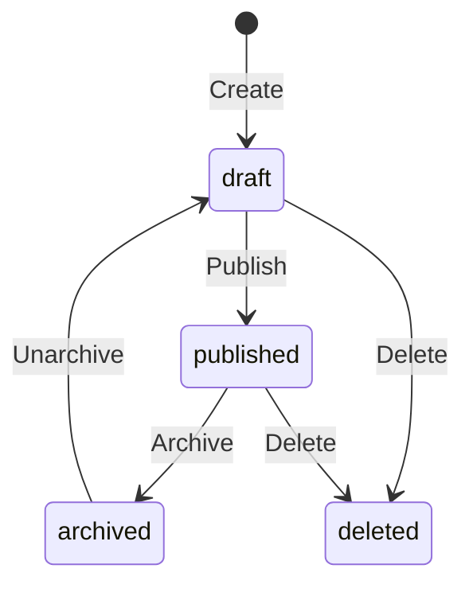

# Articles Feature

> Blog/articles system: public reading + admin CMS.

---

## Overview

The articles system provides a public blog and an admin CMS for content management.

**Public**: `/artikel` (list) + `/artikel/[slug]` (detail)
**Admin**: `/dashboard/admin/artikel` + API

---

## Routes

| Route | Page | Description |
|-------|------|-------------|
| `/artikel` | `app/artikel/page.tsx` | Article list with search + filter |
| `/artikel/[slug]` | `app/artikel/[slug]/page.tsx` | Full article detail |
| `/dashboard/admin/artikel` | `app/dashboard/admin/artikel/page.tsx` | Admin CMS |

---

## Public Article List

```tsx
// app/artikel/page.tsx
export default async function ArtikelPage() {
    const articles = await getArticles({ limit: 50 });
    return (
        <ArticlesGrid articles={articles} />
    );
}
```

**Features:**
- Search by title/excerpt
- Category filter
- Pagination (limit/offset)
- Cover image, title, excerpt, date

**API**: `GET /api/articles?search=&category=&limit=&offset=`

### Response
```json
{
    "articles": [
        {
            "id": "uuid",
            "title": "...",
            "slug": "...",
            "excerpt": "...",
            "cover_image": "https://...",
            "category": "tips",
            "tags": ["surplus", "umkm"],
            "published_at": "2024-01-15T10:00:00Z",
            "created_at": "2024-01-10T08:00:00Z"
        }
    ],
    "total": 42,
    "limit": 10,
    "offset": 0
}
```

---

## Public Article Detail

```tsx
// app/artikel/[slug]/page.tsx
export default async function ArtikelDetailPage({ params }) {
    const article = await getArticleBySlug(params.slug);
    if (!article) notFound();
    
    return (
        <ArticleContent article={article} />
    );
}
```

**Features:**
- Full content (HTML rendered)
- Cover image (lazy loaded)
- Category + tags
- Published date
- Share buttons (copy link, WhatsApp, email)

**API**: `GET /api/articles/[slug]`

---

## Admin CMS (`/dashboard/admin/artikel`)

### Article List
| Column | Data |
|--------|------|
| Judul | Title + status badge |
| Kategori | Category |
| Status | draft / published / archived |
| Published | Date |
| Actions | Edit, Publish, Archive, Delete |

### Create/Edit Form
```tsx
// Fields:
- Judul (required)
- Excerpt (auto from content)
- Konten (rich text / markdown)
- Gambar cover (upload to Supabase Storage)
- Kategori (select or create)
- Tags (comma-separated)
- Tanggal tayang (optional)
```

### Workflow


---

## Data Model

### Table: `articles`
```sql
articles (
    id UUID PRIMARY KEY,
    title TEXT NOT NULL,
    slug TEXT UNIQUE NOT NULL,
    excerpt TEXT,
    content TEXT,
    cover_image TEXT,
    category TEXT,
    tags TEXT[],
    status TEXT DEFAULT 'draft',
    published_at TIMESTAMPTZ,
    author_id UUID REFERENCES profiles,
    created_at TIMESTAMPTZ DEFAULT now(),
    updated_at TIMESTAMPTZ DEFAULT now()
)
```

**Slug Generation:**
```typescript
// From title: "5 Tips Mengurangi Food Waste" → "5-tips-mengurangi-food-waste"
// If exists: append -2, -3, etc.
```

---

## RLS Policies

| Operation | Policy |
|-----------|--------|
| SELECT (public) | `status = 'published' AND published_at IS NOT NULL AND published_at <= now()` |
| SELECT (admin) | All articles |
| INSERT (admin) | Admin only |
| UPDATE (admin) | Admin only |
| DELETE (admin) | Admin only |

**Storage Bucket**: `articles` for cover images
- Public read
- Admin write

---

## API Endpoints

| Endpoint | Method | Access |
|----------|--------|--------|
| `/api/articles` | GET | Public |
| `/api/articles/[slug]` | GET | Public |
| `/api/admin/articles` | GET, POST | Admin |
| `/api/admin/articles/[id]` | GET, PATCH, DELETE | Admin |
| `/api/admin/articles/[id]/publish` | POST | Admin |

---

## Content Rendering

```tsx
// Content stored as HTML or markdown
// Rendered with <div dangerouslySetInnerHTML={{ __html: content }} />
// Or parsed with a markdown library

// Sanitization (if HTML):
import DOMPurify from 'dompurify';
const clean = DOMPurify.sanitize(rawHtml);
```

---

## Performance

| Optimization | Implementation |
|--------------|----------------|
| SSG for article list | `generateStaticParams` + ISR (60s revalidate) |
| Lazy cover image | `loading="lazy"` |
| Excerpt truncation | 200 chars max |
| Cache | Supabase PostgREST + browser |

---

## Testing

No dedicated test files yet. Verify manually:
- `/artikel` renders without errors
- `/artikel/[slug]` shows published articles only
- Admin can create/publish/archive/delete
