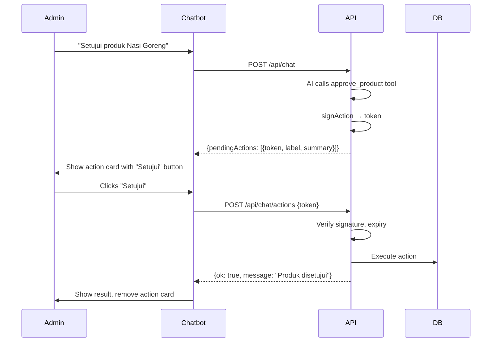

# AI Chatbot Feature

> ReBitess-Asisten: Role-based AI assistant with tool calling and pending actions.

---

## Overview

The chatbot is a fixed bottom-right widget available on all pages. It provides contextual help based on user role.

**Component**: `app/components/chatbot/chatbot-widget.tsx`

**API**: `POST /api/chat` + `POST /api/chat/actions`

---

## Role-Based Capabilities

| Feature | Public (publik) | Member (anggota) | Admin (admin) |
|---------|-----------------|------------------|---------------|
| Knowledge base | ✓ | ✓ | ✓ |
| Session history | ✗ | ✓ (persisted) | ✓ (persisted) |
| Tool calls (read) | ✗ | ✗ | ✓ |
| Tool calls (write) | ✗ | ✗ | Creates pending actions |
| Pending actions | ✗ | ✗ | Admin confirms |
| Suggestions | Public FAQ | Member help | Admin ops |

---

## Suggestions by Role

**Public:**
- "Apa itu ReBites?"
- "Siapa yang membuat ReBites?"
- "Bagaimana cara memesan makanan?"
- "Bagaimana cara mulai berjualan?"

**Member (logged in):**
- "Di mana tombol riwayat pesanan?"
- "Bagaimana cara mengunggah produk?"
- "Berapa harga paket langganan?"

**Admin:**
- "Bagaimana kondisi hari ini?"
- "Produk apa yang menunggu moderasi?"
- "Ada laporan yang belum ditangani?"

---

## Architecture

```mermaid
flowchart TB
    subgraph "Client: ChatbotWidget"
        A[User message] --> B[POST /api/chat]
        B --> C[Receive reply + pendingActions]
        C --> D[Render markdown + action buttons]
        D --> E{User clicks action?}
        E -->|Yes| F[POST /api/chat/actions]
    end

    subgraph "Server: /api/chat"
        B --> G[Rate limit check]
        G --> H[Load session history]
        H --> I[Content guard]
        I --> J{Allowed?}
        J -->|No| K[Refusal]
        J -->|Yes| L[AI Provider: chatCompletion]
        L --> M{Tool calls?}
        M -->|Admin + read| N[Execute read tool]
        M -->|Admin + write| O[Sign action → pendingActions]
        M -->|Non-admin| P[Return "data only for admin"]
        N --> Q[Next round or reply]
        O --> Q
        P --> Q
        Q --> R[Sanitize output]
        R --> S[Save to history]
        S --> T[Return reply]
    end

    subgraph "Server: /api/chat/actions"
        F --> U[Verify signature + expiry]
        U --> V{Valid?}
        V -->|Yes| W[Execute action]
        V -->|No| X[Error]
        W --> Y[Remove action from history]
        Y --> Z[Return result]
    end
```

---

## AI Provider

```typescript
// lib/server/ai-provider.ts
export async function chatCompletion({ 
    messages, 
    tools 
}: { 
    messages: AiMessage[]; 
    tools?: ToolDefinition[]; 
}): Promise<{ content: string; toolCalls: ToolCall[] }> {
    const apiKey = getAiApiKey(); // VIBE_CODE_KEY
    const baseUrl = getAiBaseUrl(); // VIBE_CODE_URL
    
    const res = await fetch(`${baseUrl}/chat/completions`, {
        method: 'POST',
        headers: {
            'Authorization': `Bearer ${apiKey}`,
            'Content-Type': 'application/json',
        },
        body: JSON.stringify({ 
            messages, 
            tools, 
            tool_choice: 'auto',
            max_tokens: 2000,
        }),
    });
    
    if (!res.ok) throw new AiProviderError(...);
    return res.json();
}
```

**Environment Variables:**
- `VIBE_CODE_URL` - AI provider endpoint
- `VIBE_CODE_KEY` - API key

**Fallback**: If tools unsupported, retries without tools.

---

## Content Guard

```typescript
// lib/chatbot/guard.ts
export function classifyInput(message: string, profile: ChatProfile): {
    allowed: boolean;
    category: 'safe' | 'pii' | 'harmful' | 'off_topic' | 'admin_only';
} {
    // 1. PII detection (email, phone, NIK, address)
    // 2. Harmful content (violence, illegal, sexual)
    // 3. Off-topic (not about ReBites)
    // 4. Admin-only queries (if non-admin)
    
    return { allowed: true, category: 'safe' };
}
```

**Refusal Messages:**
- PII: "Untuk keamanan, saya tidak bisa memproses informasi pribadi..."
- Harmful: "Saya tidak bisa membantu dengan permintaan tersebut..."
- Off-topic: "Saya hanya bisa membantu seputar ReBites..."
- Admin-only: "Informasi operasional hanya tersedia untuk admin..."

---

## Session Management

### Public Users
- No persistence
- In-memory only during session
- `sessionStorage` for transcript (last 40 messages)

### Members/Admins
- Server-side session in `chat_sessions` table
- Linked to `user_id`
- History loaded on open
- Max 40 messages in context

---

## Pending Actions (Admin Only)

### Creation Flow
```typescript
// In /api/chat when AI calls write tool:
if (isWriteTool(name)) {
    const proposal = buildProposal(name, args);
    const { token, exp } = signAction({
        adminId: userId,
        action: proposal.action,
        payload: proposal.payload,
        reason: proposal.reason,
    });
    
    pendingActions.push({
        token,
        action: proposal.action,
        label: proposal.label,      // e.g. "Setujui produk"
        summary: proposal.summary,  // e.g. "Produk Nasi Goreng dari Warung Makmur"
        targetType: proposal.targetType,
        targetId: proposal.targetId,
        expiresAt: new Date(exp).toISOString(),
    });
}
```

### Available Admin Actions
| Action | Target | Description |
|--------|--------|-------------|
| `approve_product` | product | Set `verification_status = approved` |
| `reject_product` | product | Set `verification_status = rejected` + reason |
| `warn_user` | user | Create warning record |
| `ban_user` | user | Block account |
| `sanction_store` | umkm | Deactivate store temporarily |
| `resolve_report` | report | Mark report handled |

### Confirmation Flow


### Action Security
- **Signature**: HMAC-SHA256 with secret
- **Expiry**: 15 minutes
- **One-time use**: Token consumed on execute
- **Admin verification**: Action only executable by same admin

---

## Rate Limiting

```typescript
// lib/chatbot/rate-limit.ts
const CHAT_LIMIT_ANON = 10;  // per minute
const CHAT_LIMIT_USER = 30;  // per minute

// Key: user:${userId} or ip:${clientIp}
// Sliding window with Redis-like in-memory store
```

**Response on limit:**
```json
{
    "error": "Terlalu banyak pesan. Coba lagi dalam 30 detik.",
    "retryAfterSeconds": 30
}
```

---

## Chat Markdown Rendering

```tsx
// app/components/chatbot/chat-markdown.tsx
// Renders AI responses with:
- Bold, italic, strikethrough
- Lists (bullet, numbered)
- Code blocks (inline + fenced)
- Links
- Tables
```

---

## UI Components

### ChatbotWidget (`chatbot-widget.tsx`)
- Fixed bottom-right button (Bot icon)
- Animated panel (framer-motion)
- Message list with role styling
- Pending action cards (amber border)
- Input textarea (Enter to send, Shift+Enter for newline)
- Hint tooltip: "Butuh bantuan?" (shown once via localStorage)

### ChatMarkdown (`chat-markdown.tsx`)
- Markdown renderer for AI responses
- Sanitized output

---

## Accessibility

| Feature | Implementation |
|---------|----------------|
| Keyboard navigation | Tab through messages, actions, input |
| Focus management | Input focused on open |
| ARIA labels | Button, panel, messages |
| Reduced motion | Respects `prefers-reduced-motion` |
| Screen reader | `aria-live="polite"` on message list |
| Escape to close | Keyboard handler |

---

## Error Handling

| Error | User Message | Recovery |
|-------|--------------|----------|
| AI not configured | "Asisten belum dikonfigurasi" | Set `VIBE_CODE_URL/KEY` |
| Tools unsupported | "Asisten berjalan tanpa akses data" | Fallback to no-tools completion |
| Provider error | "Layanan asisten bermasalah" | Retry after delay |
| Network error | "Tidak dapat menghubungi asisten" | Check connection |
| Rate limited | "Terlalu banyak pesan" | Wait for retryAfter |
| Action expired | "Token kadaluarsa" | Re-request action |
| Action invalid | "Aksi tidak valid" | Re-request action |

---

## Testing

```bash
npm run test:chatbot-guard
npm run test:chatbot-knowledge
npm run test:chatbot-actions
npm run test:chatbot-history
npm run test:chatbot-markdown
npm run test:chatbot-tools
npm run test:chatbot-panel-scroll
npm run test:chatbot-assistant-drag
npm run test:courier-ai
npm run test:courier-ai-reply-integrity
```

---

## Known Issues

| Issue | Location | Workaround |
|-------|----------|------------|
| No streaming | `/api/chat` | Full response at once |
| No conversation export | Chat history | Manual copy |
| Tool parallelism | Max 3 rounds | Sequential tool calls |
| Admin action audit | Not logged to admin_audit_logs | Add if needed |
| Memory leak | Long sessions | Clear sessionStorage periodically |