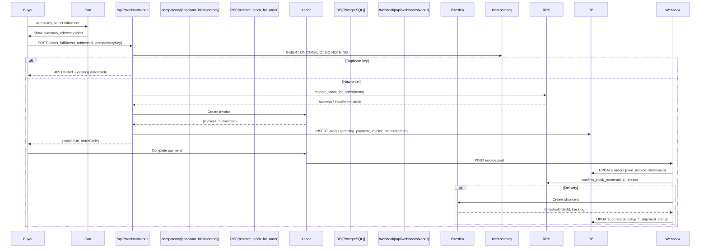
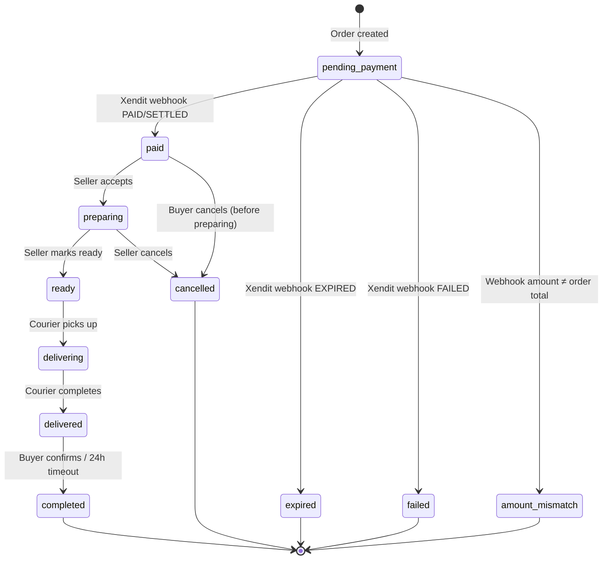

# Checkout Feature

> Complete checkout flow: cart → payment → order creation with idempotency and stock reservation.

---

## Overview

The checkout flow handles:
1. **Order creation** from cart items
2. **Idempotency** to prevent duplicate orders on retry
3. **Stock reservation** atomic RPC
4. **Xendit invoice** creation
5. **Webhook handling** for payment confirmation
6. **Biteship shipment** creation for delivery orders

---

## Flow Diagram



---

## API Endpoints

### Create Checkout

```
POST /api/checkout/xendit
```

**Request:**
```typescript
interface CheckoutRequest {
    items: CheckoutItem[];
    fulfillment: 'delivery' | 'pickup';
    addressId: string;           // Required for delivery
    idempotencyKey: string;      // UUID v4 from client
    notes?: string;
}

interface CheckoutItem {
    productId: string;
    quantity: number;
    price: number;               // surplusPrice at time of checkout
}
```

**Response (Success):**
```typescript
{
    invoiceUrl: string;          // Xendit invoice URL
    orderCode: string;           // Human-readable: RB-2024-001234
    externalId: string;          // Xendit external_id
}
```

**Response (Duplicate - 409):**
```typescript
{
    error: 'Duplicate order',
    orderCode: 'RB-2024-001234', // Existing order
    orderId: 'uuid'
}
```

**Response (Error - 400/500):**
```typescript
{
    error: 'Insufficient stock for product X',
    code: 'INSUFFICIENT_STOCK'
}
```

### Verify Checkout (Fallback)

```
POST /api/checkout/xendit/verify
```

Used when buyer returns from Xendit without webhook firing.

**Request:**
```typescript
{ externalId: string; }
```

**Response:**
```typescript
{
    orderCode: string;
    status: 'pending_payment' | 'paid' | 'expired' | 'failed';
    invoiceState: 'created' | 'paid' | 'expired' | 'failed';
}
```

---

## Idempotency Implementation

### Client-Side Key Generation

```typescript
// lib/checkout-idempotency.ts
export function generateIdempotencyKey(): string {
    return crypto.randomUUID(); // v4 UUID
}

// Stored in sessionStorage for page refresh recovery
const IDEMPOTENCY_KEY = 'rebites_checkout_idempotency_key';

export function getStoredIdempotencyKey(): string | null {
    return sessionStorage.getItem(IDEMPOTENCY_KEY);
}

export function storeIdempotencyKey(key: string) {
    sessionStorage.setItem(IDEMPOTENCY_KEY, key);
}

export function clearIdempotencyKey() {
    sessionStorage.removeItem(IDEMPOTENCY_KEY);
}
```

### Server-Side Table

```sql
-- supabase/migrations/20261008000000_checkout_idempotency_foundation.sql
CREATE TABLE checkout_idempotency (
    idempotency_key UUID PRIMARY KEY,
    order_code TEXT NOT NULL,
    order_id UUID REFERENCES orders(id),
    created_at TIMESTAMPTZ DEFAULT now(),
    expires_at TIMESTAMPTZ DEFAULT now() + INTERVAL '24 hours'
);

CREATE INDEX ON checkout_idempotency (expires_at) 
WHERE expires_at < now(); -- For cleanup
```

### Idempotency Logic

```typescript
// lib/server/checkout-idempotency.ts
export async function claimCheckoutIdempotency(
    key: string,
    createOrder: () => Promise<Order>
): Promise<{ order: Order; isNew: boolean }> {
    const supabase = createServiceClient();
    
    // Try to insert key
    const { data: inserted, error } = await supabase
        .from('checkout_idempotency')
        .insert({ idempotency_key: key })
        .select('order_code, order_id')
        .maybeSingle();
    
    if (!error && inserted) {
        // Key was new - create order
        const order = await createOrder();
        
        // Update with order reference
        await supabase
            .from('checkout_idempotency')
            .update({ order_code: order.order_code, order_id: order.id })
            .eq('idempotency_key', key);
        
        return { order, isNew: true };
    }
    
    if (error?.code === '23505') { // unique_violation
        // Key exists - fetch existing order
        const { data: existing } = await supabase
            .from('checkout_idempotency')
            .select('order_code, order_id')
            .eq('idempotency_key', key)
            .single();
        
        return { 
            order: { order_code: existing.order_code, id: existing.order_id } as Order, 
            isNew: false 
        };
    }
    
    throw error;
}
```

---

## Stock Reservation

### Atomic RPC

```sql
-- supabase/migrations/20261008000000_reserve_stock_for_order.sql
CREATE OR REPLACE FUNCTION reserve_stock_for_order(p_items jsonb)
RETURNS TABLE (
    success boolean,
    order_code text,
    error_message text
) LANGUAGE plpgsql AS $$
DECLARE
    v_item jsonb;
    v_product_id uuid;
    v_qty int;
    v_available int;
    v_order_code text := 'RB-' || to_char(now(), 'YYYY') || '-' || lpad(nextval('order_code_seq')::text, 6, '0');
BEGIN
    -- Validate all items first
    FOR v_item IN SELECT * FROM jsonb_array_elements(p_items)
    LOOP
        v_product_id := (v_item->>'product_id')::uuid;
        v_qty := (v_item->>'quantity')::int;
        
        SELECT stock INTO v_available 
        FROM products 
        WHERE id = v_product_id 
        FOR UPDATE; -- Row lock
        
        IF v_available < v_qty THEN
            RETURN QUERY SELECT false, v_order_code, 'Stok tidak mencukupi untuk produk ' || v_product_id;
            RETURN;
        END IF;
    END LOOP;
    
    -- All items available - reserve
    FOR v_item IN SELECT * FROM jsonb_array_elements(p_items)
    LOOP
        v_product_id := (v_item->>'product_id')::uuid;
        v_qty := (v_item->>'quantity')::int;
        
        UPDATE products 
        SET stock = stock - v_qty 
        WHERE id = v_product_id;
        
        INSERT INTO reservation_markers (product_id, qty, order_code, status)
        VALUES (v_product_id, v_qty, v_order_code, 'reserved');
    END LOOP;
    
    RETURN QUERY SELECT true, v_order_code, null;
END;
$$;
```

### Reservation Markers Table

```sql
CREATE TABLE reservation_markers (
    id UUID PRIMARY KEY DEFAULT gen_random_uuid(),
    product_id UUID REFERENCES products(id),
    qty INT NOT NULL,
    order_code TEXT NOT NULL,
    status TEXT DEFAULT 'reserved', -- reserved | confirmed | released
    created_at TIMESTAMPTZ DEFAULT now(),
    confirmed_at TIMESTAMPTZ,
    released_at TIMESTAMPTZ
);
```

### Marker Lifecycle

```
reserved (on checkout creation)
    │
    ├── confirmed (on payment success) → stock permanently decremented
    │
    └── released (on payment failure/expiry) → stock restored
```

---

## Xendit Integration

### Invoice Creation

```typescript
// lib/server/xendit.ts
export interface XenditInvoiceRequest {
    externalId: string;
    amount: number;              // In IDR (smallest unit)
    payerEmail: string;
    description: string;
    successRedirectUrl: string;
    failureRedirectUrl: string;
    items?: XenditInvoiceItem[];
    fees?: XenditFee[];
}

export async function createXenditInvoice(
    request: XenditInvoiceRequest
): Promise<XenditInvoiceResponse> {
    const apiKey = getXenditApiKey();
    
    const res = await fetch('https://api.xendit.co/v2/invoices', {
        method: 'POST',
        headers: {
            'Authorization': `Basic ${Buffer.from(apiKey + ':').toString('base64')}`,
            'Content-Type': 'application/json',
        },
        body: JSON.stringify(request),
    });
    
    if (!res.ok) {
        const error = await res.json();
        throw new Error(`Xendit error: ${error.message}`);
    }
    
    return res.json();
}
```

### Invoice Configuration

| Field | Value |
|-------|-------|
| `externalId` | `ORD-{orderCode}` or `SUB-{umkmId6}-{timestamp36}` |
| `amount` | Total including 12% tax |
| `payerEmail` | Buyer/seller email from Supabase Auth |
| `description` | `ReBites Order #{orderCode}` or `ReBites {Plan} ({billing})` |
| `successRedirectUrl` | `/detail/pesanan/sukses?order={orderCode}` or `/langganan/sukses?...` |
| `failureRedirectUrl` | `/detail/pesanan?payment=failed` or `/dashboard/penjual/langganan?payment=failed` |
| `items` | Product line items with price, quantity |
| `fees` | Platform fee (if applicable) |

### Webhook Handling

```typescript
// app/api/webhooks/xendit/route.ts
export async function POST(req: NextRequest) {
    // 1. Validate XENDIT_WEBHOOK_TOKEN
    const token = req.headers.get('x-callback-token') || req.headers.get('authorization')?.replace('Bearer ', '');
    if (!timingSafeEqual(token, process.env.XENDIT_WEBHOOK_TOKEN!)) {
        return NextResponse.json({ error: 'Unauthorized' }, { status: 401 });
    }
    
    // 2. Parse payload
    const payload = await req.json();
    const { id: invoiceId, external_id: externalId, status, paid_amount } = payload;
    
    // 3. Find order by externalId
    const { data: order } = await supabase
        .from('orders')
        .select('*')
        .eq('xendit_external_id', externalId)
        .single();
    
    // 4. Handle status transitions
    switch (status) {
        case 'PAID':
        case 'SETTLED':
            await handlePaymentSuccess(order, invoiceId, paid_amount);
            break;
        case 'EXPIRED':
            await handlePaymentExpired(order);
            break;
        case 'FAILED':
            await handlePaymentFailed(order);
            break;
    }
    
    return NextResponse.json({ received: true });
}
```

### Payment Success Handler

```typescript
async function handlePaymentSuccess(order: Order, invoiceId: string, paidAmount: number) {
    const supabase = createServiceClient();
    
    // 1. Verify amount matches
    if (paidAmount !== order.total_amount) {
        await supabase.from('orders').update({ invoice_state: 'amount_mismatch' }).eq('id', order.id);
        return;
    }
    
    // 2. Confirm stock reservation
    await supabase.rpc('confirm_stock_reservation', { p_order_code: order.order_code });
    
    // 3. Update order
    await supabase.from('orders').update({
        status: 'paid',
        invoice_state: 'paid',
        xendit_invoice_id: invoiceId,
        paid_at: new Date().toISOString(),
        paid_amount: paidAmount,
    }).eq('id', order.id);
    
    // 4. Create notifications
    await createNotifications(order);
    
    // 5. If delivery → create Biteship shipment
    if (order.fulfillment === 'delivery') {
        await createBiteshipShipment(order);
    }
}
```

---

## Order State Machine



### State Columns

| Column | Values | Purpose |
|--------|--------|---------|
| `status` | `pending_payment`, `paid`, `preparing`, `ready`, `delivering`, `delivered`, `completed`, `cancelled`, `expired`, `failed` | Business state |
| `invoice_state` | `created`, `paid`, `expired`, `failed`, `amount_mismatch` | Payment state |
| `shipment_status` | Biteship statuses | Delivery tracking |

### Seller Actions

```typescript
// PATCH /api/orders/[code]
// Actions: accept, mark_ready, cancel

// accept: status=paid → preparing
// mark_ready: status=preparing → ready
// cancel: status=paid|preparing → cancelled (with reason)
```

---

## Biteship Shipment Creation

```typescript
// Triggered from Xendit webhook on payment success
async function createBiteshipShipment(order: Order) {
    const biteship = new BiteshipClient();
    
    // 1. Get store address
    const { data: store } = await supabase
        .from('umkm_profiles')
        .select('address, city, postal_code, latitude, longitude, contact_name, phone')
        .eq('id', order.umkm_id)
        .single();
    
    // 2. Get buyer address
    const { data: address } = await supabase
        .from('addresses')
        .select('*')
        .eq('id', order.address_id)
        .single();
    
    // 3. Build shipment
    const shipment = await biteship.createShipment({
        origin: { 
            name: store.contact_name,
            phone: store.phone,
            address: store.address,
            city: store.city,
            postal_code: store.postal_code,
            latitude: store.latitude,
            longitude: store.longitude,
        },
        destination: {
            name: address.receiver_name,
            phone: address.phone,
            address: address.full_address,
            city: address.city,
            postal_code: address.postal_code,
            latitude: address.latitude,
            longitude: address.longitude,
        },
        items: order.items.map(item => ({
            name: item.product_name,
            quantity: item.quantity,
            weight: item.weight_gram,
            value: item.price * item.quantity,
        })),
        couriers: getConfiguredCouriers(), // From BITESHIP_COURIERS env
    });
    
    // 4. Update order with Biteship IDs
    await supabase.from('orders').update({
        biteship_order_id: shipment.id,
        biteship_tracking_id: shipment.tracking_id,
        biteship_waybill_id: shipment.waybill_id,
        shipment_status: 'confirmed',
    }).eq('id', order.id);
}
```

---

## Error Handling

| Error | Code | User Message | Recovery |
|-------|------|--------------|----------|
| Insufficient stock | `INSUFFICIENT_STOCK` | "Stok tidak mencukupi" | Refresh cart, retry |
| Duplicate order | `DUPLICATE_ORDER` | "Pesanan sudah dibuat" | Redirect to existing order |
| Xendit unavailable | `XENDIT_ERROR` | "Pembayaran tidak tersedia" | Retry later |
| Invalid address | `ADDRESS_INCOMPLETE` | "Alamat tidak lengkap" | Fix address, retry |
| Amount mismatch | `AMOUNT_MISMATCH` | "Jumlah tidak sesuai" | Contact support |
| Biteship quota | `BITESHIP_QUOTA` | "Layanan pengiriman penuh" | Retry later |

---

## Testing

```bash
# Run checkout-related tests
npm run test:checkout-idempotency
npm run test:checkout-price-consistency
npm run test:checkout-failure-handling
npm run test:stock-release-guard
npm run test:order-expiry
npm run test:prep-deadline
```

**Test Coverage:**
- Idempotency key uniqueness
- Stock reservation atomicity
- Price consistency (cart → checkout → Xendit)
- Payment failure → stock release
- Invoice expiry → order expiry
- Seller prep deadline enforcement

---

## Known Issues

| Issue | Location | Impact |
|-------|----------|--------|
| ESLint skipped in build | `next.config.js` | Lint errors don't block deploy |
| Windows EOL in test | `tests/admin-ui-regressions.test.ts` | Flaky on fresh checkout |
| No distance-based courier selection | Biteship integration | All couriers tried |
| Manual verify fallback | `/api/checkout/xendit/verify` | Needed if webhook delayed |