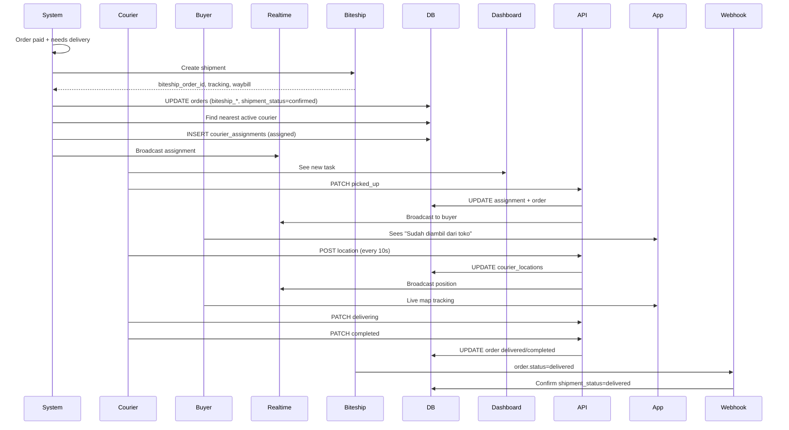
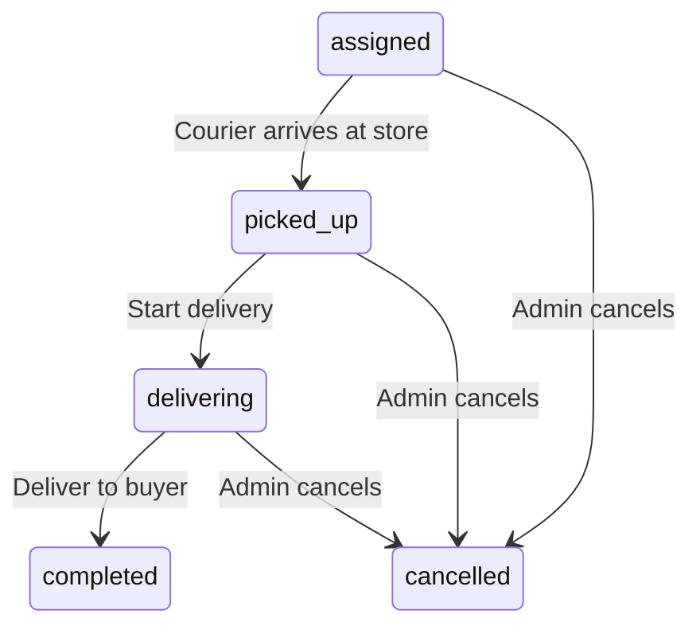

# Courier Dashboard Feature

> Courier delivery management: assignments, GPS tracking, status progression, buyer chat.

---

## Overview

The courier dashboard enables delivery partners to manage their assigned orders, share live location, and communicate with buyers.

**Access**: `/dashboard/kurir/` (requires courier role + active courier profile)

**Schema Dependency**: Requires `couriers` table and related migrations (feature flags via `schemaReady` check).

---

## Routes

| Route | Page | Description |
|-------|------|-------------|
| `/dashboard/kurir` | `app/dashboard/kurir/page.tsx` | Main dashboard (assignment list + history) |

---

## Courier Registration

If no courier profile exists, user sees registration form:

```tsx
// Fields:
- Nama lengkap (required)
- Nomor HP (optional)
- Kendaraan: Motor / Mobil / Sepeda
```

**API**: `POST /api/courier/profile`
- Creates `couriers` row linked to `auth.users.id`
- Sets `is_active = true`, `is_available = true`

---

## Dashboard Sections

### Active Assignments

```tsx
// TaskCard per assignment:
- Order: product name, order code, vendor name
- Fulfillment: 🏪 Pickup / 🚚 Delivery
- Status badge: Menunggu diambil / Sudah diambil / Sedang diantar / Selesai
- Address: receiver name, phone, full address
- Distance: km from courier position at assignment time
- Live GPS: "Kirim posisi sekarang" button (every 10s)
- Actions per status:
  - assigned → "Pesanan sudah diambil" (picked_up)
  - picked_up → "Mulai antar ke pembeli" (delivering)
  - delivering → "Selesai diantar" (completed)
- CourierChat: embedded chat with buyer
```

### Assignment History

Completed/cancelled assignments list with:
- Product name
- Order code
- Final status

---

## Assignment Flow



---

## GPS Position Sharing

### Client Hook: `useCourierPositionSender`

```typescript
// hooks/use-courier-assignments.ts
export function useCourierPositionSender({ orderId, active }) {
    const send = useCallback(async () => {
        if (!orderId || !active) return;
        
        const position = await new Promise<GeolocationPosition>((resolve, reject) => {
            navigator.geolocation.getCurrentPosition(resolve, reject, {
                enableHighAccuracy: true,
                timeout: 15000,
                maximumAge: 0,
            });
        });
        
        const { latitude, longitude, accuracy } = position.coords;
        
        await fetchWithAuth('/api/courier/location', {
            method: 'POST',
            body: JSON.stringify({ orderId, latitude, longitude, accuracy }),
        });
    }, [orderId, active]);
    
    // Auto-send every 10s when tab visible
    useEffect(() => {
        if (!orderId || !active) return;
        void send();
        const interval = setInterval(() => {
            if (document.visibilityState === 'visible') void send();
        }, 10000);
        const onVisibility = () => {
            if (document.visibilityState === 'visible') void send();
        };
        document.addEventListener('visibilitychange', onVisibility);
        return () => { clearInterval(interval); document.removeEventListener('visibilitychange', onVisibility); };
    }, [orderId, active, send]);
}
```

### Server: `/api/courier/location`

```typescript
// Updates courier_locations table
// Broadcasts via Supabase Realtime
// Buyer DeliveryMap subscribes to this channel
```

---

## Courier Chat

### Embedded in TaskCard

```tsx
// TaskCard.tsx
{assignment.orderId && (
    <CourierChat orderDbId={assignment.orderId} />
)}
```

### Chat Features
- Real-time via Supabase Realtime
- Messages stored in `messages` table
- Both courier and buyer can send
- Auto-scroll to bottom
- Typing indicator (if implemented)

---

## API Endpoints

| Endpoint | Method | Description |
|----------|--------|-------------|
| `/api/courier/profile` | GET | Get courier profile |
| `/api/courier/profile` | POST | Register as courier |
| `/api/courier/assignments` | GET | List assignments |
| `/api/courier/assignments` | PATCH | Update status |
| `/api/courier/location` | POST | Share GPS position |
| `/api/courier/messages` | GET | Get chat messages |
| `/api/courier/messages` | POST | Send chat message |

### Assignment Status Transitions



---

## Realtime Subscriptions

### Assignment Channel
```typescript
supabase.channel(`courier-assignments-${courierId}`)
    .on('postgres_changes', { 
        event: '*', 
        schema: 'public', 
        table: 'courier_assignments',
        filter: `courier_id=eq.${courierId}`
    }, () => refresh())
    .subscribe();
```

### Location Channel (Buyer side)
```typescript
supabase.channel(`courier-location-${orderId}`)
    .on('postgres_changes', { 
        event: 'INSERT', 
        schema: 'public', 
        table: 'courier_locations',
        filter: `order_id=eq.${orderId}`
    }, (payload) => updateMap(payload.new))
    .subscribe();
```

---

## Data Structures

### CourierProfile
```typescript
// hooks/use-courier-profile.ts
export interface CourierProfile {
    fullName: string;
    phone: string | null;
    vehicleType: 'motor' | 'mobil' | 'sepeda';
    isActive: boolean;
    isAvailable: boolean;
}
```

### CourierAssignment
```typescript
// hooks/use-courier-assignments.ts
export type AssignmentStatus = 
    'assigned' | 'picked_up' | 'delivering' | 'completed' | 'cancelled';

export interface CourierAssignment {
    id: string;
    orderId: string;
    status: AssignmentStatus;
    distanceKm: number | null;
    assignedAt: string | null;
    pickedUpAt: string | null;
    completedAt: string | null;
    order: {
        orderCode: string;
        productName: string;
        vendorName: string;
        fulfillment: 'delivery' | 'pickup';
        orderStatus: string;
        addressSnapshot: Record<string, unknown> | null;
        shippingSnapshot: Record<string, unknown> | null;
    } | null;
}
```

---

## Demo Courier (Development)

```typescript
// app/api/courier/demo/route.ts
// GET /api/courier/demo
// Creates mock assignments for testing without Biteship
```

---

## Schema Readiness Check

```typescript
// hooks/use-courier-profile.ts
const [schemaReady, setSchemaReady] = useState(true); // Defaults true
// If couriers table doesn't exist, API returns schemaReady: false
// Dashboard shows: "Fitur kurir belum aktif"
```

---

## Testing

```bash
npm run test:courier-location
npm run test:courier-live-delivery
npm run test:demo-courier
npm run test:demo-courier-migration
```

---

## Known Issues

| Issue | Location | Workaround |
|-------|----------|------------|
| Schema not auto-migrated | `supabase/migrations/` | Run courier migrations manually |
| GPS permission denied | `useCourierPositionSender` | Shows error, tasks still work |
| No background location | Browser limitation | Pauses when tab hidden |
| Biteship webhook sync | `/api/webhooks/biteship` | Manual verify if delayed |