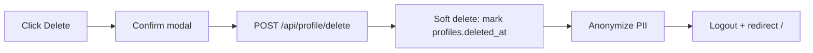

# Profile & Account Management

> Buyer profile, addresses, avatar, and account settings.

---

## Overview

Profile management for authenticated users (buyers and sellers).

**Routes:**
- `/profile` - Buyer profile
- `/pengaturan` - Account settings
- `/pengaturan/coin` - Coin balance/history
- `/dashboard/penjual/[storeId]/pengaturan` - Seller store settings

---

## Buyer Profile (`/profile`)

### Sections

| Section | Fields |
|---------|--------|
| Profile | Full name, email, phone, avatar |
| Addresses | List + add/edit/delete |
| Security | Change password |
| Notifications | Preferences (placeholder) |
| Account | Delete account |

### Avatar Upload

```tsx
// POST /api/profile/avatar
// FormData: { file: image }
// → Supabase Storage bucket: avatars
// → Updates profiles.avatar_url
```

### Address Management

```tsx
// GET/POST/PATCH/DELETE /api/profile/addresses

// Address fields:
- receiver_name
- phone
- full_address
- district (kecamatan)
- city (kota)
- province (provinsi)
- postal_code
- latitude (for delivery)
- longitude (for delivery)
- is_default
```

**Location Picker:**
```tsx
// app/components/shared/LocationPickerMap.tsx
<LocationPickerMap
    latitude={address.latitude}
    longitude={address.longitude}
    onPick={(lat, lng) => updateAddress({ latitude: lat, longitude: lng })}
/>
```

---

## Account Settings (`/pengaturan`)

### Tabs
| Tab | Content |
|-----|---------|
| Akun | Name, email, phone, password |
| Keamanan | 2FA (not implemented), login history |
| Notifikasi | Push/email preferences (placeholder) |
| Data | Export data, delete account |

### Delete Account



---

## Coin System (`/pengaturan/coin`)

### Coin Balance
- Earned from: orders, reviews, referrals
- Spent on: discounts, promotions
- Displayed in header (if > 0)

### History
| Date | Type | Amount | Description |
|------|------|--------|-------------|
| 2024-01-15 | Earn | +50 | Pesanan #RB-2024-001234 |
| 2024-01-10 | Spend | -100 | Diskon Flash Sale |

---

## Seller Store Settings

Located at `/dashboard/penjual/[storeId]/pengaturan`

### Sections
| Section | Fields |
|---------|--------|
| Profil Toko | Nama usaha, Deskripsi, Logo, Foto sambilan |
| Jam Operasional | Per-hari buka/tutup, libur |
| Lokasi | Map picker, alamat lengkap, kota, kode pos |
| Pengiriman | Aktifkan pengiriman, radius, biaya manual |
| Akun | Email, HP, ganti sandi |

---

## API Endpoints

| Endpoint | Methods | Description |
|----------|---------|-------------|
| `/api/profile` | GET, PATCH | Profile info |
| `/api/profile/avatar` | POST, DELETE | Avatar upload/remove |
| `/api/profile/addresses` | GET, POST, PATCH, DELETE | Address CRUD |
| `/api/profile/addresses/[id]` | PATCH, DELETE | Single address |

---

## Data Structures

### Profile (profiles table)
```sql
profiles (
    id UUID PRIMARY KEY REFERENCES auth.users,
    full_name TEXT,
    phone TEXT,
    avatar_url TEXT,
    role TEXT DEFAULT 'buyer',
    deleted_at TIMESTAMPTZ,
    created_at TIMESTAMPTZ DEFAULT now(),
    updated_at TIMESTAMPTZ DEFAULT now()
)
```

### Addresses
```sql
addresses (
    id UUID PRIMARY KEY,
    user_id UUID REFERENCES auth.users,
    receiver_name TEXT,
    phone TEXT,
    full_address TEXT,
    district TEXT,
    city TEXT,
    province TEXT,
    postal_code TEXT,
    latitude DOUBLE PRECISION,
    longitude DOUBLE PRECISION,
    is_default BOOLEAN DEFAULT false,
    created_at TIMESTAMPTZ DEFAULT now()
)
```

---

## RLS Policies

```sql
-- Profile: users see own
CREATE POLICY "Own profile" ON profiles
    FOR SELECT USING (id = auth.uid());

-- Addresses: users see own
CREATE POLICY "Own addresses" ON addresses
    FOR ALL USING (user_id = auth.uid());
```

---

## Testing

No dedicated tests. Verify manually:
- Profile edit saves
- Address CRUD works
- Avatar upload → storage → profile update
- Delete account → soft delete

---

## Known Issues

| Issue | Location | Workaround |
|-------|----------|------------|
| No 2FA | Security tab | Placeholder only |
| No notification prefs | Notifications tab | Placeholder only |
| Avatar crop | Upload | No crop UI |
| Address autocomplete | Add address | Manual + map picker |