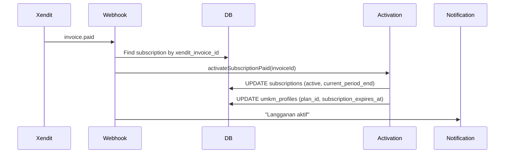
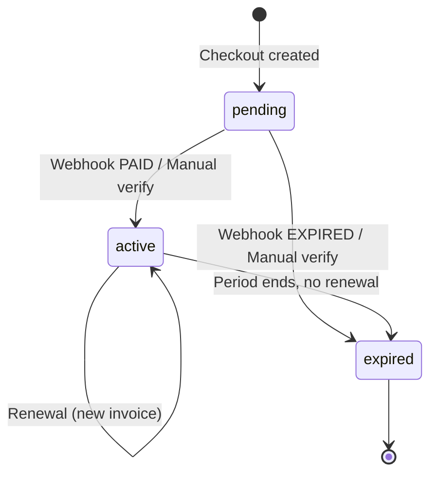
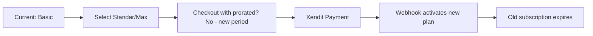

# Subscriptions Feature

> 3-tier seller subscription plans with Xendit payment and activation.

---

## Overview

Sellers (UMKM) must subscribe to a plan to activate their store and access features.

**Plans**: Basic / Standar / Premium (branded as "Max" in UI)
**Billing**: Monthly / Yearly (yearly = 10× monthly = 2 months free)
**Payment**: Xendit invoice (QRIS, GoPay, OVO, DANA, ShopeePay, VA, Card)
**Tax**: 12% PPN included in total

---

## Plan Definitions

```typescript
// lib/subscription-plans.ts
export const SUBSCRIPTION_PLANS: SubscriptionPlan[] = [
    {
        slug: 'basic',
        name: 'Basic',
        tagline: 'Mulai berjualan, 3 produk, riwayat 30 hari.',
        monthly: 24_999,
        yearly: 249_990,
        features: [
            'Maksimal 3 produk',
            'Riwayat penjualan 30 hari',
            'Dashboard penjualan',
        ],
        cta: 'Pilih Basic',
        popular: false,
    },
    {
        slug: 'standar',
        name: 'Standar',
        tagline: 'Untuk UMKM yang mulai aktif berjualan di ReBites.',
        monthly: 49_000,
        yearly: 490_000,
        features: [
            'Maksimal 5 produk',
            'Riwayat penjualan tanpa batas',
            'Prioritas di marketplace',
            'Laporan penjualan detail',
            'Badge UMKM Terverifikasi',
        ],
        cta: 'Pilih Standar',
        popular: false,
    },
    {
        slug: 'premium',
        name: 'Max',
        tagline: 'Akses semua fitur, maksimal 15 produk.',
        monthly: 99_000,
        yearly: 990_000,
        features: [
            'Maksimal 15 produk',
            'Akses semua fitur',
            'Promosi unggulan',
            'Analitik permintaan',
            'Dukungan prioritas',
        ],
        cta: 'Pilih Max',
        popular: true,
    },
];
```

---

## Routes

| Route | Page | Description |
|-------|------|-------------|
| `/dashboard/penjual/[storeId]/langganan` | Seller dashboard | Current plan + upgrade link |
| `/langganan/pembayaran` | `app/(app)/langganan/pembayaran/page.tsx` | Checkout with plan selector |
| `/langganan/sukses` | `app/(app)/langganan/sukses/page.tsx` | Success + verification |

---

## Checkout Flow (`/langganan/pembayaran`)

### UI: SubscriptionCheckoutView

```tsx
// Features:
- Plan cards (Basic/Standar/Max) with radio selection
- Billing toggle: Bulanan / Tahunan
- Price breakdown: subtotal + 12% tax = total
- Feature comparison (full list on right)
- "Bayar via Xendit" button
- Auto-redirect to Xendit on success
```

### Price Calculation
```typescript
// subtotal = plan.monthly or plan.yearly
// tax = Math.round(subtotal * 0.12)
// total = subtotal + tax
```

### API: `POST /api/subscriptions/xendit`

```typescript
// Request:
{ planSlug: 'basic' | 'standar' | 'premium', billing: 'monthly' | 'yearly' }

// Flow:
1. Verify user authenticated
2. Get umkm_profiles for user
3. Calculate total (price + 12% tax)
4. Generate externalId: SUB-{umkmId6}-{timestamp36}
5. Create Xendit Invoice
6. INSERT subscriptions (status=pending, xendit_invoice_id)
7. Return { invoiceUrl }
```

---

## Xendit Webhook Handling

### Webhook: `POST /api/webhooks/xendit`



### Activation Logic (`lib/server/subscription-activation.ts`)

```typescript
export async function activateSubscriptionPaid(
    service: SupabaseClient,
    invoiceId: string,
    paymentChannel: string | null,
    amount: number | null
): Promise<ActivationResult> {
    // 1. Find subscription by xendit_invoice_id
    // 2. Verify status = pending
    // 3. Verify amount matches
    // 4. Calculate period end (monthly/yearly from subscription.billing)
    // 5. UPDATE subscriptions: status=active, current_period_end
    // 6. UPDATE umkm_profiles: plan_id, subscription_expires_at
    // 7. Return { reason: 'activated', periodEnd }
}
```

---

## Manual Verification (Fallback)

If webhook delayed/failed, seller on `/langganan/sukses` triggers verify:

```typescript
// POST /api/subscriptions/xendit/verify
// Request: { externalId: string, invoiceId?: string }

// Flow:
1. Throttle: 1 check per 30s per externalId (VERIFY_CHECK_WINDOW_SECONDS)
2. Find subscription by externalId + umkm_id
3. Query Xendit for invoice status
4. If PAID/SETTLED → activate
5. If EXPIRED → mark expired
6. Return status + periodEnd
```

---

## Subscription State Machine



### Database: `subscriptions` table

```sql
subscriptions (
    id UUID PRIMARY KEY,
    umkm_id UUID REFERENCES umkm_profiles,
    plan_id UUID REFERENCES plans,
    status TEXT DEFAULT 'pending', -- pending | active | expired | cancelled
    billing TEXT, -- monthly | yearly
    price_paid INT, -- total IDR including tax
    xendit_invoice_id TEXT,
    xendit_status TEXT, -- PENDING | PAID | SETTLED | EXPIRED | FAILED
    current_period_start TIMESTAMPTZ,
    current_period_end TIMESTAMPTZ,
    created_at TIMESTAMPTZ DEFAULT now(),
    updated_at TIMESTAMPTZ DEFAULT now()
)
```

### Plans Table

```sql
plans (
    id UUID PRIMARY KEY,
    slug TEXT UNIQUE, -- basic | standar | premium
    name TEXT,
    monthly_price INT,
    yearly_price INT,
    features JSONB,
    max_products INT, -- 3 | 5 | 15 (null = unlimited)
    flash_sale_slots INT, -- 0 | 1 | 999
    featured_promo BOOLEAN,
    priority_marketplace BOOLEAN,
    detailed_reports BOOLEAN,
    verified_badge BOOLEAN,
    demand_analytics BOOLEAN,
    priority_support BOOLEAN
)
```

---

## Seller Dashboard Integration

### Plan Display (`/dashboard/penjual/[storeId]/langganan`)

```tsx
// Shows:
- Current plan badge (Basic/Standar/Max)
- Billing cycle
- Period end date
- Feature list with checkmarks
- Upgrade link → /langganan/pembayaran?plan=...
```

### Product Limit Enforcement

```typescript
// lib/seller-plan.ts
export function useSellerPlan(): { plan: SellerEntitlements } {
    // Reads from subscription + plans table
    // Cached in localStorage (5min)
}

// In MenuSayaPage:
const isLimitReached = plan.maxProducts !== null && products.length >= plan.maxProducts;

{isLimitReached ? (
    <Link to={`/langganan/pembayaran?plan=${plan.upgradeSlug}`}>
        Naikkan kuota via upgrade
    </Link>
) : (
    <Link to={sellerStorePath(storeId, 'tambahMenu')}>
        Tambah Menu
    </Link>
)}
```

### Flash Sale Quota

```typescript
// lib/flash-sale.ts
export function getFlashQuota(plan: SellerEntitlements): number {
    return plan.flashSaleSlots; // 0 | 1 | 999
}
```

---

## Admin Subscription Management

### `/dashboard/admin/langganan`
- List all subscriptions
- Filter by status, plan, date
- View details
- Manual activation (if needed)

### API: `/api/admin/subscriptions`
- GET: List with filters
- PATCH: Update status (admin override)

---

## Upgrade/Downgrade Flow

### Upgrade


### Downgrade
- Not directly supported
- Let current period expire
- Purchase lower plan at expiry

---

## Pricing Summary

| Plan | Monthly | Yearly | Savings |
|------|---------|--------|---------|
| Basic | Rp 24.999 | Rp 249.990 | 2 months free |
| Standar | Rp 49.000 | Rp 490.000 | 2 months free |
| Max | Rp 99.000 | Rp 990.000 | 2 months free |

**All prices include 12% PPN**

---

## Error Handling

| Error | Code | User Message |
|-------|------|--------------|
| No UMKM profile | `NO_UMKM_PROFILE` | "Lengkapi profil penjual dulu" |
| Plan not found | `PLAN_NOT_FOUND` | "Paket tidak ditemukan" |
| Plan DB missing | `PLAN_DB_MISSING` | "Plan ID tidak ditemukan di database" |
| Xendit error | `XENDIT_ERROR` | "Gagal membuat invoice" |
| Amount mismatch | `AMOUNT_MISMATCH` | "Jumlah pembayaran tidak sesuai" |
| Already active | `ALREADY_ACTIVE` | "Langganan sudah aktif" |
| Not found | `NOT_FOUND` | "Langganan tidak ditemukan" |

---

## Testing

```bash
npm run test:subscription-success
```

---

## Known Issues

| Issue | Location | Workaround |
|-------|----------|------------|
| No prorated upgrades | Upgrade flow | New period starts immediately |
| No auto-renewal | Subscription expiry | Manual re-purchase |
| Webhook delay fallback | Manual verify | `/langganan/sukses` triggers verify |
| No trial period | All plans | N/A |
| Tax hardcoded | 12% in code | Update if regulation changes |