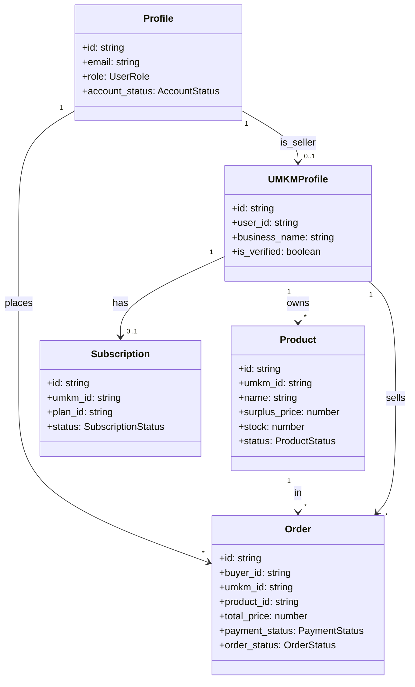

# TypeScript Domain Types

> **Source:** `types/index.ts` — Core domain model types
> **Note:** These are the canonical types for all domain entities.

---

## Role & Status Types

### `UserRole`

```typescript
export type UserRole = 'admin' | 'umkm' | 'buyer';
```

### `OrderStatus`

```typescript
export type OrderStatus =
  | 'pending'
  | 'paid'
  | 'processing'
  | 'ready_for_pickup'
  | 'out_for_delivery'
  | 'preparing'
  | 'ready'
  | 'completed'
  | 'cancelled'
  | 'refunded';
```

### `PaymentStatus`

```typescript
export type PaymentStatus = 'unpaid' | 'paid' | 'failed' | 'refunded';
```

### `ProductStatus`

```typescript
export type ProductStatus = 'available' | 'sold_out' | 'hidden';
```

### `SubscriptionStatus`

```typescript
export type SubscriptionStatus = 'trial' | 'active' | 'expired' | 'cancelled';
```

### `DeliveryOption`

```typescript
export type DeliveryOption = 'delivery' | 'pickup';
```

### `AccountStatus`

```typescript
export type AccountStatus = 'active' | 'suspended' | 'banned';
```

### `ActivityType`

```typescript
export type ActivityType =
  | 'login'
  | 'register'
  | 'product_created'
  | 'product_updated'
  | 'product_deleted'
  | 'order_created'
  | 'order_cancelled'
  | 'store_updated'
  | 'subscription_changed'
  | 'report_received'
  | 'warning_received';
```

### `ReportStatus`

```typescript
export type ReportStatus = 'open' | 'reviewing' | 'resolved' | 'dismissed';
```

### `WarningLevel`

```typescript
export type WarningLevel = 1 | 2 | 3;
```

### `SanctionType`

```typescript
export type SanctionType = 'suspend' | 'ban' | 'delete';
```

---

## Entity Interfaces

### `Profile`

```typescript
export interface Profile {
  id: string;
  email: string;
  full_name: string | null;
  role: UserRole;
  phone: string | null;
  avatar_url: string | null;
  is_verified: boolean;
  account_status: AccountStatus;
  created_at: string;
}
```

### `UMKMProfile`

```typescript
export interface UMKMProfile {
  id: string;
  user_id: string;
  business_name: string;
  description: string | null;
  category: string | null;
  address: string | null;
  city: string | null;
  latitude: number | null;
  longitude: number | null;
  logo_url: string | null;
  is_verified: boolean;
  rating: number;
  created_at: string;
}
```

### `Product`

```typescript
export interface Product {
  id: string;
  umkm_id: string;
  name: string;
  description: string | null;
  category: string;
  original_price: number;
  surplus_price: number;
  stock: number;
  status: ProductStatus;
  image_url: string | null;
  sell_window_start: string | null;
  sell_window_end: string | null;
  is_delivery: boolean;
  is_pickup: boolean;
  created_at: string;
}
```

### `ProductWithUMKM`

```typescript
export interface ProductWithUMKM extends Product {
  umkm: Pick<UMKMProfile, 'id' | 'business_name' | 'city' | 'rating'>;
}
```

### `Order`

```typescript
export interface Order {
  id: string;
  buyer_id: string;
  umkm_id: string;
  product_id: string;
  quantity: number;
  total_price: number;
  delivery_option: DeliveryOption;
  delivery_address: string | null;
  note: string | null;
  payment_status: PaymentStatus;
  order_status: OrderStatus;
  created_at: string;
}
```

### `OrderWithDetails`

```typescript
export interface OrderWithDetails extends Order {
  product?: Pick<Product, 'name' | 'image_url' | 'surplus_price'>;
  umkm?: Pick<UMKMProfile, 'business_name' | 'city'>;
  buyer?: Pick<Profile, 'full_name' | 'email'>;
}
```

### `Plan`

```typescript
export interface Plan {
  id: string;
  name: string;
  price_monthly: number;
  price_yearly: number;
  max_products: number;
  features: string[];
  is_popular: boolean;
}
```

### `Subscription`

```typescript
export interface Subscription {
  id: string;
  umkm_id: string;
  plan_id: string;
  status: SubscriptionStatus;
  trial_ends_at: string | null;
  current_period_start: string | null;
  current_period_end: string | null;
  created_at: string;
}
```

### `ActivityLog`

```typescript
export interface ActivityLog {
  id: string;
  user_id: string | null;
  activity_type: ActivityType;
  description: string;
  target_type: string | null;
  target_id: string | null;
  metadata: Record<string, unknown>;
  created_at: string;
}
```

### `UserReport`

```typescript
export interface UserReport {
  id: string;
  reported_user_id: string | null;
  reported_by: string | null;
  activity_id: string | null;
  category: string;
  description: string;
  status: ReportStatus;
  resolved_by: string | null;
  resolved_at: string | null;
  created_at: string;
}
```

### `UserWarning`

```typescript
export interface UserWarning {
  id: string;
  user_id: string | null;
  report_id: string | null;
  issued_by: string | null;
  warning_level: WarningLevel;
  category: string;
  reason: string;
  created_at: string;
}
```

### `UserSanction`

```typescript
export interface UserSanction {
  id: string;
  user_id: string | null;
  warning_id: string | null;
  issued_by: string | null;
  sanction_type: SanctionType;
  reason: string;
  start_at: string;
  end_at: string | null;
  created_at: string;
}
```

### `AdminAuditLog`

```typescript
export interface AdminAuditLog {
  id: string;
  admin_id: string | null;
  action: string;
  target_type: string;
  target_id: string | null;
  reason: string;
  metadata: Record<string, unknown>;
  created_at: string;
}
```

---

## Additional Types (from `lib/types.ts`)

### `ShippingRateOption`

```typescript
export interface ShippingRateOption {
  courierCode: string;
  serviceCode: string;
  courierName: string;
  serviceName: string;
  price: number;
  distanceLabel: string;
  etaLabel: string;
  serviceType: string;
  originEstimated: boolean;
  weightEstimated: boolean;
}
```

### `AddressSnapshot`

```typescript
export interface AddressSnapshot {
  addressId: string;
  label: string | null;
  receiverName: string | null;
  phone: string | null;
  province: string | null;
  city: string | null;
  district: string | null;
  fullAddress: string | null;
  note: string | null;
  postalCode: string | null;
  latitude: number | null;
  longitude: number | null;
}
```

---

## Type Relationships



---

## Usage Patterns

### In API Routes

```typescript
// Fetch with explicit column list
const { data: order } = await service
  .from('orders')
  .select('id, order_code, buyer_id, total_price, payment_status, order_status')
  .eq('order_code', code)
  .maybeSingle();

if (order) {
  const typed = order as unknown as Order; // Safe cast
}
```

### In Hooks

```typescript
export function useProduct(slug: string) {
  const [product, setProduct] = useState<ProductWithUMKM | null>(null);
  
  useEffect(() => {
    fetch(`/api/products/${slug}`)
      .then(r => r.json())
      .then((data: { product: ProductWithUMKM }) => setProduct(data.product));
  }, [slug]);
  
  return { product };
}
```

---

## Related Docs

- [Reference: Error Codes](./error-codes.md) — Error types
- [Database: Overview](../database/overview.md) — SQL schema
- [Types: index.ts](../../../types/index.ts) — Source file
- [Database: Functions](../database/functions.md) — RPC return types